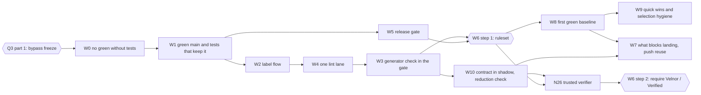
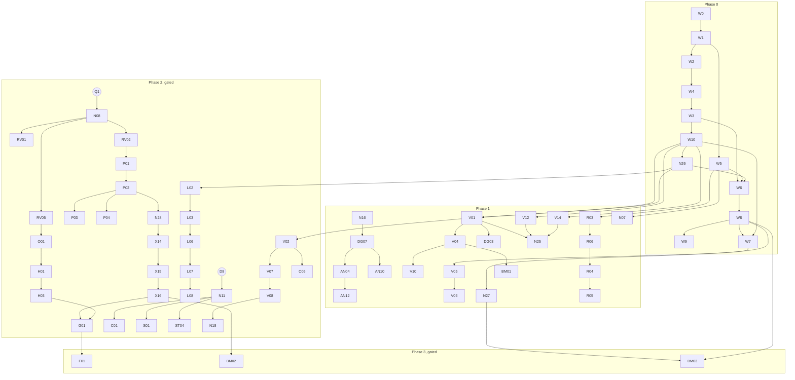

# Velnor delivery plan

| Field | Value |
|---|---|
| Status | Proposed. The owner confirms it before any issue is created (ruling R12) |
| Source of truth | [Rulings R1–R13](velnor-gen-rebase/rulings.md). Where this plan and a ruling disagree, the ruling wins |
| Built from | [Plan audit](velnor-gen-rebase/as-built/plan-audit.md) §6 (status of every item) and §8 (missing items N01–N24); [panel comparison](velnor-gen-rebase/comparison.md) §5 (merged phase 0) |
| Main read at | `515d4c7ff1` (2026-11-19 19:44 UTC), with PR, issue and run states read at that time. An executor reads main again before it starts (section 13) |
| Owner questions | Q1–Q19 and the D ids that still stand are in [owner-questions.md](owner-questions.md) |

This plan delivers the [design](../../proposed/velnor-runner-architecture.md) on top of velnor-gen, which now writes every
generated workflow. It has four phases. Phase 0 makes the gate correct. Phase 1 adds reuse inside velnor-gen and
velnor-ci; every reuse item waits for Q8, which carries one sentence for `docs/goals.md`. Phase 2 builds the runner,
Velnor Native, the platform, storage and the App, and waits for the owner. Phase 3 proves the speed claim and adds the
full Actions protocol.

## 1. Summary

- **167 items, 1284 agent-hours of building, 1450.5 with review** (section 9). Phase 0 is 12 items and 94 h.
  Phase 1 is 36 items and 245 h. Phases 2 and 3 (94 + 25 items) are gated on owner answers.
- **Of the old plan's 174 items:** 8 are done on main, 10 are removed, 12 are folded into phase 0, and 144 survive
  with new file targets. 12 new N-items come from the audit and the rulings, and phase 0 adds W0–W10.
- **Main is red.** The newest completed push runs fail in `velnor-ci plan` on stale recorded metadata (runs
  44599278133 and 44599906946), with helper 0.1.98 pinned. Earlier reds were lint failures and helper skew (W1).
- **A change can still merge without tests.** PR #1799 merged on the green `Required` of a draft run (W0).
- **Nothing reaches the ruleset until `Required` has been green on main with tests running** (R2). The critical path
  of phase 0 is W0 → W1 → W2 → W4 → W3 → W6 → W8 → W9: 52 agent-hours, plus three tools releases, owner time and
  measurement wall time (section 4.2).
- **No runner, platform or storage crate is in phase 0** (R7). The runner crates get correctness fixes only until Q1
  and Q9 are answered.
- **Targets stay budgets until W8 measures them** (R9). `docs/goals.md` sets the binding targets. The 90 s / 4 min PR
  verdict and the 3 / 8 min push-to-merge are proposed targets from the earlier design round (Q18).

## 2. How to read an item

- **IDs.** W0–W10 are phase 0, with N26. Old IDs (V01, R04, …) keep their number with a rewritten scope. N-IDs are
  new; N01–N24 are the audit's numbers, N25–N28 come from the rulings. An ID is never reused.
- **Size.** Agent-hours of building, without review. An item over 8 h has sub-issues of at most 8 h each, written
  before its issue is created. Phase 0's are in section 4; the manager writes the others with their phase's issue
  files. The parent item has no PR of its own and closes when its sub-issues close.
- **Seats.** Implementation uses the repository's executor labels only: Haiku 5.5 (`exec:haiku`), Sonnet 5.5
  (`exec:sonnet`), Opus 5.5 (`exec:opus`), with `effort:low`, `effort:medium` or `effort:high`.
- **Review.** Following root issue #574: the reviewer uses the executor's seat or a cheaper one at low effort, except
  where a mistake would be silently wrong (the gate, selection, reuse, cache keys, credentials, releases). Those get
  Opus 5.5 high. "Fable†" marks the ten soundness and trust-boundary reviews: Opus 5.5 high by default, and Fable 5.2
  xhigh, named in the issue text, if the owner answers Q11 with (a).
- **Done when.** Every check reads the state of main or of GitHub, not the contents of a PR, and names the exit code
  or output it expects. When another session lands the work first, the checks pass and the issue closes with their
  output instead of being built again.
- **Gate.** A Q or D id from [owner-questions.md](owner-questions.md). A question without a default, and every owner
  action, is an `[OWNER]` issue that blocks the item natively. A question with a default does not block: the item
  runs on the default.
- **Release.** An item that changes velnor-gen or velnor-ci takes effect in CI only after its release train
  (section 4.1). Its "done when" checks on `rust-ci.yml` or on runs can pass only after the train's pin PR.
- **Deletion.** Each item removes what it replaces in the same PR. Nothing deletes `images/runner`,
  `.velnor/runner.lock` or the official-runner wrapper.

## 3. Main at `515d4c7ff1`: the facts the items depend on

| Fact | Evidence |
|---|---|
| Generated workflows: `rust-ci.yml` (729 lines), `rust-cache-trim.yml`, `qualification.yml`, `release-rust-ci-tools.yml`, `tag-ruleset-drift.yml`. `ci.yml` (Alint, Cargo Deny, Cargo Machete, Jactionlint) is the last hand-written one | `.github/workflows/`; `.velnor/workflows.toml` |
| A PR runs `rust` (plan, fmt, clippy, tests, local-mode lane), then `policy`, then `Required`. A push to main adds docs, 18 alone-checks and cache saves | `.velnor/rust-ci.toml` (`docs` and `check_alone` = `post_merge`) |
| `pr_ci = "label"` with `ci:run` and `ci:auto`. On a draft, `Required` runs one notice step and is green. On a ready PR with neither label the gate step is skipped and `Required` is green unless a job failed. An unrelated label or a non-base edit runs a job named `Required (ignored event)` in its own concurrency group (#1770) | `rust-ci.yml` lines 11, 24 and 631–672; run 44599847337 (PR #1799: two `Required` check runs on one commit, one green from the draft run) |
| `.velnor/rust-ci.lock` pins helper 0.1.98 (#1801). The workspace manifests are at 0.1.98 | `git show origin/main:.velnor/rust-ci.lock` |
| The tools release gate checks only that the tag is on the default branch. 0.1.97 and 0.1.98 were published while the tagged commit's push run had failed | `release-rust-ci-tools.yml` job `gate`; release runs 44596703249 and 44599294031 against push runs 44596682603 and 44599278133 |
| `velnor-ci release-gate` takes `--repo`, `--sha` and `--pr-only-check`. It has no workflow or attempt selector and can print `ready=false` with exit 0 | `crates/velnor-ci/src/{cli_release,gate}.rs` |
| `StepKind::GeneratorCheck` is rendered as a bare `velnor-gen check` and never planned. No CI step runs the check; only the PR template asks for it | `crates/velnor-render/src/helper_steps.rs`; `.github/PULL_REQUEST_TEMPLATE.md` |
| `.velnor/config.toml` is read only by `velnor-ci plan --mode/--request`, which no workflow calls. Its presence sets `engine_configured`, and while that is set `velnor-gen check` does not report an unmarked workflow file such as `ci.yml` | `crates/velnor-gen/src/{drifts.rs,io/mod.rs}` |
| The generator accepts `[[inputs]]`; this repository's file has none. A matching `[[inputs]]` entry is used before the global triggers are checked | `crates/velnor-rust/src/{config,classify}.rs` |
| `policy` runs `cargo deny` only when a dependency, deny or cargo-config file changed, or when the run selects everything (as the nightly schedule does). `ci.yml` runs it on every event | `crates/velnor-rust/src/{policy,select_event}.rs` |
| The push-after-queue lookup accepts any green `merge_group` run of the workflow on the same commit and returns one yes or no for all steps. `[ci] skip_push_after_merge_group` is off | `crates/velnor-ci/src/merge_group.rs`; `crates/velnor-rust/src/config_ci.rs` |
| Ruleset 24396608 has six rules: `deletion`, `non_fast_forward`, `required_linear_history`, `pull_request` (squash only, thread resolution required, stale reviews dismissed), `required_status_checks` (`Required`, no `integration_id`) and `merge_queue` (HEADGREEN, build 2, minimum 1, maximum 10, wait 5, timeout 90). Bypass: `RepositoryRole 5`, mode `pull_request`. `allow_auto_merge` is false. `Rust CI` has never run on `merge_group` | `gh api repos/tailrocks/velnor-new/rulesets/24396608`; `gh api repos/tailrocks/velnor-new` |
| The organisation is on the Free plan; the organisation rulesets API answers 403 "Upgrade to GitHub Team" | `gh api orgs/tailrocks`; `gh api orgs/tailrocks/rulesets` |
| One full push `rust` job is measured: 564 s, conclusion failure (Lint failed; Test failed after 15 s and ran no tests), helper 0.1.95, target cache restored. Alone-checks 48%, lane guard 17%, docs 16% of that job | Run 44584072510 at `57b65af0db` (R8) |

## 4. Phase 0: correctness, W0–W10 and N26

Phase 0 starts when the owner declares the bypass freeze (Q3, part 1): the admin bypass is used only for a PR that
repairs main and names the red run it repairs. The order below is a dependency graph, and each edge has a reason.



| Edge | Why |
|---|---|
| Freeze → W0, W1 | A bypass merge can turn main red again at any time |
| W0 → W1 | Three green pushes cannot hold while a draft merges on a green check that ran nothing |
| W1 → W2, W5 | Both change the gate and need a green base to show red and green |
| W2 → W4 | The lint jobs are born under the new label flow |
| W4 → W3 | Deleting `.velnor/config.toml` makes `velnor-gen check` report `ci.yml` as unmarked, so `ci.yml` goes first |
| W2–W5 → W6 step 1 | R2: the ruleset binds a gate only when it is honest, fresh and guards the release |
| W6 → W8 | The baseline needs the queue running. W8 runs with push reuse off |
| W8 → W7, W9 | Their effect is measured against the baseline |
| W10 → W7, N26 | Both read the contract's resolved keys |
| N26 → W6 step 2 | Only a base-controlled verdict may be called proof against a PR that edits its gate (R4) |

**Until W2 replaces the labels,** every phase-0 PR carries `ci:auto`, and its reviewer checks that the head's
`Required` run executed the `velnor-ci gate` step and that the Test step ran tests. Nobody merges on the check of a
draft run. `ci:run` and `ci:auto` are deleted by W2's PR, not by an owner chore.

### 4.1 Release trains

A change to velnor-gen or velnor-ci reaches CI only through a tools release and a pin PR
(`velnor-gen pin-helper <version>`, then `velnor-gen generate`), because the plan and the required check always come
from a released version (goals rule 12).

| Train | Carries | What the pin PR makes checkable |
|---|---|---|
| A | W0, W1 | The red `Required` on drafts and unlabelled PRs; the schema in the lock |
| B | W2, W4, W3, W5 | The label flow, the lint lane, the generator check, the release gate. The lab pins the same release |
| C | W10, N26, W7, W9 | The contract, the verifier's helper commands, per-obligation reuse, the selection rules |

- **Each release needs D9.** Under D9's default every train waits for the owner's approval. A train carries what is
  merged when it is cut; an item that is ready earlier may get a release of its own under the same rules.
- **A release is cut only from a commit of main whose push `Required` passed** (goals rule 13). Until W5 enforces it,
  the release PR carries the push run id, its attempt and the `Required` conclusion of the commit to be tagged.
- **Bootstrap.** Train B ships W5's gate but is itself published under the old ancestry gate plus the manual rule
  above. Train C is the first release the new gate decides.
- **Repair release.** When main cannot be green without a helper fix, the owner approves one release from a red
  commit. The approval names the failing run and the fixing commit.
- **A pin PR that turns CI red** is reverted by a pin PR to the previous release (D15).

### 4.2 Wall time on the critical path

Agent-hours do not set the pace here. Each train costs an owner approval (under D9's default), a release run of
about 4 min and one pin PR. W1 waits for three green pushes, W6 for three queue merges, W8 for its samples. At the
pre-cutover rate of 2.7 merges an hour, W7's 20 queue merges take about 7.5 hours of traffic [E], and W10's 200 runs
about a day at two to three labelled runs per merged PR [E]. Neither is on the path to W9.

### W0. No green without tests

| | |
|---|---|
| Goal | A draft and an unlabelled ready PR get a red `Required` now, before W2 rewrites the label flow. Evidence: PR #1799 merged 15 s after "ready" on the green `Required` of a draft run that ran only a notice step (run 44599847337); its real run failed after the merge (44599865034), and main went red (44599906946) |
| Remaining | In `PrCi::Label`, the `required` job plans `StepKind::FailOnDraftRun` instead of `DraftNotice`, and its last step fails "CI not requested" on a ready PR that carries neither `ci:run` nor `ci:auto`. The labels, the quick set and #1770's ignored-event path stay as they are |
| Files | `crates/velnor-rust/src/{plan_budget,required_job}.rs`, `crates/velnor-render/src/{gate,draft_steps}.rs`, `crates/velnor-gen/tests/it/{pr_ci,pr_ci_labels}.rs`, `generator/samples/pr-ci-label/`, regenerated `rust-ci.yml` |
| Done when | 1. `rg -c 'Note that CI is not requested' .github/workflows/rust-ci.yml` exits 1. 2. A golden test: on a draft and on an unlabelled ready PR the `required` job has a step that fails. 3. velnor-lab, one run id per case: a push to a draft gives `Required` failure; a ready unlabelled PR gives failure; `ci:auto` runs the gate step |
| Size | 2 h |
| Implement / review | Sonnet 5.5 high / Opus 5.5 high |
| Needs / gate | — / Q3 part 1 (the freeze); D9 (train A) |
| Links | #1770 (merged), #1769 |

### W1. Green main, and tests that keep it green

| | |
|---|---|
| Goal | Main is green with tests running, and each known cause of red has a test that fails before a merge |
| Causes seen | Lint and line caps (run 44584072510). A rendered helper command the pin lacks (44592388313). Arguments the helper builds that nextest rejects (44584861409, 44594918317). Stale recorded metadata after a manifest edit (44590714518, 44599278133, 44599906946). The condition that let all of them land is W0's and the freeze's subject |
| Remaining | (1) Repair until green, under the freeze. (2) The schema check: `velnor-ci` prints its command schema, `pin-helper` stores it in the lock with the binary's digest, and `generate` and `check` reject a rendered argv the schema does not accept. It replaces the hand-written version floors (`DocsHelperTooOld`, `TestLaneHelperTooOld` and nine more in `crates/velnor-gen/src/helper_gate.rs`; `BATCHED_HELPER` in `crates/velnor-rust/src/base_cache.rs`). A lock without a schema is refused; no older pin is supported. (3) End-to-end tests: render this repository's configuration, then run the pinned helper's `plan` and its nextest preflight on the rendered arguments with the pinned nextest. (4) A freshness test: a manifest edit without `velnor-gen generate` fails `velnor-gen check` and `velnor-ci plan`, and both name the file |
| Files | `crates/velnor-ci/src/cli.rs`, `crates/velnor-gen/src/{helper_gate.rs,io/pin.rs}`, `crates/velnor-rust/src/base_cache.rs`, `crates/velnor-render/src/helper_steps.rs`, `.velnor/rust-ci.lock`, `crates/velnor-gen/tests/it/`, `crates/velnor-ci/tests/it/`, regenerated `rust-ci.yml` |
| Done when | 1. The last three completed `push` runs of `rust-ci.yml` on main are `success` on attempt 1, and each log has a nextest summary line with a test count above 0. 2. The newest of them names the target cache key it saved, and `gh cache list --ref refs/heads/main --key <key>` returns it. 3. `.velnor/rust-ci.lock` holds the helper's schema. 4. `git grep -nE 'HelperTooOld\|BATCHED_HELPER' origin/main -- crates/velnor-gen/src/helper_gate.rs crates/velnor-rust/src/base_cache.rs` exits 1. 5. The three tests of (2)–(4) are on main, each seen red on the broken code and green on the fix by an independent reviewer |
| Size | 8 h |
| Implement / review | Opus 5.5 high / Opus 5.5 high |
| Needs / gate | W0 / Q3 part 1; D9 (train A) |
| Links | Landed: #1768, #1754, #1764, #1771, #1780, #1777, #1794, #1801, #1795, #1800. #1555 (open; a catch-all issue that W1 refers to and does not close). Absorbs N01 |

### W2. An honest `Required`

| | |
|---|---|
| Goal | Ruling R3, exactly: one label `velnor:verify`; a draft and an unlabelled ready PR run nothing and are red; adding the label runs the latest commit; each push while labelled runs and cancels the previous run; removing the label cancels the run in flight and turns `Required` red, also on a commit that was green. `Required` is never skipped on a pull-request event. A label carried by a draft arms the PR when it becomes ready. A base change runs the latest commit against the new base |
| Remaining | Rewrite `PrCi::Label` in place (no third mode): add the `unlabeled` trigger; keep `edited` only for a base change; route an unrelated `labeled` or `unlabeled` event and a non-base edit through the ignored path main already has (a job named `Required (ignored event)` in its own concurrency group), so they publish no `Required` and cancel nothing; a `Required` job that always runs on the other PR events and fails without a verdict; delete `ci:run`, `ci:auto`, `ClearRunLabel` and the `ci-run-label` job; `[[lint]]` jobs follow the label. No lookup of an earlier run by SHA. Update `generator/CONFIG.md` (`pr_ci`) and `docs/rust-ci.md`. Labels are applied with a user or App token, since `GITHUB_TOKEN` label events start nothing |
| Sub-issues | **W2a** (6 h): the generator change and its goldens. **W2b** (4 h): the lab ruleset and cases on velnor-lab after train B, then the label migration here (`velnor:verify` created, `ci:run` and `ci:auto` deleted) |
| Files | `crates/velnor-model/src/{plan,steps,repo_config}.rs`, `crates/velnor-rust/src/{config_pr_ci,plan,plan_budget,required_job,lint_jobs}.rs`, `crates/velnor-render/src/{gate,events,draft_steps}.rs`, `crates/velnor-gen/tests/it/{pr_ci,pr_ci_labels,pr_ci_sim}.rs`, `generator/samples/pr-ci-label/`, `generator/CONFIG.md`, `docs/rust-ci.md` |
| Done when | 1. `gh label list` shows `velnor:verify` and neither `ci:run` nor `ci:auto`. 2. `rg -c 'ci:run\|ci:auto\|ci-run-label' .github/workflows/rust-ci.yml` exits 1, and `on.pull_request.types` includes `unlabeled`. 3. A golden test proves the `required` job cannot be skipped on a counted `pull_request` event. 4. velnor-lab, one run id per case: draft red; ready unlabelled red; label starts a full run on the head; a push while labelled cancels the previous run; green, then unlabel, is red; an unrelated label added or removed during a run does not cancel it and leaves the check as it was; a base change reruns; two PRs on one commit (behaviour recorded); a run that completes after an unlabel or a push cannot make the head green. 5. The lab records which commit GitHub attaches the check to and what the queue admits |
| Size | 10 h |
| Implement / review | Opus 5.5 high / Fable† |
| Needs / gate | W1 / Q2 (default: the flow above); Q6 (default: fork PRs keep today's fence); D9 (train B) |
| Links | Landed: #1769, #1785, #1770. #1551, #1652, #1370. Absorbs B06, B07, N02 |

### W4. One lint lane

| | |
|---|---|
| Goal | Alint and Jactionlint become `[[lint]]` entries, `cargo deny` and `cargo machete` run only in `policy`, and `ci.yml` is deleted, without losing the advisory scan that `ci.yml` runs on every event |
| Remaining | (1) `[[lint]]` for Alint (with `scripts/alint-line-cap-probe.sh`) and Jactionlint (`.github/actions/velnor-verify-jactionlint`). (2) `policy` keeps today's rule on PRs (deny runs when a dependency, deny or cargo-config file changed) and also runs `cargo deny check advisories` on every push to main and on the nightly schedule. That step reads the advisory database, so it is never reused. (3) The `workflow_dispatch` inputs of `ci.yml`, which `docs/proposed/hosted-cache-qualification-contract.md` and `workflow-contract.md` name, served the deleted engine's cache campaign, and their resolver is the `resolve-qualification` command that W3 deletes. W4 proves that nothing else reads them and retires the two contract sections in the same PR. If a reader remains, W4 stops and that becomes an `[OWNER]` issue |
| Files | `.velnor/rust-ci.toml`, `crates/velnor-rust/src/{config_lint,lint_jobs,lint_tasks,lint_tools,lane,policy}.rs`, `.github/workflows/ci.yml`, the two contract documents |
| Done when | 1. `test ! -e .github/workflows/ci.yml`. 2. `Required`'s `needs` lists the lint jobs. 3. `cargo machete` appears once in `rust-ci.yml`, and a push run and a scheduled run of main each executed the advisory step (run ids). 4. velnor-lab, one red run per lane: a 401-line Rust file (Alint); an unpinned action (Jactionlint); an unused dependency (machete); a lockfile entry with a known advisory, on a push that changes no dependency file (deny) |
| Size | 6 h |
| Implement / review | Sonnet 5.5 high / Opus 5.5 high |
| Needs / gate | W2 / D9 (train B) |
| Links | Landed: #1754, #1779. Absorbs N17, the `ci.yml` part of B06 |

### W3. Generator freshness in the gate

| | |
|---|---|
| Goal | `Required` fails when a generated file is stale or edited by hand, on every event, including PRs that touch no Rust. The engine leftovers go. This is an accident guard (R4): it does not stop a PR that deletes the check step. N26 does |
| Remaining | Plan `StepKind::GeneratorCheck` for every managed workflow and add a gate need for it. Today the step renders a bare `velnor-gen check`, which no job installs. `velnor-ci` already links velnor-gen (`=0.1.98` in `crates/velnor-ci/Cargo.toml`), so expose the check as a `velnor-ci` subcommand and render that. Delete `.velnor/config.toml`, `plan --mode/--request`, `write-request`, `resolve-qualification`, the `image` command group (its one subcommand is `verify-candidate`) and `engine_configured`. No workflow calls those commands, so confirm with the session that owns them before deleting (R12) |
| Files | `crates/velnor-rust/src/plan.rs`, `crates/velnor-model/src/steps.rs`, `crates/velnor-render/src/helper_steps.rs`, `crates/velnor-ci/src/{cli.rs,cli_args.rs,plan_request.rs,plan_request/,write_request.rs,write_request/,resolve_qualification/,image_candidate/}`, `crates/velnor-ci/src/io/{plan.rs,plan_request.rs,write_request.rs,resolve_qualification.rs,image_candidate.rs}`, `crates/velnor-workflows/src/helper_call.rs`, `crates/velnor-gen/src/{drifts.rs,io/mod.rs,io/workflows.rs}`, `.velnor/config.toml` |
| Done when | 1. `velnor-gen check` from the pinned release exits 0 on `origin/main`. 2. `rust-ci.yml` runs the generator check on pull requests, merge groups and pushes, and `Required` needs it. 3. velnor-lab, one red run each: a hand edit to `rust-ci.yml`; a manifest edit without regeneration; an unmarked workflow file. 4. `test ! -e .velnor/config.toml`. 5. `rg -l 'plan_request\|write_request\|resolve_qualification\|image_candidate' crates/velnor-ci/src` and `rg ENGINE_CONFIG crates/velnor-gen` each exit 1 |
| Size | 8 h |
| Implement / review | Sonnet 5.5 high / Opus 5.5 high |
| Needs / gate | W4 / D9 (train B) |
| Links | Landed: #1757, #1772, #1769, #1778. Absorbs DG08, N04, N14, RV03 (freshness part) |

### W5. Release gate on the green push run

| | |
|---|---|
| Goal | A tools release publishes only when the tagged commit's push run of `rust-ci.yml` passed `Required` (goals rule 13), checked by one helper command that fails closed. Evidence that the ancestry check is not enough: tools 0.1.97 and 0.1.98 were published (runs 44596703249, 44599294031) although the push runs of their commits had failed (44596682603, 44599278133) |
| Remaining | Extend `velnor-ci release-gate`: it takes the workflow file, and accepts only a run of that file, for a `push` to the default branch, on the exact commit, on its latest attempt, in which the named `Required` job succeeded. A missing, pending, skipped, cancelled or older-attempt run exits non-zero; `ready=false` never exits 0. Its other callers move to the new arguments in the same PR. The gate job of the generated release calls it instead of the ancestry check; it lives in velnor-gen's release rendering, so the declared workflow and a future `release.toml` both get it. Close #1608 as superseded. The bootstrap is section 4.1 |
| Files | `.velnor/workflows.toml`, `crates/velnor-ci/src/{gate.rs,gate/,cli_release.rs,io/mod.rs}`, `crates/velnor-render/src/release*.rs`, `crates/velnor-workflows/src/helper_call.rs`, `crates/velnor-gen/tests/it/release_workflow.rs`, regenerated `release-rust-ci-tools.yml` |
| Done when | 1. The tools release's gate job runs `velnor-ci release-gate`; `rg -c 'compare/' .github/workflows/release-rust-ci-tools.yml` exits 1. 2. Tests: a job named `Required` in another workflow does not satisfy it; a green older attempt with a pending latest attempt blocks; `ready=false` exits non-zero. 3. Lab tag dry runs, one run id each: red push blocks; green push passes; skipped run blocks. 4. #1608 is closed |
| Size | 6 h |
| Implement / review | Sonnet 5.5 high / Opus 5.5 high |
| Needs / gate | W1 / D9 (train B) |
| Links | Landed: #1763, #1774, #1787, #1792. #1608 (open, superseded), #1758 (open). Absorbs R02, N06 |

### W6. Ruleset and settings (owner applies, in two steps)

| | |
|---|---|
| Goal | Step 1: `Required` is bound to GitHub Actions (integration 15368), the bypass list is empty, the queue uses ALLGREEN, and a generated drift check fails if any of it is undone. From then on nothing merges on red, on a draft, without the label or around the queue. Step 2, after N26: the ruleset also requires `Velnor / Verified` from the verifier's App, and only then is the gate proof against a PR that edits its own workflow (R4) |
| Precondition | Step 1: W0–W5 are done, the last three pushes to main are green with tests run, and agents act under the D7 identity, which cannot edit the ruleset. Step 2: N26's "done when" passes |
| Owner action | Three separate operations, each read back (commands below): the ruleset `PUT` for step 1; the repository setting `allow_auto_merge`; the ruleset `PUT` for step 2. The queue's "Merge when ready" does not depend on `allow_auto_merge`; the lab shows which of the two the agents' merge command needs |
| Agent part | velnor-gen renders the branch ruleset and its drift check the way it already does for tag rulesets. The lab runs two overlapping queue entries, A red and B green, under ALLGREEN, and records each entry's `merge_group` base and head, the commit the check lands on, A's removal and B's re-entry. Until that record exists, "each entry is tested on its own diff" is read from the planner's code, not observed |
| Files | `crates/velnor-gen/src/io/ruleset.rs`, `.velnor/workflows.toml` (drift job), `scripts/tag-ruleset-drift.mjs` |
| Done when | 1. The step-1 read-back differs from the prepared payload in no field. 2. `gh api repos/tailrocks/velnor-new --jq .allow_auto_merge` prints `true`. 3. Three PRs merged through `merge_group` here, each with a green `Rust CI` group run, and the lab's overlap case with its run ids. 4. In the lab, the drift job is red when a bypass actor is added again. 5. Step 2: the read-back lists `Velnor / Verified` with the App's `integration_id` |
| Size | 4 h plus owner time |
| Implement / review | Sonnet 5.5 high / Opus 5.5 high |
| Needs / gate | W2, W3, W4, W5 (step 1); N26 (step 2) / Q3, Q4, D7 |
| Links | Absorbs B04, B05, N03, N23 (branch part) |

A `PUT` replaces the whole ruleset, so the payload is built from the live one and changes three things only. All six
rules and every other field survive, among them `allowed_merge_methods: ["squash"]`,
`required_review_thread_resolution: true`, `dismiss_stale_reviews_on_push: true`, `max_entries_to_build: 2`,
`max_entries_to_merge: 10` and `check_response_timeout_minutes: 90`.

```sh
R=repos/tailrocks/velnor-new
gh api $R/rulesets/24396608 > before.json
jq '{name, target, enforcement, conditions, rules, bypass_actors: []}
  | (.rules[] | select(.type == "required_status_checks").parameters.required_status_checks)
      = [{"context": "Required", "integration_id": 15368}]
  | (.rules[] | select(.type == "merge_queue").parameters)
      |= (.grouping_strategy = "ALLGREEN" | .min_entries_to_merge_wait_minutes = 0)' before.json > payload.json
jq -r '.rules[].type' payload.json | sort | tr '\n' ' '
# expected: deletion merge_queue non_fast_forward pull_request required_linear_history required_status_checks
gh api -X PUT $R/rulesets/24396608 --input payload.json > after.json
diff <(jq -S '{rules, bypass_actors}' payload.json) <(jq -S '{rules, bypass_actors}' after.json)   # expected: no output, exit 0
gh api -X PATCH $R -F allow_auto_merge=true --jq .allow_auto_merge                                  # expected: true
```

Step 2 repeats the same commands with one more entry in `required_status_checks`:
`{"context": "Velnor / Verified", "integration_id": <the verifier App's id>}`. The wait of 0 minutes is for clarity
only; it costs nothing at a minimum group size of 1 (R11).

### W8. The first green baseline

| | |
|---|---|
| Goal | Measured numbers replace every estimate, for the targets in `docs/goals.md` first, with push reuse off |
| Remaining | (1) Three runs per event class prove only that the collector works. (2) Cohorts: event (labelled PR, merge group, push) × cache (warm, cold) × selection (some packages, everything). (3) Clock: from the triggering event to the completion of `Required`, attempt 1, every conclusion counted and reported apart. (4) Per run: revision, helper version, job list, selected and executed steps, cache hits, queue wait, ejections, runner-minutes, and whether a failure passed on rerun. (5) A median needs 20 runs in its cohort; a P90 needs 50 and is given with its interval; a smaller cohort reports its median and range. (6) The `docs/goals.md` targets: a run that selects no crate, job start to first cargo command, the generator's tests, and wait and runner-minutes against the last run set before W0 (the cost Q18 asks the owner to accept). (7) Measure the docs and alone-check steps in the one job and in a second, parallel job (Q13, Q7). (8) Commit `.velnor/rust-ci-timings.json`, and a `[budget]` whose fields are non-zero only for cohorts that meet (5). Include the PR delta layer's restore time, which has never been measured |
| Files | `crates/velnor-ci/src/{timings,budget,collect,metrics}.rs`, `.velnor/rust-ci.toml`, `.velnor/rust-ci-timings.json` |
| Done when | 1. `.velnor/rust-ci-timings.json` exists on main. 2. An issue holds, per cohort, the run ids with revision, helper version, job list and conclusion, and the statistics rule (5) allows. 3. The same issue has the `docs/goals.md` target table and the 564 s job's shares measured again on a green full push run. 4. `[budget]` is on main, and `rust-ci.yml` renders the budget job from it |
| Size | 4 h plus wall time |
| Implement / review | Sonnet 5.5 medium / Opus 5.5 medium (benchmark checklist) |
| Needs / gate | W6 step 1 / Q7, Q18 |
| Links | #1770 (fail-closed budget measurement, merged), #1705. Absorbs B15, N09, N10, N19 |

### W7. Decide what blocks landing, then let the push reuse the queue

| | |
|---|---|
| Goal | Docs and alone-checks run where Q13 says. Then the push after a queue merge reuses the queue's result per obligation (R5 rung 2), and never for a step the queue did not run |
| Remaining | (1) Apply Q13 with W8's numbers: under (a) or (c) the steps move into the queue, in a second job only if W8 measured a gain; under (c) alone-checks run only for released crates. (2) Replace the run-level lookup. A push step is skipped only when the queue run's record for that obligation shows it executed and passed, on the run's latest attempt, with the full resolved key equal to the push's (W10's keys: tree, selection, workflow and helper digests, toolchain, runner image). Anything else runs: a different commit, an unequal selection, a skipped or cancelled step, an obligation V12 has not classified. (3) Shadow first: over 20 queue merges, report each would-hit and re-execute it. Reuse saves lint and test time only; builds and cache saves still run |
| Files | `.velnor/rust-ci.toml`, `crates/velnor-rust/src/{docs_post_merge,merge_group_skip,config_ci,root_jobs}.rs`, `crates/velnor-ci/src/merge_group.rs` |
| Done when | 1. Tests, each red before the change: the queue selected less than the push; a step skipped or cancelled in the queue; a green older attempt; a queue commit that differs from the push commit. In each the push runs the step. 2. The shadow report over 20 queue merges shows at least one valid would-hit, no mismatch, and the hit rate. 3. Only then `.velnor/rust-ci.toml` has `skip_push_after_merge_group = true` under `[ci]`. 4. A planted doc break is caught where Q13 says |
| Size | 8 h |
| Implement / review | Opus 5.5 high / Opus 5.5 high |
| Needs / gate | W6 step 1, W8, W10 / Q13 (placement; default: after merge), Q8 (reuse; no default), Q7; D9 (train C) |
| Links | Landed: #1764, #1785, #1788. #1688, #1572, #1618 |

### W9. Speed quick wins and selection hygiene

| | |
|---|---|
| Goal | Cut the measured waste without touching soundness (R8 levers 4 and 5) |
| Remaining | (a) Global triggers win: an `[[inputs]]` glob that covers a path the goals say selects everything is a configuration error. Those paths are the workflow, `.velnor/rust-ci.{toml,lock}`, `.velnor/verify.lock`, `actions/setup-velnor/**`, the toolchain file and cargo configuration. `.github/workflows/**` is never narrowed. (b) `[[inputs]]` entries only for paths with a proven owner, such as `generator/samples/**`; an ambiguous path stays wide. A replay of 400 commits publishes the unknown-path count and the select-everything count apart, over one revision range. (c) On a multi-commit push or group, fetch the base commit on demand instead of selecting everything. (d) The local-mode lane's Lint and Documentation run only when its package is selected. (e) The lane guard reads the Test step's listing instead of calling `nextest list` three times. (f) Remove the `velnor-ci-serial` group (`max-threads = 1`) after isolating the tests that change the environment. (g) If cheap, `policy` stops waiting for `rust` (#1618 left this open) |
| Sub-issues | **W9a** (5 h): (a)–(c) with the replay. **W9b** (5 h): (d)–(g) |
| Files | `.velnor/rust-ci.toml`, `crates/velnor-rust/src/{root_jobs.rs,root_jobs/,lane.rs,classify.rs,config.rs}`, `crates/velnor-ci/src/{lane_guard.rs,io/git.rs}`, `.config/nextest.toml` |
| Done when | 1. Tests: an edit to `rust-ci.yml`, to `.velnor/rust-ci.lock` or to the toolchain file selects everything under any `[[inputs]]`; a planted sample, workspace-manifest and feature-lane change each select the packages named in the test. 2. The replay report is posted with both counts and their denominators. 3. `rg -c velnor-ci-serial .config/nextest.toml` exits 1. 4. A PR that does not select `velnor-runner-host` skips the local-mode Lint and Documentation steps. 5. The lane guard makes no `nextest list` call of its own. 6. Wall time and runner-minutes against W8's cohorts are posted |
| Size | 10 h |
| Implement / review | Sonnet 5.5 high / Opus 5.5 high |
| Needs / gate | W8 / D9 (train C) |
| Links | #1618, #1745 (grouped inputs audit; must not conflict). Absorbs T03 |

### W10. The verification contract in shadow, and the reduction check

| | |
|---|---|
| Goal | R1, and R4's accident guard. velnor-gen writes a sealed `.velnor/verify.lock` next to the workflow: one obligation per thing that must pass, with an id, a key recipe, a reuse class and when it is due. `velnor-ci plan` fills the input half of each key. Each obligation gets a disposition (`Execute`, `Reused(receipt)`, `Excluded(reason)`), and `velnor_rust::decide` reports them; no reuse is accepted yet. The gate compares the PR's contract with the base branch's and fails on a reduction without a valid waiver. It catches reductions made through configuration and regeneration. It is not a trust boundary: the PR's workflow runs it, so N26 runs the same comparison from main |
| Waiver | A file `.velnor/waivers/<digest>.sig` in the PR: an SSH signature (`ssh-keygen -Y sign -n velnor-waiver`) over a record of the base contract digest, the head contract digest, the sorted list of reductions and an expiry of at most 7 days. `<digest>` is the SHA-256 of that record. It is verified against `.velnor/allowed_signers` as it is on the base branch, never the PR's copy. The owner's key is not on a machine agents use. A rebase, or any change to either contract, changes the digest and voids the waiver |
| Sub-issues | **W10a** (8 h): the model types, the sealed lock, `velnor-gen check` covers it. **W10b** (6 h): `plan` resolves keys, dispositions in the `Required` summary, the shadow report. **W10c** (4 h): the base comparison and waiver verification |
| Files | `crates/velnor-model/src/obligation.rs` (new), `crates/velnor-rust/src/{plan,required_job,verdict,verdict_plan,weaken}.rs`, `crates/velnor-render/src/header.rs`, `crates/velnor-ci/src/{plan.rs,required.rs,io/plan.rs,io/required.rs}`, `crates/velnor-gen/src/{lib,drifts}.rs`, `.velnor/verify.lock`, `.velnor/allowed_signers` |
| Done when | 1. `.velnor/verify.lock` is on main with a digest header and `velnor-gen check` covers it. 2. The `Required` summary lists every obligation with its disposition. 3. In the lab: a PR that drops a test or an obligation through configuration is red; with a valid waiver it is green; after a rebase, with an expired waiver, or with a waiver signed by a key only the PR lists, it is red again. 4. A shadow report over 200 runs counts the pairs of runs with equal keys and shows none with different outcomes; the report states the bound that count supports. 5. The 500 000-byte workflow cap still holds with the contract wired in |
| Size | 18 h |
| Implement / review | Opus 5.5 high / Fable† |
| Needs / gate | W3 / Q12 (default: yes); D9 (train C) |
| Links | Absorbs G03, DG01, DG04, N24, RV03 (gate part) |

### N26. The trusted verifier

| | |
|---|---|
| Goal | R4: a verdict whose producer a PR cannot change. A `workflow_run` workflow, generated by velnor-gen, runs from the default branch after each `rust-ci.yml` run on a PR or a merge group. It checks out nothing and reads the candidate tree as data. With main's pinned helper it checks: the generated files are fresh; the candidate's contract has no reduction against the base contract without a valid waiver; the helper pin is not older than main's without a waiver; and the `rust-ci.yml` run for that exact commit, on its latest attempt, concluded `success` with its `Required` job. It writes `Velnor / Verified` on the PR head or the group head with an App token stored in an environment restricted to `main` |
| Sub-issues | **N26a** (6 h): the workflow and its helper command, writing the status in shadow. **N26b** (4 h): the App identity and environment with the owner, and the lab cases |
| Files | `.velnor/workflows.toml`, `crates/velnor-workflows/src/`, `crates/velnor-ci/src/{cli.rs,gate/}`, a generated `.github/workflows/velnor-verify.yml` |
| Done when | 1. For seven days every labelled head and every group head has the status, and it agrees with `Required` except where it is stricter. 2. velnor-lab, with the lab ruleset requiring the status from the App, one red case each: a PR that deletes the generator-check step; a PR that adds a workflow with a job named `Required`; a PR that pins an older helper; a PR whose own workflow posts `Velnor / Verified` with `GITHUB_TOKEN` (the PR stays blocked). 3. The lab shows the verifier runs for a `merge_group` run and its status lands on the group head. 4. The App key exists only as a secret of an environment whose deployment branch is `main` |
| Size | 10 h |
| Implement / review | Opus 5.5 high / Fable† |
| Needs / gate | W10, W6 step 1 / Q12, D7; D9 (train C) |
| Links | L02 and L03 (the App) take over from it in phase 2 |

**Phase 0 total: 94 agent-hours of building, 111.5 with review.**

## 5. Phase 1: trust and reuse on velnor-gen

Phase 1 climbs the reuse ladder of R5 one rung at a time (same commit, then same tree; per-obligation keys are
phase 2), moves the release to "built once, promoted", and gives agents the same plan locally. Every reuse item waits
for Q8, which carries the one sentence `docs/goals.md` needs. A rung turns on only with trusted per-obligation
records, the full resolved key, classified obligations (V12, V14) and shadow comparisons counted as real would-hits
(R5).

**V: verification records, reuse and audits**

| ID | Item and files | Done when (state on main) | h | Implement | Review | Needs | Gate |
|---|---|---|---|---|---|---|---|
| N25 | **Same-commit lookup (R5 rung 1).** A re-run of a commit reuses an obligation only from a trusted record whose full resolved key is equal (tree, selection, workflow and helper digests, toolchain, runner image). An obligation that V12 or V14 has not classified, or that is C5, runs fresh. `crates/velnor-ci/src/{plan,merge_group}.rs`, `crates/velnor-rust/src/{select_event,verdict}.rs` | `gh run rerun` of a verified commit: equal-key obligations show `Reused` with the source run and attempt, and C5 obligations run; a planted tool, environment, clock and selection change each run fresh; R5's shadow count is posted | 4 | Sonnet high | Opus high | W10, V01, V12, V14 | Q8 |
| V01 | **Verification records (R5).** Records are GitHub cache entries keyed by the full key. Two publishers: push runs on main write trusted records (`crates/velnor-ci/src/mbx_store.rs` `trusted_event`), and the verifier (N26) writes candidate records for the PR runs it verified. That is the only path from a PR's result to a queue run; a PR run writes nothing a queue run can read. Types in `crates/velnor-model/src/{verdict,cache}.rs`; key text only from `crates/velnor-render/src/cache.rs`. `decide` accepts `Reused(receipt)` only on an exact key. No ledger service | `gh cache list` shows records only from push runs of main and from the verifier; a lab case shows a PR-written entry never satisfies a queue lookup; a test in `crates/velnor-rust` refuses a near-miss key | 12 | Opus high | Fable† | W10, N16, N26 | Q8 |
| V04 | **Same-tree reuse in the queue (R5 rung 3).** `ReusePoint::SameTree`: a group reuses an obligation whose full resolved key equals a verified record; C5 and unclassified obligations run. Generalises `Step.skip_after_merge_group` (`crates/velnor-model/src/plan.rs`, `crates/velnor-rust/src/merge_group_skip.rs`). It stays in shadow until the lab shows a PR on a fresh tree followed by an equal-tree group hit through V01's verifier path | A shadow report of would-hit comparisons per obligation kind, each re-executed, with zero mismatches, at the count Q8 sets (C6 asks for about 3,000 per kind); the lab hit; BM01's cases stay red. Only then the key is on in `.velnor/rust-ci.toml` | 8 | Opus high | Fable† | W7, V01, V12, V14 | Q8 |
| DG02 | **Would-hit telemetry.** Count would-hit obligations per kind from W10's shadow keys in `velnor-ci report` and `ci-metrics.json`. No gate path reads it | Seven days of would-hit counts per obligation kind on main | 4 | Sonnet medium | Sonnet low | W10 | — |
| DG03 | **Test binaries as the reuse unit (R13).** A test run keyed by nextest archive digests, the runtime contract and the definition key | A data-file edit with unchanged binaries still runs; 3,000 clean shadow comparisons per kind before it gates | 12 | Opus high | Fable† | V01, DG02, R06 | Q8, Q15 |
| V10 | **Speculative queue (R13).** The label run tests the PR on top of the current queue tip, so a matching group is a lookup. Shadow first | Tree-match rate over 50 merges posted; on only at 60% or more, else closed with the number | 8 | Opus high | Opus high | V04, W8 | Q8 |
| V05 | **Audit A1: reuse-free full run.** A scheduled full run of the whole contract on the tip (`full_run` key). A persisted frontier on main's first-parent history: every landed commit is listed and audited, whether or not it had a push run or reused results. Missing evidence and audit lag are visible to the release gate. Push `Required` stays (goals rule 13). Name per N16 | `full_run` set in `.velnor/rust-ci.toml`; seven green nights; with two PRs landed back to back the report lists both commits; a commit whose push run reused results is audited | 6 | Sonnet high | Opus high | W7, N16 | — |
| V06 | **Audit A2: shifted clock.** Nightly run with the clock moved +8 and +30 days through T08's clock | A planted date bomb fails A2 | 4 | Sonnet medium | Sonnet low | V05, T08 | — |
| V09 | **Flake sampler.** 300 paired reruns of main's test binaries with `velnor-ci bench collect` | Flake rate with an interval posted on the issue | 3 | Haiku medium | Haiku low | W8 | — |
| V16 | **Flake scoring.** Per-test discordance from V09, A1 and reruns; an issue per flaky test; quarantine only with an equal blocking check; quarantine expires | A planted flake is scored and gets an issue; an expired quarantine blocks again | 6 | Sonnet high | Sonnet low | V09, V05 | — |
| V12 | **C5 classifier.** The planner marks test binaries that read the clock, randomness, network or event (`now_seconds` in `crates/velnor-ci/src/io/{mod,budget}.rs`); they get reuse class `never` | `.velnor/verify.lock` marks the clock-reading binaries `never` | 6 | Opus medium | Opus high | W10 | — |
| V14 | **No-`.git` census.** List obligations that need Git metadata (for example `crates/velnor-ci/tests/it/plan_diff.rs`, `plan_main.rs`) and key them by commit | Every obligation passes without `.git` or is keyed by commit in the contract | 4 | Sonnet medium | Sonnet low | W10 | — |
| V15 | **Fast red.** The `rust` job runs check, clippy and previously failing tests first; never writes success | Time to first red on 20 planted failures posted, lower than W8's baseline | 6 | Sonnet high | Sonnet low | W8 | — |

**L: trusted status and the App**

| ID | Item and files | Done when (state on main) | h | Implement | Review | Needs | Gate |
|---|---|---|---|---|---|---|---|
| L01 | **GitHub semantics lab.** velnor-lab cases for statuses, App identities, skipped versus red checks and who applied a label. The label-flow, queue and verifier cases belong to W2, W6 and N26 | Run ids for every case on the issue; every pass condition holds | 8 | Sonnet high | Sonnet low | W2 | D7 |

**H: conformance harness and canaries**

| ID | Item and files | Done when (state on main) | h | Implement | Review | Needs | Gate |
|---|---|---|---|---|---|---|---|
| H09 | **Canary PRs.** Permanent PRs that must never merge (no label; red check; hand-edited workflow), probed every 10 minutes | A canary that turns mergeable opens an issue within 15 minutes | 4 | Sonnet medium | Sonnet low | W6 | — |

**DG: names, checks and telemetry**

| ID | Item and files | Done when (state on main) | h | Implement | Review | Needs | Gate |
|---|---|---|---|---|---|---|---|
| N16 | **Naming ADR.** Names for new crates, binaries and subcommands; settles `velnor-ci inputs audit` vs audit A1/A2, velnor-local's dispatch ledger vs records, `report` vs `trace`, `gate`/`release-gate` vs `check`/`verify`, `velnor-host`/`velnor-local` vs one `velnor` | The ADR is in `docs/`; later items use its names | 2 | Opus medium | Opus low | — | — |
| DG07 | **Checks by name.** `check -l` and `check <name>` from the base commit's contract; names are velnor-gen step names (`Format`, `Lint`, `Test`, `Check <crate> alone`) | An unknown name is refused; `check -l` equals the contract's obligation list | 8 | Sonnet high | Sonnet low | W10, N16 | — |
| DG11 | **Traces.** Extend `velnor-ci report` and `ci-metrics.json` with per-step spans exported over OTLP | Every step of a main run appears in the exported trace | 8 | Sonnet medium | Sonnet low | W8 | — |

**AN: agent-native local and remote work**

| ID | Item and files | Done when (state on main) | h | Implement | Review | Needs | Gate |
|---|---|---|---|---|---|---|---|
| AN10 | **Hooks call check names.** `hk.pkl` fmt, clippy and deny steps call DG07's names | `rg 'cargo (fmt\|clippy\|deny)' hk.pkl` exits 1 | 4 | Sonnet medium | Sonnet low | DG07 | — |
| AN04 | **Local `verify` (R13).** Runs the contract's obligations on the agent's tree with CI's plan; results are advice and can never satisfy `Required` | On a clean tree it runs the same obligation list as the label run; a test proves its output cannot reach the gate | 16 | Opus high | Opus high | DG07, V01 | — |
| AN12 | **Failure lookaside.** A failed record on an unchanged key comes back as advice with a `why-red` class and `--rerun-failed`; never a gate input | A repeat failure is answered from the record in under 50 ms | 8 | Sonnet high | Sonnet low | V01, AN04 | — |

**B: phase-0 follow-ups**

| ID | Item and files | Done when (state on main) | h | Implement | Review | Needs | Gate |
|---|---|---|---|---|---|---|---|
| N13 | **Advisory `Cache` job.** The `cache` job in `rust-ci.yml` is advisory yet fails runs; it reports without failing (goals rule 3) | A red cache check leaves the run's conclusion green while `Required` is green | 3 | Sonnet medium | Sonnet low | W1 | — |
| N21 | **Evidence hygiene.** Dated numbers and PR references leave `docs/proposed/`; dead links fixed (`rustfs-exp/results.md`, `manager/owner-decisions-late.md`, `milestones.md`) | A link check over `docs/proposed/` and `docs/research/velnor-runner-2026-11/` is clean | 3 | Haiku medium | Haiku low | — | Q10 |

**R: release**

| ID | Item and files | Done when (state on main) | h | Implement | Review | Needs | Gate |
|---|---|---|---|---|---|---|---|
| R03 | **Smoke the shipped bytes.** Download the published archives and run them on x86_64 and native arm64 (`ubuntu-24.04-arm`) | The generated release workflow smokes the downloaded asset digests on both architectures | 4 | Sonnet medium | Sonnet low | W5 | — |
| R06 | **Stamp after link.** Write `VELNOR_COMMIT` into a fixed ELF note after linking, so bytes built on main survive a squash | Patched bytes pass smoke and `gh attestation verify` | 8 | Opus high | Opus high | R03 | Q15 |
| R04 | **Build once, promote (R10).** The push run on main builds the release binaries; the tag promotes those bytes after `release-gate`; a signed manifest binds digests to the tagged commit | The tag run compiles 0 crates; published digests equal the push run's | 16 | Opus high | Opus high | W5, R06 | Q5, Q15 |
| R05 | **Release timing.** Measure tag-to-published and dispatch-to-published | Numbers on the issue | 3 | Haiku medium | Haiku low | R04 | — |
| N07 | **`runner-v` release.** Declare the release of the `runner-v` group (`release-plz.toml`, 8 crates) in `.velnor/workflows.toml`, gated by `release-gate` | A generated runner release workflow exists; a dry run publishes to a lab tag | 8 | Sonnet high | Opus high | W5 | Q17, Q9 |

**A: actions**

| ID | Item and files | Done when (state on main) | h | Implement | Review | Needs | Gate |
|---|---|---|---|---|---|---|---|
| A08 | **Last `github-script` uses.** The two in `qualification.yml` become `velnor-ci` commands declared in `.velnor/workflows.toml` | `grep -c github-script .github/workflows/*.yml` is 0 everywhere | 3 | Sonnet medium | Sonnet low | W3 | — |

**T: test floor**

| ID | Item and files | Done when (state on main) | h | Implement | Review | Needs | Gate |
|---|---|---|---|---|---|---|---|
| T02 | **Long tests.** Split tests over 60 s; `velnor-runner-host` `receipt_integrity` (924.8 s) first. A test change, not a runner feature (R7) | No test over 60 s outside a named list in `.config/nextest.toml` | 6 | Sonnet medium | Sonnet low | W8 | — |
| T07 | **Split `velnor-ci`.** velnor-gen is already split; split `crates/velnor-ci` (about 34k source lines) along module lines: gate, release, inputs and delta, collect | Same test ids; edit-to-test time on 30 replayed diffs falls | 12 | Sonnet high | Sonnet low | W8 | — |
| T08 | **Injectable clock.** `now_seconds()` and the realtime-reading tests go through one clock fixed per obligation; `CARGO_MANIFEST_DIR` climbs become declared fixtures | Same assertions; V12's `never` share falls | 8 | Sonnet high | Sonnet low | V12 | — |

**BM: benchmarks**

| ID | Item and files | Done when (state on main) | h | Implement | Review | Needs | Gate |
|---|---|---|---|---|---|---|---|
| N27 | **Helper-pin regression check (R9).** A declared `rust-ci-bench` workflow replays the last N commits on the pinned helper and on a candidate with `velnor-ci bench collect/compare/budget`. The threshold and the noise rule are fixed in advance from W8's run-to-run spread. It is not part of S1–S6 | A pin-bump PR carries the result; a planted slowdown beyond the threshold blocks it; a planted change inside the noise does not | 10 | Opus medium | Opus high | W8 | — |
| BM01 | **Planted failures (S1).** 100 failing edits on every fast path: push reuse, same tree, record keys, selection (older mtime, undeclared build-script input, sibling file, clock shift, seeded flake) | 100% red; reruns on every change to a fast path | 10 | Opus high | Opus high | W7, V04 | Q8 |
| BM08 | **Floor inventory.** Wall and CPU per test binary on a scale-set worker | Longest binary and per-package floor posted | 4 | Sonnet medium | Sonnet low | W8 | — |
| BM14 | **GitHub's share.** 50 auto-merged PRs timed from green to enqueue, group and merge; a shadow train that lands nothing | Numbers for D18 posted | 6 | Sonnet medium | Sonnet low | W6 | — |

## 6. Phase 2: runner, Velnor Native, platform, storage and the App

Every item here is gated. The runner, executor, platform and storage items wait for Q1 (the `docs/goals.md` executor
amendment, item N08) and, for the runner crates, Q9. Velnor Native's first target is the dialect velnor-render emits
(N28, Q14), not the full Actions protocol. Cluster and storage items wait for D8 and N11, because the manifests live
outside this repository. Lines 45 and 59 of `docs/goals.md` (GitHub's free limits and its cache size) need their own
change before C09 and ST03: that is Q19. New crates go under `crates/velnor-*` in the one workspace, named by N16;
there is no separate Cargo root.

**G: goals, routing and job types**

| ID | Item and files | Done when (state on main) | h | Implement | Review | Needs | Gate |
|---|---|---|---|---|---|---|---|
| N08 | **Goals and spec amendment.** The text Q1 approves for `docs/goals.md` lines 11-12, 16 and 75 and `docs/proposed/macos-scaleset-runner.md` §3 and §8 | Merged with the owner's approval linked | 2 | Opus medium | Opus high | — | Q1 |
| N11 | **Where cluster manifests live.** ARC and cluster manifests sit outside the repo today; pick the home | The decision is recorded and the manifests are in it | 2 | Sonnet medium | Sonnet low | — | D8 |
| G01 | **Move job types, one obligation kind at a time,** to Native; each move deletes the old route | Each moved kind runs on Native with H07 sampling it | 6 | Haiku medium | Sonnet medium | X16, H03 | Q1, Q7 |
| G02 | **Executor routing in velnor-gen.** Per-job executor; runner overrides already exist (`test_groups.runner`, `crates_mirror.runner`, `[[workflow]] runner`); hosted release labels (`HOSTED_RUNNER`, `crates/velnor-render/src/release.rs`) stay unless Q5 says otherwise | A golden with mixed executors | 4 | Sonnet medium | Sonnet low | N16 | Q1, Q5 |
| G05 | **Config keys for executors and storage routes** through `crates/velnor-rust/src/config_keys.rs`, `generator/CONFIG.md` and `crates/velnor-gen/src/helper_gate.rs` | A golden per new key; a key read from the PR side has no effect until it lands | 4 | Sonnet medium | Sonnet low | G02 | Q1 |

**RV: reviews before reuse**

| ID | Item and files | Done when (state on main) | h | Implement | Review | Needs | Gate |
|---|---|---|---|---|---|---|---|
| RV01 | **Review `velnor-runner-host` for the Docker backend.** Docker client and spec audit, ownership proofs, daemon lock, journal v58 | Verdict table per part merged into the design | 6 | Opus high | Opus high | N08 | Q9 |
| RV02 | **One runtime trait.** Reconcile `docs/proposed/kubernetes-runtime.md` (keeps the journal) with the architecture (deletes it) | One merged proposal | 4 | Opus high | Opus high | N08 | Q9 |
| RV04 | **Review velnor-local.** `crates/velnor-local`, `local/{scenarios,conformance,docker}`; record a run of the `velnor-new` scenario as a conformance seed | Verdict table; the recorded run is in `local/scenarios` | 4 | Sonnet high | Sonnet low | N08 | Q1 |
| RV05 | **Review the official-runner wrapper.** `crates/velnor-runner-host/src/launch/`, `crates/velnor-resource-probe`, `images/runner` | Verdict per part: move, redesign or delete | 4 | Opus high | Opus high | N08 | Q9 |

**P: platform trait and backends**

| ID | Item and files | Done when (state on main) | h | Implement | Review | Needs | Gate |
|---|---|---|---|---|---|---|---|
| P01 | **Capability model** and the fallback table (reflink → copy, no private daemon → refuse the Docker class, no read audit → whole-tree keys) | Each fallback has a test that turns the capability off | 3 | Opus high | Opus high | RV02 | Q1 |
| P02 | **Platform trait** in a new `crates/velnor-*` crate (name per N16): warm pool, mounts, exec and logs, limits, cancel, teardown, recovery; a backend kit | The kit runs against a fake backend | 8 | Opus high | Opus high | RV01, RV02, P01 | Q1 |
| P03 | **Docker backend.** Move the existing bollard code out of `velnor-runner-host` behind P02 | The kit passes on Linux and macOS Docker | 10 | Sonnet high | Opus high | P02 | Q1, Q9 |
| P04 | **Kubernetes backend.** kube-rs, warm pods, node-store mounts, Pod-UID proofs, no token on job pods | The kit passes; warm pod to first step 1 s or less | 14 | Opus high | Opus high | P02, N11 | Q1, D8 |
| P05 | **Private Docker daemon per request** (`images/dind`), refused where neither backend qualifies | Nothing of one request is visible to the next, on both backends | 8 | Sonnet high | Opus high | P03, P04 | Q1 |
| P06 | **Per-backend conformance.** The corpus on each backend, reported per backend | Both backends in the daily report | 3 | Sonnet medium | Sonnet low | P03, P04, H03 | Q1 |
| P07 | **Local runs on the Docker backend.** velnor-local drives Velnor Native; `--runner pair` and `plain` go only after goals rule 11 changes | Local scenarios equal the reference | 10 | Sonnet high | Opus high | P06, RV04 | Q1 |
| P08 | **Namespace slots (lab).** Direct namespace and cgroup slots against warm pods, 200 cycles at 80% CPU | Adopted only if faster at P90 | 10 | Opus high | Opus high | P04 | Q1 |
| P09 | **Resident planner, pre-cloned sandboxes.** `velnor-ci plan` stays resident; sandboxes cloned from the sealed generation | Plan 0.5 s or less and sandbox ready 0.3 s or less at P50 | 6 | Sonnet high | Sonnet low | V01, C05 | Q1 |

**O: GitHub Official executor**

| ID | Item and files | Done when (state on main) | h | Implement | Review | Needs | Gate |
|---|---|---|---|---|---|---|---|
| O01 | **GitHub Official executor.** Extend the existing wrapper for acquired jobs on both backends; bump `.velnor/runner.lock` from 2.338.0 | A real job completes on each backend; lease faults never double-report | 11 | Opus high | Opus high | RV05, P02 | Q1 |
| O02 | **Reference role isolation.** Reference runs write no verdict, cache entry or release | A test proves it on both backends | 4 | Sonnet high | Opus high | O01 | Q1 |
| O03 | **Official obligation mode.** A synthetic job message from the released command | Its conformance cases pass; until then the planner refuses Official for obligations | 14 | Opus high | Opus high | O01, V02 | Q1 |
| O04 | **Paired speed per job type** on the same backend, store and generation | A per-type table of measured numbers | 4 | Sonnet medium | Sonnet low | O01, H03 | Q1 |

**X: Velnor Native executor**

| ID | Item and files | Done when (state on main) | h | Implement | Review | Needs | Gate |
|---|---|---|---|---|---|---|---|
| X01 | **Executor crates and port checker.** Crates under `crates/velnor-*` in the one workspace (no separate root); a function-hash provenance checker for ports | The checker fails on one changed token | 4 | Sonnet medium | Sonnet low | N08, N16 | Q1 |
| N20 | **One action set.** The native set is `ALLOWED_ACTIONS` in `crates/velnor-render/src/rules.rs` (16 pinned actions); the design's list is corrected to match | A test fails if the two lists differ | 2 | Sonnet medium | Sonnet low | — | Q14 |
| N28 | **Velnor Native runs the velnor-render dialect (R6).** velnor-gen emits an execution manifest; Native runs one-command `run:` steps, the fixed expression set and `Step.after` edges for concurrent steps (R13) | `rust-ci.yml`'s jobs give the same results under Native and Official on velnor-lab | 24 | Opus high | Opus high | X01, P02, N20 | Q1, Q14 |
| X14 | **Journal and faults.** Append-only job journal with fault points | A kill at every boundary never double-reports | 8 | Opus high | Opus high | N28 | Q1 |
| X15 | **Executor image and deploy.** Built on main, digest-pinned, attested | One real job green on the production label | 4 | Sonnet medium | Opus medium | N28, N11 | Q1, D8 |
| X16 | **velnor-dispatch.** Session client, scaling over the platform trait, placement before acquire | Start 2 s or less at P90; 0 lost jobs under faults | 14 | Opus high | Opus high | X15, P04 | Q1, Q9 |
| X17 | **Legacy-incident suite** on both backends | Each case fails on a planted reintroduction | 6 | Sonnet medium | Sonnet low | X16 | Q1 |

**A: actions**

| ID | Item and files | Done when (state on main) | h | Implement | Review | Needs | Gate |
|---|---|---|---|---|---|---|---|
| A01 | **checkout as a native step** with mirror alternates and C10's verification | Same tree and `.git` state as the action; 1 s or less warm | 8 | Sonnet high | Opus high | N28, C03, C10 | Q14 |
| A02 | **Artifacts v4 as a native step**, uploads visible to `gh run download` | Digests equal; read back through the API | 6 | Sonnet high | Sonnet low | N28 | Q14 |
| A03 | **Cache as a native step** over the cache index | Hit and miss equal to the action on 20 keys and every restore-key order | 8 | Sonnet high | Opus high | N28, ST03 | Q14 |
| A04 | **mise-action as a native step** over the read-only tool store | Same `PATH`, env and outputs | 4 | Sonnet medium | Sonnet low | N28, C01 | Q14 |
| A05 | **mr-boxington, alint and setup-velnor as native steps** | Same output as the actions | 6 | Sonnet medium | Sonnet low | N28, C01 | Q14 |
| A06 | **Attest.** Signing on Velnor; today verification denies self-hosted runners (`crates/velnor-render/src/release_attest.rs`) | `gh attestation verify` passes under the policy Q5 picks | 6 | Opus high | Opus high | N28 | Q5 |

**H: conformance harness and canaries**

| ID | Item and files | Done when (state on main) | h | Implement | Review | Needs | Gate |
|---|---|---|---|---|---|---|---|
| H01 | **Conformance lab.** Official in the reference role beside Native on both backends | Both sides serve a hello job | 4 | Sonnet medium | Sonnet low | O01, P03 | Q1 |
| H02 | **Transform and replay.** Paired jobs in one run; replay real commits | 10 paired replays | 8 | Sonnet high | Sonnet low | H01 | Q1 |
| H03 | **Comparator.** Replace `qualification.yml`'s `echo compare-lanes` with `velnor-ci qualification compare`; conclusions, steps, outputs, logs, artifact digests, cache effects | Identical pairs show 0 differences | 10 | Opus high | Opus high | H02 | Q1 |
| H04 | **Corpus v1.** Seeded from `qualification.yml`'s 64 hosted-versus-scale-set jobs, `local/conformance` and RV04's recorded run | Every case runs on both sides | 16 | Sonnet high | Opus medium | H02, RV04 | Q1 |
| H05 | **Mutants.** About 30 planted executor faults | 95% or more caught | 4 | Sonnet high | Sonnet low | H03 | Q1 |
| H06 | **Runner release watcher.** Hourly release poll and protocol diff (`.velnor/runner.lock`) | A synthetic release triggers a run | 4 | Haiku medium | Haiku low | H03 | Q1 |
| H07 | **Drift sampler.** Shadow a sample of production runs per moved job type | A planted divergence opens an issue within 15 minutes | 5 | Sonnet high | Sonnet low | H03, O02 | Q1 |
| H08 | **Flake-aware pairing.** Rerun both sides before calling a difference | A planted flake is not a divergence | 3 | Sonnet medium | Sonnet low | H03 | Q1 |

**L: trusted status and the App**

| ID | Item and files | Done when (state on main) | h | Implement | Review | Needs | Gate |
|---|---|---|---|---|---|---|---|
| L02 | **velnor-control (the App).** Webhooks, the armed state machine, status `Velnor / Verified`, detail check `Velnor / Details` | 50 lab pushes: status P50 2 s or less; drafts and unlabelled heads get no status | 12 | Opus high | Opus high | N26, L01 | D7, Q12 |
| L03 | **Fenced status writer.** Epoch lease, read-back reconciliation | A stale lease's write is refused | 8 | Opus high | Fable† | L02 | D7 |
| L04 | **Reconciler** every 10 s from REST state | A killed webhook still verifies within 10 s | 4 | Sonnet high | Sonnet low | L02 | D7 |
| L05 | **Policy changes, revocation and emergency stop.** Planned freeze and drain; a revoked epoch ejects queued groups | Lab: a revoked epoch ejects a queued group | 6 | Opus high | Opus high | L03 | Q16 |
| L06 | **Shadow and parity** of the App against W10's contract | 300 heads and 100 groups with 0 unexplained lost obligations | 6 | Opus high | Opus high | L03, L04 | D7 |
| L07 | **Status writer handover.** `velnor-control` takes over writing `Velnor / Verified` from the verifier workflow (N26) under the same App, and the workflow is deleted | The verifier workflow is gone; the statuses on 50 heads come from `velnor-control` | 1 | Sonnet medium | Opus medium | L06 | Q12 |
| L08 | **Ruleset: drop the PR and queue Actions gates.** The push `Required` stays for `release-gate` | The release gate still passes on main; H09's canaries stay blocked | 2 | Sonnet high | Opus high | L07 | Q12 |

**V: verification records, reuse and audits**

| ID | Item and files | Done when (state on main) | h | Implement | Review | Needs | Gate |
|---|---|---|---|---|---|---|---|
| V02 | **Observation and signing.** The node agent records every executed binary's digest; receipts are signed | A forged report mints 0 receipts | 12 | Opus high | Opus high | P04, V01 | Q1, Q8 |
| V03 | **Witness scheduler.** A distinct node, attempt and order seed | Two witnesses on one node are refused | 8 | Opus high | Opus high | V02 | Q8 |
| V07 | **Read audit.** eBPF in the node agent on file-open and stat calls per sandbox | Shadow traces on every obligation; overhead measured | 18 | Opus high | Fable† | V02 | Q1, Q8 |
| V08 | **Per-package keys (R5 rung 4).** Contracts per package closure, including `[[workspace_groups]]` (`crates/velnor-rust/src/groups.rs`), enforced by V07 | 3,000 clean comparisons per kind; the sibling-file canary is caught | 14 | Opus high | Fable† | V07, V04 | Q8 |
| N18 | **Select what is not yet proven (R13).** Selection becomes "obligations without a record for this key", so a shallow checkout no longer turns a multi-commit push into "everything" (`PLAN_DEPTH` in `crates/velnor-rust/src/plan.rs`; `crates/velnor-ci/src/io/git.rs`). Diff selection stays until per-package keys cover the workspace: with whole-tree keys this would select everything on any edit | A paired replay (leaf edit, multi-commit push, workspace-wide input, unknown path) shows equal verdicts and no more selected work than diff selection; only then the base-commit path is deleted | 12 | Opus high | Opus high | V08 | Q8 |

**C: compile reuse, checkout and mirrors**

| ID | Item and files | Done when (state on main) | h | Implement | Review | Needs | Gate |
|---|---|---|---|---|---|---|---|
| C01 | **Tool store.** Extend `velnor-ci tools-local` (`crates/velnor-ci/src/tools_local.rs`) to a read-only node store by digest | Set-up 0.1 s or less; a write fails with `EROFS` | 4 | Sonnet high | Sonnet low | N11 | D8 |
| C02 | **Crates store per lockfile** on the existing crates mirror (`[crates_mirror]`, `crates/velnor-ci/src/io/crates_mirror.rs`) | 0 downloads on a hit | 4 | Sonnet medium | Sonnet low | N11 | D8 |
| C03 | **Git mirror and bundle** per node, one writer per mirror | Fetch 0.5 s or less | 8 | Sonnet high | Opus medium | N11, ST01 | D8 |
| C04 | **XFS work volumes** with project quotas | Quota enforced | 6 | Sonnet medium | Sonnet low | N11 | D8 |
| C05 | **Verified generations** built on the PR delta layer (`crates/velnor-ci/src/io/delta*.rs`) and `inputs restore` | The canaries rebuild and fail as they must | 14 | Opus high | Fable† | C04, P01, V02 | Q8 |
| C06 | **Reproducibility audit.** One commit cold on two nodes | Digests equal, or the unit is listed and stays cold | 4 | Sonnet medium | Sonnet low | C05 | — |
| C07 | **Compile-reuse shadow** against a cold second witness | 3,000 clean comparisons per package | 6 | Opus high | Opus high | C05, V03 | Q8 |
| C08 | **mbx head-to-head** against today's shared `mbx-store` node store | Measured; the loser is deleted | 8 | Sonnet high | Sonnet low | C05 | — |
| C09 | **Retire GitHub-cache families** (tools, sources, target and delta in `rust-ci.yml`; `rust-cache-trim.yml`) | 0 restores needed in 50 runs | 3 | Sonnet medium | Sonnet low | C05, ST03 | Q1, Q19 |
| C10 | **Checkout verification.** Full staged-tree hash; sparse, submodule and symlink rules | Stale file, mode change, deletion and concurrent refresh all caught | 6 | Opus high | Opus high | C03 | — |
| C11 | **Upstream mirrors.** A registry mirror per site (crates mirror and tools-local exist) | 0 internet fetches on a hit | 6 | Sonnet medium | Sonnet low | N11, ST01 | D8 |
| C12 | **Twin generations.** Each landed tip built cold twice on two nodes | Witness-2 deltas equal witness 1's on 50 commits | 8 | Opus high | Opus high | C05, C06 | Q8 |
| C13 | **Narrowed step 3 (lab).** 300 diffs that add or remove a path, plus planted cases | Every planted case rebuilds; every digest equals cold | 10 | Opus high | Opus high | C05, C06 | Q8 |

**ST: storage**

| ID | Item and files | Done when (state on main) | h | Implement | Review | Needs | Gate |
|---|---|---|---|---|---|---|---|
| ST01 | **`velnor-storage`.** `BlobStore` with local and S3 backends | The kit passes on local, RustFS and MinIO | 10 | Sonnet high | Sonnet low | N08 | Q1 |
| ST02 | **Tiers and routes.** Every route `local` until ST06 passes | A degraded tier is slower, never wrong | 4 | Sonnet medium | Sonnet low | ST01 | Q1 |
| ST03 | **Cache index** with GitHub's lookup order and scope rules | Concurrent saves and PR-to-main isolation hold | 16 | Opus high | Opus high | ST01, V01 | Q1, Q19 |
| ST04 | **RustFS per site.** Pinned version, one drive per worker | A shared or mis-sized layout is refused at startup | 8 | Sonnet high | Sonnet low | ST01, S03, N11 | D8 |
| ST05 | **Cache endpoint for Official.** | Conformance cache cases pass under Official | 10 | Opus high | Opus high | ST03, O01 | Q1 |
| ST06 | **RustFS cluster test** on the real workers: node loss, replication, fsync cost, snapshot transfer | Each part reports a measured result; a failed part keeps its route `local` | 10 | Opus high | Opus high | ST04 | D8 |
| ST07 | **Site replication** with lag monitoring | A stalled backfill alarms and costs only misses | 4 | Sonnet medium | Sonnet low | ST06 | D8 |

**S: cluster**

| ID | Item and files | Done when (state on main) | h | Implement | Review | Needs | Gate |
|---|---|---|---|---|---|---|---|
| S01 | **Cluster policy.** Priority classes, a reserved merge path, PID limits | No OOM in a week | 8 | Sonnet high | Sonnet low | N11 | D8 |
| S02 | **Control plane.** Three k3s servers across failure domains | Server and site loss drills pass | 4 | Sonnet medium | Sonnet low | N11 | D8 |
| S03 | **FI volume rebuild,** one node at a time | Each node rejoins with both volumes; no job lost | 4 | Sonnet medium | Sonnet low | N11 | D8 |

**AN: agent-native local and remote work**

| ID | Item and files | Done when (state on main) | h | Implement | Review | Needs | Gate |
|---|---|---|---|---|---|---|---|
| AN01 | **Count-only `cargo` wrapper.** Takes the `mise.toml` wrapper slot only after C08 retires mbx | 50 ms or less added per call at P90 | 14 | Sonnet high | Sonnet low | C08, DG07 | — |
| AN02 | **Tree snapshots and wip refs** to the node mirror | A later commit of the same tree hits the same key | 10 | Opus high | Opus high | AN01, C03 | D8 |
| AN03 | **Remote counting lane** on warm nodes with a per-identity budget | Interactive wait P90 5 s or less at 80% load | 18 | Opus high | Opus high | AN02, V03, S01 | Q1, D8 |
| AN05 | **Trust tiers** T0–T3 on every record | No T0 or T1 result reaches a gate | 8 | Opus high | Opus high | AN04, V02 | Q8 |
| AN06 | **Routing by replay** of 200 recorded agent commands | A published routing table | 6 | Sonnet medium | Sonnet low | AN03 | — |
| AN07 | **Flake soak in verify** | A planted 10% flake is found in 80% of soaks | 6 | Sonnet medium | Sonnet low | AN04, V16 | — |
| AN08 | **Dev runs feed graduation** through shadow re-execution | One disagreement suspends the class | 6 | Sonnet medium | Sonnet low | AN03, V04 | Q8 |
| AN09 | **Per-test-case receipts (stretch)** | 3,000 clean, then 2% sampled | 30 | Opus high | Opus high | AN04, DG03 | Q8 |
| AN11 | **Ejection prediction (lab)** | Dropped if fewer than 2% of 100 groups eject on semantic conflicts | 8 | Sonnet medium | Sonnet low | L06 | — |
| AN13 | **Receipt-coverage parity** of `verify` against the label run | Exact parity on 100 labelled heads | 12 | Opus high | Opus high | AN04, L06 | — |
| AN14 | **Shared local generation** per Mac (APFS clones), speed only | 0.25 s per worktree; never evidence | 16 | Sonnet high | Sonnet low | AN01 | — |

**DG: names, checks and telemetry**

| ID | Item and files | Done when (state on main) | h | Implement | Review | Needs | Gate |
|---|---|---|---|---|---|---|---|
| DG05 | **Targets** (`local`, `k8s://de`, `docker://host`) with mTLS | The trust tier follows the signer, never the URL | 4 | Sonnet medium | Sonnet low | P02, V02 | Q1 |
| DG06 | **Node-local request socket** for cluster agent shells | The socket accepts no results | 6 | Sonnet high | Sonnet low | DG05 | Q1, D8 |
| DG09 | **Agent environments** (`env new/push`, per-environment target and ports) | Environments never mint; parallel agents do not collide | 16 | Sonnet high | Sonnet low | DG05, P07 | Q1 |
| DG10 | **Frozen resolution.** Network inputs only from committed locks through the mirrors | An unlocked input fails or is `never`, never a hit | 8 | Sonnet high | Sonnet low | C11 | D8 |

**R: release**

| ID | Item and files | Done when (state on main) | h | Implement | Review | Needs | Gate |
|---|---|---|---|---|---|---|---|
| R01 | **Release jobs on Velnor**, if Q5 allows dropping `--deny-self-hosted-runners` | Dry-run assets equal the hosted build | 6 | Opus high | Opus high | A06, G02 | Q5 |

## 7. Phase 3: proof and the full Actions protocol

The benchmark suite S1–S6 runs as arms only once two executors exist (R9). The full protocol (X02–X12) serves other
repositories and waits for Q14. The evaluator choice D4 is asked when X06b is scheduled. Each X item's scope is the old plan's, ported into
crates under `crates/velnor-*` named by N16; its acceptance is the H corpus.

**BM: benchmarks**

| ID | Item and files | Done when (state on main) | h | Implement | Review | Needs | Gate |
|---|---|---|---|---|---|---|---|
| BM02 | **Control race (S2).** Native against Official on the same workers, 30 interleaved pairs per job type at 15% and 80% CPU | Per-type deltas with intervals published | 10 | Opus high | Opus high | O01, X16 | Q1 |
| BM03 | **Head-to-head harness (S3).** Replay 300 heads at arrival times on every arm; the baseline is W8's | Two dry arms reproduce W8's numbers within their interval | 16 | Opus high | Opus high | W8, N27 | Q1 |
| BM04 | **Loaded replay (S4)** with a fresh trace | Verdict P90 1.5× quiet or less | 6 | Sonnet medium | Sonnet low | BM03 | — |
| BM05 | **Census (S5).** C5 and whole-tree shares on main and 300 heads | Shares published | 6 | Opus high | Opus high | V07, V12 | — |
| BM06 | **Warm compile (S6)** per package, 300 diffs | Slower witness P90 published; digests equal | 6 | Sonnet medium | Sonnet low | C05 | — |
| BM07 | **Strong conventional arm.** Official runner on persistent agents with a reflinked warm target and mirrors | Same expected test ids as the contract | 12 | Sonnet high | Sonnet low | BM03, C04 | — |
| BM09 | **Contract freeze and publication rule** | A planted tie is reported as a tie | 6 | Opus high | Opus high | BM03 | — |
| BM10 | **RBE arm (optional)** for the cold-build lane | Same outputs and test ids on the lane, or dropped with the figure | 16 | Opus high | Opus high | BM03 | D22 |
| BM11 | **Toolchain matrix** (linkers, debuginfo, incremental, dependency opt-level) | Zero false greens; edit-to-test per cell | 8 | Sonnet high | Sonnet low | C06 | — |
| BM12 | **Page-cache contention** with 1, 4 and 6 sandboxes | P90 slowdown 1.25× idle or less | 6 | Sonnet medium | Sonnet low | C05, ST04 | — |
| BM13 | **Per-execution overhead** of the read audit and tree hash | 3% of suite wall or less | 6 | Sonnet medium | Sonnet low | V07, C10 | — |
| BM15 | **Hardware floor** against one rented high-clock node | Ratio published | 4 | Sonnet medium | Sonnet low | BM03 | D20 |

**F: final deletion**

| ID | Item and files | Done when (state on main) | h | Implement | Review | Needs | Gate |
|---|---|---|---|---|---|---|---|
| F01 | **Final deletion.** ARC's velnor-new scale set and the runner code RV01 and RV05 rejected; the same change updates `release-plz.toml`'s `runner-v` group, the `local-mode` lane in `.velnor/rust-ci.toml` and the tag rulesets. Keeps `images/runner`, `.velnor/runner.lock` and GitHub Official | No production path through ARC; `rg` finds no dangling references | 8 | Sonnet high | Opus high | G01, P07, R01 | Q9, Q1 |

**X: Velnor Native executor**

| ID | Item and files | Done when (state on main) | h | Implement | Review | Needs | Gate |
|---|---|---|---|---|---|---|---|
| X02 | **Broker and JIT** | Conformance cases pass on both sides | 6 | Sonnet high | Sonnet low | X01 | Q14 |
| X03 | **Acquire, renew, complete** | Conformance cases pass on both sides | 4 | Opus high | Opus high | X02 | Q14 |
| X04 | **Results service** | Conformance cases pass on both sides | 6 | Sonnet high | Sonnet low | X02 | Q14 |
| X05 | **Job model** | Conformance cases pass on both sides | 4 | Sonnet high | Sonnet low | X01 | Q14 |
| X06a | **Expressions, ported as-is** | Conformance cases pass on both sides | 3 | Haiku medium | Haiku low | X01 | Q14 |
| X06b | **Expressions, upstream parser** | Conformance cases pass on both sides | 28 | Opus high | Opus high | X06a | Q14, D4 |
| X07 | **Templates and contexts** | Conformance cases pass on both sides | 8 | Sonnet high | Sonnet low | X05, X06a | Q14 |
| X08 | **Job state machine and steps** | Conformance cases pass on both sides | 16 | Opus high | Opus high | X07, P02 | Q14 |
| X09 | **Workflow commands** | Conformance cases pass on both sides | 3 | Haiku medium | Haiku low | X01 | Q14 |
| X10 | **Secret masker** | Conformance cases pass on both sides | 6 | Opus high | Opus high | X04 | Q14 |
| X11 | **Post steps and cancel** | Conformance cases pass on both sides | 6 | Opus high | Opus high | X08 | Q14 |
| X12 | **Composite actions and admission** | Conformance cases pass on both sides | 8 | Sonnet high | Sonnet low | X08 | Q14 |

## 8. Dependency graph across phases

Phase 0's own graph is in section 4.



## 9. Totals

The numbers in this section, and [the assignments file](planning/backlog-assignments.tsv), are computed from the item
tables above, so they cannot drift from them.

| Phase | Items | From the old plan | New | Build h | Review h | Total h |
|---|---|---|---|---|---|---|
| 0: correctness (W0–W10, N26) | 12 | 12 absorbed | 12 (W0–W10, N26) | 94 | 17.5 | 111.5 |
| 1: reuse on velnor-gen | 36 | 30 | 6 | 245 | 31.0 | 276.0 |
| 2: runner, Native, platform, storage, App (gated) | 94 | 89 | 5 | 737 | 94.5 | 831.5 |
| 3: proof and the full protocol (gated) | 25 | 25 | 0 | 208 | 23.5 | 231.5 |
| **All** | **167** | | | **1284** | **166.5** | **1450.5** |

Review hours count 0.5 h for a low-effort review, 1 h for medium and 1.5 h for high. The ten Fable† reviews count as
Opus 5.5 high; if the owner answers Q11 with (a), each takes 2 h and the review total is 171.5 h.

**Items and hours per stream in phases 1–3** (phase 0 is in the first row above):

| Stream | Phase 1 items / h | Phase 2 items / h | Phase 3 items / h |
|---|---|---|---|
| V | 13 / 83 | 5 / 64 | — |
| L | 1 / 8 | 7 / 39 | — |
| H | 1 / 4 | 8 / 54 | — |
| DG | 3 / 18 | 4 / 34 | — |
| AN | 3 / 28 | 11 / 134 | — |
| B | 2 / 6 | — | — |
| R | 5 / 39 | 1 / 6 | — |
| A | 1 / 3 | 6 / 38 | — |
| T | 3 / 26 | — | — |
| BM | 4 / 30 | — | 12 / 102 |
| G | — | 5 / 18 | — |
| RV | — | 4 / 18 | — |
| P | — | 9 / 72 | — |
| O | — | 4 / 33 | — |
| X | — | 7 / 62 | 12 / 98 |
| C | — | 13 / 87 | — |
| ST | — | 7 / 62 | — |
| S | — | 3 / 16 | — |
| F | — | — | 1 / 8 |

**Implementation seats:**

| Seat (label) | Items implemented | Build h |
|---|---|---|
| Haiku 5.5 (`exec:haiku`) | 7 | 25 |
| Sonnet 5.5 (`exec:sonnet`) | 96 | 585 |
| Opus 5.5 (`exec:opus`) | 64 | 674 |

The ten Fable† reviews are W2, W10, N26, V01, V04, DG03, L03, V07, V08 and C05.

## 10. Done, folded in and removed

**Done on main (listed once, not planned again):**

| ID | Item | Where it landed |
|---|---|---|
| B03 | Gate jobs off hosted runners | `053fefa6a3` (#1523): every Rust CI job runs on `ubuntu-26.04-scale-set` |
| B08 | Cancel stall | `053fefa6a3` (#1523): PR concurrency cancels older runs on the scale set |
| B10 | macOS paused | `8cffe375c4` (#1529), `533fc35623` (#1550), `fa7fbfc865` (#1757) |
| B11 | Narrow per-push workflows | `533fc35623` (#1550), `a2c66d24db` (#1554); `qualification.yml` is dispatch-only |
| B12 | No `-j2` caps | `57b65af0db` (#1747) removed the last engine tasks |
| A09 | Closed action set | `ALLOWED_ACTIONS` in `crates/velnor-render/src/rules.rs`, pinned in `pinned_actions.rs` (`57b65af0db`) |
| G04 | velnor-gen cutover | `053fefa6a3` (#1523), `57b65af0db` (#1747), `cbf55d5df6` (#1763, tools release generated) |
| T06 | One `tests/it` per package | `57b65af0db` (#1747); only `velnor-runner-host` keeps several binaries |

T07 is partly done: velnor-gen is split into `velnor-gen`, `-model`, `-rust`, `-render`, `-release` and `-workflows`;
splitting `velnor-ci` remains (phase 1).

**Folded into phase 0:**

| Old IDs | Now part of |
|---|---|
| B04, B05 | W6 |
| B06 | W2, W4 |
| B07 | W2 |
| B15 | W8 |
| RV03 | W3, W5, W10 |
| R02 | W5 |
| G03, DG01, DG04 | W10 |
| DG08 | W3 |
| T03 | W9 |

**Removed:**

| IDs | Why they leave the plan |
|---|---|
| B01 | Replaced by the owner decision sheet, `owner-questions.md` |
| B02, B14 | Engine releases; the engine was deleted (#1747) |
| B13 | Engine per-job profiles; velnor-gen has its own runner keys (G02) |
| X13 | No workflow uses background steps |
| T04, T05 | The fixture script and `non_inputs_differential.rs` were deleted with the engine |
| S04 | The image jobs it would measure were deleted (#1554) |
| A07 | No workflow in this repository uses the App-token action |
| V13 | Merged into V08: per-package keys are the default in one workspace |

## 11. Open PRs and issues this plan touches

| PR or issue | State | What happens |
|---|---|---|
| #1608 | Open PR, stale | Close as superseded by W5 |
| #1297 | Open PR (Renovate) | Close and let Renovate recreate it (R12) |
| #1555 | Open issue (catch-all) | W1 refers to it; it closes on its own terms |
| #1745 | Open issue | Independent of phase 0; W9 must not conflict with it |
| #1758 | Open issue | Owner decision on moving the tools release to `release.toml`; W5 works either way |
| #574 | Root issue | Parent of the phase epics; its executor and review rules apply |

Before any issue exists, the `velnor-roadmap` and `velnor-runners-fc` sessions are told what is coming, so they do not
open duplicates (R12).

## 12. Risks

| Risk | What stalls | Mitigation |
|---|---|---|
| Main moves faster than the plan: 48 commits landed in the 95 minutes after the panel's tip (`0eb2d76a5c..515d4c7ff1`) | Items are built twice | State-based "done when"; an executor runs the checks before it starts and closes an issue that already passes |
| A change merges without a green, test-running `Required` (the cause behind every red main so far) | Everything | The freeze (Q3 part 1), W0, then W6 |
| A regeneration renders what the pinned helper cannot run, or metadata goes stale | A red main | W1's schema check and end-to-end tests; W3 in the gate |
| The owner does not declare the freeze, or does not answer D9 | Phase 0 cannot start; each release train waits | Both are asked first in the owner sheet |
| An unlabelled PR shows one short red job per push until the App | Noise | Accepted in R3; L02 removes it later |
| A PR edits its own gate | A false green once the bypass is gone | W3 and W10 catch accidents only. N26 and W6 step 2 close it; until then the gate is not called proof against it, and H09's canaries watch |
| Reuse hides a failure | A false green | Per-obligation evidence on the full key, unclassified work fresh, shadow would-hits, BM01's planted failures stay red (R5) |
| The honest gate makes PRs slower | A `docs/goals.md` target (line 60) | W8 measures the cost; the owner accepts it in Q18 |
| Q1 is not answered | All of phase 2 | Phases 0 and 1 need no executor change |
| Agents collide on shared files (`.velnor/rust-ci.toml`, `rust-ci.yml`, `generator/CONFIG.md`, goldens) | Rework | One item at a time per file, which the section 4 graph already gives phase 0; regenerate after rebasing, never merge generated files by hand |

## 13. Operating rules

- One issue is one PR. The executor and reviewer follow `docs/roadmap.md` and root issue #574: branch
  `fast/<issue>-<name>`, label `in-progress`, the "done when" proofs in the PR description, squash merge only on a
  green required check, never `--admin`.
- Before building, the executor fetches `origin/main`, records the commit, runs every "done when" check against it and
  reads each linked PR. Boxes that already pass are ticked with their output; if all pass, the issue closes without a
  PR.
- Until W2 lands, a phase-0 PR carries `ci:auto` and merges only when its head's `Required` ran the gate step and the
  tests (section 4).
- A failed attempt retries once on the next stronger seat, then the issue gets `blocked` with the evidence.
- An unanswered owner question without a default, and every owner step (the freeze, W6's two ruleset changes, the
  identities of D7, labels the agents cannot create, N08's goals text), is an `[OWNER]` issue with the label
  `owner-action`. The items that depend on it are blocked by it natively, and it closes only with the answer or the
  read-back posted.
- Dated measurements go in issues and PR descriptions; the evergreen design stays in `docs/` (Q10).
