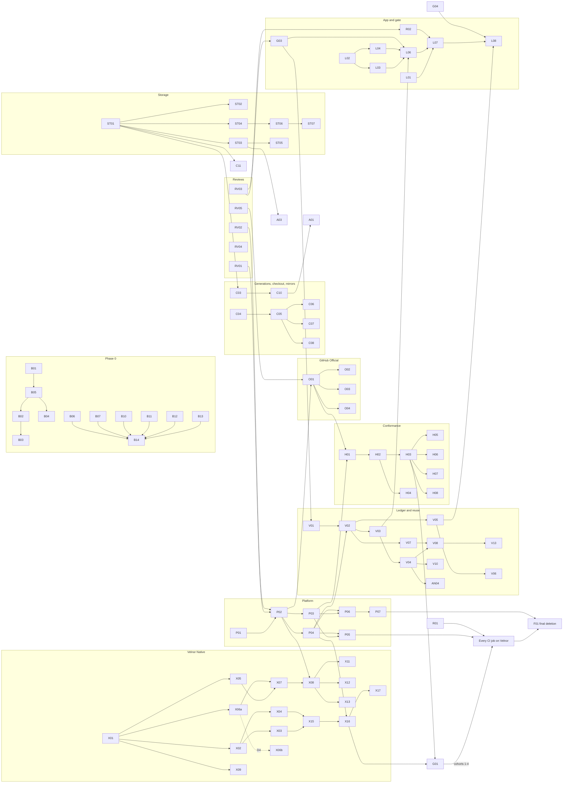

# Velnor delivery plan: the fastest step-by-step path

Status: plan v2, 2026-11-19. Destination: `docs/research/velnor-runner-2026-11/delivery-plan.md`. It
delivers the [architecture](../../proposed/velnor-runner-architecture.md) and follows the owner's
binding decisions 1–12 (the Rust-only brief) and 13–24 (`manager/owner-decisions-late.md`) and the
[rulings](rust-only-rulings.md):

- 13, 21: one platform-agnostic core with Docker and Kubernetes backends, branching on capabilities;
- 14, 17: every existing component is reviewed before reuse, velnor-new's own code included;
- 15: everything is sized by its real constraint;
- 16, 18: migration per job type; migrate and delete, with no fallbacks;
- 19, 20: the official runner stays, as the reference executor and as the selectable GitHub Official
  executor; **its image (`images/runner`, `.velnor/runner.lock`) and `velnor-official` are never
  deleted**; ARC is;
- 22–24: native `actions/cache`, configurable storage tiers with RustFS per site, node-local mirrors
  of the repository and every upstream.

Code was re-read at velnor-new `d6be276a6c` and velnor-legacy `1b9fc038`. Labels: **[M]** measured
(evidence pack), **[M, proxy]** measured on a stand-in clock, **[E]** estimated (arithmetic shown),
**[C]** read from code at the cited path, **[T]** target.

## 1. Summary

- **Fleet assumed:** N = 12 builder agents, 4 reviewer agents and 1 orchestrator, around the clock.
  Only the owner's decisions are human. Section 7.6 explains why more builders buy almost nothing.
- **Total work:** about 1238 agent-hours of building plus about 120 of review (section 3.2's sum),
  about 4.3 days of fleet time (1238 ÷ 12 builders ≈ 103 h). Coding does not set the dates.
- **What sets the dates (decision 15):** (a) velnor-new's own CI and merge queue; (b) review gates
  and owner decisions, including engine releases; (c) evidence: conformance pairs, gate parity and
  clean reuse comparisons; (d) free cluster capacity, GitHub API limits and shared-file conflicts.
- **Day 0, phase 0.** One ruleset update first (ALLGREEN, empty `bypass_actors`, both contexts bound
  to 15368, depth 2, timeout 90, minimum wait 0), then the engine batch through the queue. An agent
  PR's cycle falls from 94 to about 34 min at P50 [E]; the queue lands about 8 merges an hour at
  depth 2 [E], above the 2.44 entries an hour that arrive [M].
- **First conformance runs, day 1.2,** on the Docker backend, both executors.
- **Every CI job on Velnor, or retired: day 4.8 at P50 (P90 day 7).** Each move deletes the type's
  old route in the same change.
- **The App gate, day 4.2 (P90 6.5); the PR and group Actions gates deleted, day 5.2 (P90 7.5).**
- **Speed proof:** benchmarks BM01–BM15 (design section 11); the claim is published at about day 15
  (P90 19), only if they pass, and only against the arms that ran.
- **Storage:** the site RustFS clusters deploy on day 1; L1 routes leave `local` at about day 3,
  only after the phase-1 cluster test (ST06) passes; no verdict waits on them.
- **Final deletion, day 6.5 (P90 9):** ARC's velnor-new scale set and the old runner code review did
  not keep. The official runner image and `velnor-official` stay.
- **Goal, day 10 (P90 13.5):** PR verdict ≤ 90 s / ≤ 4 min, push-to-merge ≤ 3 / ≤ 8 min, ≤ 50
  runner-min per merged PR [T], after per-root keys enrol behind the read audit.
- **Stretch, measured by day 18:** verdict 30 s / 100 s; push-to-merge 100 s / 4 min; ≤ 20
  runner-min [T].
## 2. Reuse from velnor-legacy and velnor-new

Nothing is reused by default (decision 17). Each component below has a verdict:

- **port as-is:** sound design and code; moved with its tests;
- **port and refactor:** sound design, but the code is poorly structured (god files, Docker or
  official-runner coupling), so it is moved and reshaped;
- **redesign:** the design does not fit this architecture; it is written fresh, using the old
  code's tests and incidents as cases.

The verdicts below come from this plan's reading. Where a verdict depends on facts not yet
checked, a review item (RV01-RV04) must confirm it before any code moves. Line and test counts:
`wc` and a grep for `#[test]` in `refs/velnor-legacy/crates/velnor-runner/src`; "prod" means the
lines before the first test module.

**Why this is days, not weeks.** velnor-legacy's native lane already did most of what the executor
needs:

- JIT, broker, run-service acquire, renew and complete, and Results;
- expressions, the job model, script steps, commands, composites, post steps and cancel;
- native checkout, artifacts, attest, the App token and mise.

Legacy has 8,222 tests, and 8,172 pass on macOS [M §E.5]. It is "very old legacy" (decision 14):
`executor.rs` (37,028 lines) and `runner.rs` (36,759) are god files, and in September 2026, 60 of
its last 100 commits were fixes [M §E.6]. So the **structure** is redesigned, while the
**functions and tests** are ported. That is still much faster than writing fresh.

### 2.1 velnor-legacy

| Component | Legacy source (lines, tests) | Verdict, reason | Coverage | Strip | Adapt | Genuinely new | Agent-h port / fresh |
|---|---|---|---|---|---|---|---|
| Scale-set admin client and session | `scaleset/client.rs` 1,488 (13), `session.rs` 667 (8), `listener.rs` 857 (3) | Port and refactor: mirrors ARC's Go client faithfully; needs App auth | ~85% | — | App installation auth; ≤ 1% idle-CPU budget (#408) | Pre-acquired JIT pool | 6 / 20 |
| Scale-set lane: scaling, demand, workers | `scale.rs` 2,797, `demand.rs` 2,326, `lane.rs` 4,710, `worker/*` 4,813 | **Redesign:** built around official-runner containers plus dind (`worker/runner.rs` runs `run.sh --once`) | ~0% | Everything | — | Dispatcher placement through the platform trait | — / 16 |
| Broker, run service, Results | `protocol.rs` 18,419 (~10.2k prod, 154 tests): acquire 63 refs, renew 10, complete 12, steps update 8 [C] | Port and refactor: correct calls, but one 18k-line file | ~85% | 13 `_apis/distributedtask` paths, `pools/*/messages`; diff v2.337 → v2.338.x | Split into ≤ 400-line files; renew loop fresh (upstream null-deref) | String scan for banned endpoints | 14 / 74 |
| Job-message model | `job_message.rs` 6,799 (4.3k prod, 61) | Port and refactor: faithful shapes, one file | ~90% | — | Split | Executing `BackgroundStepControl` (legacy refuses it, `runner.rs:2654`) | 4 / 20 |
| Expression engine | `expression/` 3,565 (41) | **Port as-is** as option A of D4, the default until the owner answers: a clean lexer, parser and evaluator, faithful to DTExpressions2; the harness's reference either way | 100% (A) | — | `hashFiles` native | Option B, see 2.4 | 3 / 28 |
| Job orchestration: step loop, job state | `executor.rs` (16.7k prod, 356 tests), `runner.rs` (409 tests) | **Redesign:** god files mixing Docker, cache, telemetry and adapters. Rewrite the step loop after upstream `StepsRunner`; port the 765 tests as cases | ~30% (tests) | Docker job containers | — | New `velnor-exec` state machine | 16 / 30 |
| Templates, contexts, env | Functions in `executor.rs` | Port and refactor at function level | ~70% | Container env plumbing | Process env inside a sandbox | Byte-equal env corpus | 8 / 30 |
| Script steps, conditions, outcomes | `script_step.rs` 2,160 (30), `execution/step_conditions` 364, `step_outcome` 227 | Port and refactor | ~80% | `docker exec` | Run through the platform trait | — | 6 / 20 |
| Workflow and file commands | `workflow_command.rs` 1,521 (26), `command_files.rs` 481 (14) | Port as-is: small, well tested | ~95% | — | — | — | 3 / 14 |
| Post steps and cancel | `cancel.rs` 1,865 (19), `post_drain.rs` 346 | Port and refactor | ~80% | Docker kill paths | SIGINT, then SIGTERM after 7.5 s, then kill through the trait | — | 6 / 16 |
| Masking | Inside `workflow_command.rs` and `runner.rs` | **Redesign:** scattered, encodings incomplete | ~30% | — | — | One Aho-Corasick masker with all upstream encodings | 6 / 8 |
| Composites, admission, closed set | `action.rs` 6,978 (77), `admission.rs` 3,163 (42), `manifest.rs` 3,841 (57) | Port and refactor the metadata parsing; **redesign** admission (manifest schema v15 and 26 adapters → a closed set from velnor-gen's qualified SHAs) | ~60% | JavaScript runtimes (`executor.rs:654`), Docker actions, 20 unused adapters | — | Qualified-SHA admission | 8 / 24 |
| Background steps | none | — | 0% | — | — | Port `BackgroundStepCoordinator.cs` (394 lines); ci.yml has 105 `background: true` and 29 `wait-all` [C] | 8 / 8 |
| Crash safety | `fault_injection.rs` 914 (13) | Port and refactor | ~50% | — | Fault points in the new state machine | Kill-at-every-boundary suite | 4 / 8 |
| Docker and Firecracker backends | `docker/` 11,984, `docker_lease.rs` 21,607 (a socket proxy injecting labels; BuildKit hangs, #348), `container.rs` 5,425, Firecracker 1,339 | **Redesign:** the proxy design caused hangs; Firecracker is not needed now | ~5% | All | — | See 2.3 | — / 14 |
| checkout | `checkout.rs` 5,128 (61), `git_mirror.rs` 1,613 (18) | Port and refactor | ~80% | — | Mirror alternates; `fetch-depth: 0` | `sparse-checkout` (legacy refuses it) | 8 / 24 |
| Artifacts v4 (upload v7, download v8) | `executor.rs:10351-10760` plus `ArtifactService` | Port and refactor | ~70% | Same-host fallback | Per-run scope (#671); read back (#311) | v7/v8 inputs | 6 / 16 |
| Cache v2 | `gha_cache.rs` 17,140 is a **server** | **Redesign:** the native action talks to Velnor's authoritative cache index (ST03); GitHub Official needs a v2-compatible endpoint, for which the server's v2 message types are reviewed (ST05) | ~30% (message types) | v1 | Scope from the job token | Index, GitHub lookup order, endpoint | 8 / 12 |
| mise-action | `native_mise` (`executor.rs:5164`) | **Redesign:** it installs into a container; we mount a read-only store | ~20% | — | — | Store-backed `PATH` and env | 4 / 6 |
| mr-boxington-action, alint, setup-velnor | none | — | 0% | — | — | Thin native adapters | 6 / 6 |
| attest | `attestation.rs` 692 (sigstore-sign) plus `native_attest_build_provenance` | Port as-is (signing), refactor the adapter | ~80% | — | OIDC from the job | Generic `actions/attest` forms | 6 / 20 |
| create-github-app-token | `native_create_github_app_token` plus revoke | Port as-is | ~90% | — | — | — | 3 / 8 |
| Caches and trust stores | `mbx_store.rs` 1,870, `stable_workspace.rs` 4,443, `stale_trust_scope.rs` 6,284 | **Redesign:** host-persistent stores with GitHub-lane coupling | ~10% | All | — | Reflink snapshots and tool store | — |
| Harness inputs | `velnor-bench` 13,958 | **Redesign:** not differential | ~5% | — | — | Section 3, stream H | — |

### 2.2 velnor-new's own components (decision 17)

| Component | Source | Verdict, reason | Review item |
|---|---|---|---|
| `velnor-runner-github` (6,878 LOC of pure scale-set wire types, pinned to `actions/scaleset` e6daac70) | `crates/velnor-runner/crates/velnor-runner-github` | Port and refactor, pending review: no HTTP coupling, which is good; it carries official-runner lifecycle states | RV01 |
| `velnor-runner-core` (719 LOC: lifecycle, `CleanupProof`, `OwnedIds`) | `velnor-runner-core` | Port and refactor: the tri-state "unknown is never absent" rule is right; open defects #1143 (`covers` accepts a short id) and #1142 (`reserve` replaces a live slot) become tests | RV01 |
| velnor-host launch state machine, official-runner pair, JIT-to-`Runner.Listener` delivery, job-start hook | `velnor-runner-host/src/launch/*`, `local/*`, `velnor-resource-probe` job hook | **Reviewed for `velnor-official` (RV05):** decisions 19 and 20 keep the official runner as a maintained executor; what passes review moves into `velnor-official`, the rest is redesigned there, and the ARC-bound launch path is deleted at F01 | RV05 |
| velnor-host journal (Turso, ~35 schema modules) | `velnor-runner-host/src/journal*` | **Delete at F01** (decision 16, no new investment): schema bound to the official-runner lifecycle; open defects #1303, #1206. The executor journal (X14) keeps the discipline (persist intent, call, record), not the code | RV01 |
| velnor-host Docker client and spec audit (`docker_client` over a unix socket only; `docker_spec::audit_plan` forbids host mounts and the outer socket) | `velnor-runner-host/src/docker_*` | Port and refactor into the Docker backend, pending review: the audit rules are valuable; the call sites are spread over ~50 files (#1324 §1) | RV01 |
| Daemon lock, launchd service, keychain credential | `daemon_lock`, `plist`, `keychain` | Port and refactor for the Docker backend on macOS, pending review | RV01 |
| `Runtime` trait proposed in #1324 (`Observation{Present, AbsentProven, Unknown}`, Pod-UID proof mapping) | PR #1324, design only | Port and refactor into the platform trait: the observation model is right; `create_worker`, `deliver` and the JIT secret serve the official-runner pair and are dropped; warm pool, capabilities and exec plus log streaming are added | RV02 |
| `velnor-ci` (plan, gate, report, `inputs restore` mtime rule) | `ci-helper/` | Port and refactor: `velnor-ci release-gate` becomes the one release authority for the tools and both product entry points, with `--app-check` and `--push-check` (R02); the obligation inventory ships with it (G03); the generation rule replaces the `inputs restore` time rule (C05) | RV03 |
| `velnor-gen` | `generator/` | Port and refactor: it is the generator of record, but it has one `runner` for all jobs (`velnor-rust/src/plan.rs:344`) and hosted runners hard-coded for release (`release.rs:157,172`, `release_binaries.rs:188,222`) | RV03 |
| Engine `velnor-actions` (orchestrator 186.8k, renderer 88.7k lines) and today's 39-job `ci.yml` | `crates/velnor-actions-*`, `.github/workflows` | **Redesign:** a 39-job, 3-runs-per-merge shape. Replaced by velnor-gen's push-only workflow (G04), which deletes velnor-new's engine-generated CI. Until G04, the engine gets only phase-0 config changes | — |
| `velnor-local` (runner.server stand-in, mitmproxy recorder, scenarios) | `local/` | Port and refactor the recorder and scenarios into the harness; **redesign** local runs onto the Docker backend (P07), deleting `--runner pair` and `plain` | RV04 |

**Totals for the executor and actions** (rows from the scale-set client through create-github-app-token):

- port: about 190 agent-hours, against about 450 to write fresh;
- the redesigned parts (orchestration, masking, admission, mise, cache client, Docker backend)
  are written fresh, but against more than 1,000 ported tests used as cases.

**Freeze the old runner now (decision 16, D13).** The ~35 open velnor-runner-host PRs
(#1249-#1359 [M §D.10]) improve code that the final milestone deletes. They are parked. That
frees review capacity and queue slots on day 0.

### 2.3 The platform trait and the two backends (decision 13)

**Trait `velnor-platform`.** The core (protocol, expressions, steps, actions, caches, ledger,
label flow) never names a backend. The trait covers:

- provisioning, with a warm pool;
- mounts for caches and work dirs, chosen by capability;
- process execution and log streaming;
- limits, cancellation and teardown;
- crash recovery and ownership proofs with tri-state observations;
- `capabilities()`: reflink, shared page cache, a private Docker daemon per request, read audit,
  network policy, cgroup kill.

A missing capability selects a slower but correct path:

- copy instead of reflink;
- refusing Docker-class jobs instead of sharing a daemon (never the host daemon's siblings);
- whole-tree keys instead of narrowed keys without a read audit;
- killing the container instead of `cgroup.kill`.

| Backend | Runs | Comes first for | Base after review |
|---|---|---|---|
| **Docker** (P03) | Containers on one host: macOS Docker Desktop or any Linux Docker host | **First conformance runs (day 1)**: no RBAC, pod pool or cluster deploy needed; runs on any lab host or a developer Mac | velnor-host's Docker client and audit rules if RV01 passes; legacy `docker_lease` is not used |
| **Kubernetes** (P04) | Pods on the Hetzner k3s cluster, warm pods, node stores | **Production** (cohort 1 on day 2.1) | #1324's proof mapping (Pod UID, `preconditions.uid`) via RV02 |

Conformance runs per backend (P06). A job type moves in production when it passes on Kubernetes.
The Docker backend must pass the same corpus before local runs are advertised (P07).

### 2.4 The evaluator question (Q4): both branches

**What upstream actually runs.** Read in the official runner:
`Runner.Worker/ExecutionContext.cs:1551-1564`.

- By default, the runner builds `PipelineTemplateEvaluator` (DTExpressions2) under the comment
  `// Legacy`.
- Under `CompareWorkflowParser`, `PipelineTemplateEvaluatorWrapper` also runs the new evaluator but
  returns `_legacyEvaluator`'s result (`:115-199`, `:224-238`).

So legacy's transcription **is** upstream's "Legacy" evaluator, and it is also what production
jobs see today. Decision 3 bans it; decision 2 demands oracle-equal behaviour. The oracle runs in
compare mode and Velnor refuses every job on which the two official evaluators differ, so on every
job Velnor accepts, A and B give the same result: the choice is decision 3 against 25 agent-hours,
not correctness.

- **Option A (critical path, the default until the owner answers):** port `expression/` as-is
  (X06a, 3 h). It matches what the latest official runner returns.
- **Option B (parallel; recommended):** port `Sdk/Expressions` plus `WorkflowParser` (X06b, about
  28 h, a strong model), the ruling Q4 path, checked against the oracle in compare mode.
- **D4, by day 3.** Under decision 18 only the chosen evaluator ships in production; the other is
  deleted from production code (A stays in the harness as the reference).
  - If A: X06b stops, and is redone when GitHub flips the wrapper.
  - If B: B passes the full corpus before cohort 2, and A leaves production in that change.

### 2.5 Legacy defects that become regression tests (X17)

| Legacy incident [M §E.6] | Test |
|---|---|
| #389: slots "supervising" then silent, never registered; 9 daemons | Every warm JIT identity completes a broker poll within 30 s or is recycled; killing a session mid-registration re-registers and alerts |
| #329: job container dies; `exec` hangs on "container is not running" | Kill the sandbox mid-step on each backend: an infrastructure failure within 30 s, never a hang |
| #408: 600-700% idle CPU, JIT reconfig loops, broker 409s, poll 404s | 10-min idle soak at ≤ 1% CPU; injected 409/404/5xx get bounded backoff; single-instance lock |
| #670: a rerun poisons log ownership across attempts | Corpus "re-run failed jobs": attempt-2 ids, equal to the oracle |
| #671, #311, #672: artifact name collisions, lost uploads, lost logs of failed jobs | Concurrent same-name uploads; read-back after finalize; a planted failure's logs are visible |
| #275: an interrupted compile poisons the persistent mise store | The tool store is read-only; a write gets `EROFS` |
| #327 and velnor-new #1005, #1142: stuck or replaced slots across drain or cancel | Drain while queued, cancel mid-acquire: no stuck slot, no double report |

## 3. The dependency graph

### 3.1 Conventions

- **Size:** agent-hours of building, excluding review.
- **Classes:** strong (Opus 5.5, GPT-6.x high) for judgement; mid (Sonnet 5.5, GPT-6.x medium,
  Gemini Pro-class) for port, refactor and plumbing; cheap (Haiku 5.5, Gemini Flash-class, Muse) for
  mechanical work, configuration and case generation.
- **Deletes:** what the item removes in the same PR (decision 18): the item that moves or replaces
  the last user of something deletes it. Nothing deletes `images/runner`, `.velnor/runner.lock` or
  `velnor-official` (decisions 19, 20).
- **Location:** new code lives in the new Cargo root `executor/`, with its own lockfile (design
  section 5.2). The engine crates, `ci-helper/` and `generator/` keep their roots.
- **Acceptance:** each item's verification column is its acceptance test; an item whose test is a
  measurement reports the number and its label.

### 3.2 Work items

**B: bootstrap (phase 0), day 0.** B05 lands first; everything after it merges through the queue
under ALLGREEN (section 3.4).

| ID | Title | Scope | Depends on | Agent-h | Class | Verification | Deletes |
|---|---|---|---|---|---|---|---|
| B01 | Owner decision pack | D1–D4, D7–D9, D11, D15–D17 with defaults, answered in one sitting | — | 1 | strong | Recorded in an issue | — |
| B05 | First ruleset update (owner applies) | Section 3.4's phase-0 JSON: ALLGREEN, `bypass_actors: []`, both contexts bound to 15368, depth 2, timeout 90, minimum wait 0 | D3 | 0.5 | strong | Read-back equals the JSON field by field; a canary PR without status stays `blocked` | HEADGREEN; the admin bypass actor; unbound contexts |
| B02 | Release velnor-actions 0.1.81 | Dispatch the release prepared in #1345; bump the lock | D1, B05 | 1 | cheap | Asset sha256 equal to the lock | 0.1.80 lock entries |
| B03 | Gate jobs off hosted runners | Overrides for plan, alint, cargo-deny, cargo-machete, jactionlint, ledger-cli, required, required-gate; regenerate (`ci.yml:63-616` [C]) | B02 | 1.5 | mid | 0 CI jobs on a hosted label in 50 runs; hosted queue on the critical path p90 ≤ 1 min | Hosted placement of these 8 jobs |
| B04 | Merge procedure | Auto-merge at creation; no "0 behind main" or catch-up merges | D2 | 0.5 | cheap | ≥ 90% auto-merge; green to enqueue P50 ≤ 30 s | The catch-up rule |
| B06 | No `edited` | Remove from `pull_request` types | — | 2 | mid | A body edit creates 0 runs | `edited`; the "don't edit PR bodies" rule |
| B07 | Interim label step | An always-run `Required`-path job with no `if:` and no `needs:` that fails with "CI not requested" without `velnor:verify`; triggers `labeled`, `unlabeled`, `synchronize`, `reopened`; same authority as today's gate. Accepted costs: any label change re-runs the workflow, and removal turns a verified head red; agents and Renovate label only at creation | — | 4 | strong | Lab: unlabelled is red and cannot merge; label starts a run ≤ 5 s | Fork twin `required-gate-fork` and fork fence (decision 8) |
| B08 | Cancel stall | `always()` gates on the cluster | B03 | 2 | mid | Supersede first-job wait p90 ≤ 30 s (626 s [M]) | — |
| B10 | macOS paused | Darwin release legs, `macos-arm64` tools, mac-proof, homebrew macOS; Linux-only lock | — | 4 | mid | 0 `macos-*` jobs; Linux dry run | Darwin jobs, 4 macOS release composites, darwin lock entries, macOS renderer paths |
| B11 | Narrow per-push workflows | job-image-candidate on `images/**`, `main` and dispatch; source qualification in the group or on dispatch | — | 2 | mid | 306 → ≤ 10 and 267 → ≤ groups per day [M T11] | Per-push triggers |
| B12 | No `-j2` caps | Remove compiler and test budgets and `build.jobs=2` | — | 1 | cheap | maintenance-helpers 8.5 → ≤ 5 min; no OOM in 50 runs | The caps |
| B13 | Per-job profiles | Overrides for crate and check jobs; `native` profile, label `velnor-native` | — | 3 | mid | Golden moves only the named job | — |
| B14 | Release 0.1.82 and regenerate | B06–B13 in one engine release | B06–B13, D9 | 1 | cheap | Freshness passes | — |
| B15 | Daily report | Push-to-merge (proxy labelled), push-to-green, time to actionable red, enqueue, residence, landing, runner-min with cancelled work, per-type durations, per-backend conformance; ETag reads | — | 6 | mid | Reproduces the 85-min proxy baseline | — |

The full push run stays until A1 replaces it (V05): it is today's third execution.

**RV: reviews before reuse (decision 17)**

| ID | Title | Scope | Depends on | Agent-h | Class | Verification | Deletes |
|---|---|---|---|---|---|---|---|
| RV01 | velnor-host for the Docker backend | Docker client and spec audit, ownership proofs, daemon lock, launchd and keychain, journal | — | 6 | strong | Verdict table merged into the design | — |
| RV02 | The #1324 `Runtime` trait | Keep the observation model; drop pair-specific calls | — | 3 | strong | Trait sketch approved | — |
| RV03 | velnor-ci, velnor-gen and the product release gate | `gate.rs`, the planner, the time rule, the runner model, hosted release labels, `schema2_release_eligibility.rs` and `schema2_release_publish.sh` | — | 5 | strong | Verdict table | — |
| RV04 | velnor-local | Recorder and scenarios for the harness; the local-run path | — | 3 | mid | Verdict table | — |
| RV05 | The official-runner wrapper for `velnor-official` | `velnor-runner-host` `launch/*`, JIT delivery, job-start hook | — | 4 | strong | Verdict per part: move, redesign or delete | — |

**P: platform trait and backends**

| ID | Title | Scope | Depends on | Agent-h | Class | Verification | Deletes |
|---|---|---|---|---|---|---|---|
| P01 | Capability model | `Capabilities` and the fallback table (reflink → copy; no private daemon → refuse the Docker class; no read audit → whole-tree keys; no cgroup kill → container kill) | RV02 | 3 | strong | Each fallback has a test that turns the capability off | — |
| P02 | `velnor-platform` trait | Warm pool, mounts, exec and log stream, limits, cancel, teardown, recovery, tri-state proofs; a backend kit | RV01, RV02, P01, X01 | 8 | strong | The kit runs | — |
| P03 | Docker backend | bollard, unix socket only; warm containers; spec audit; macOS and Linux | P02 | 12 | mid | Kit passes on Linux and macOS Docker | — |
| P04 | Kubernetes backend | kube-rs; warm pods; node-store mounts; Pod-UID proofs with `preconditions.uid`; no token on job pods | P02, D8 | 14 | strong | Kit passes; pod-to-first-step ≤ 1 s warm | — |
| P05 | Private Docker daemon per request | Kubernetes: privileged sidecar on tainted nodes; Docker: a daemon container per request; refusal where neither qualifies | P03, P04 | 8 | mid | Lab D: equal pass, fail and skip sets; nothing of one request visible to the next, on both backends | The shared dind sidecar; host-daemon sibling containers |
| P06 | Per-backend conformance | The corpus on each backend; report split by backend | P03, P04, H03 | 3 | mid | Both backends shown daily | — |
| P07 | Local runs on the Docker backend | velnor-local drives Velnor Native through the Docker backend | P06, RV04 | 10 | mid | Local scenarios oracle-equal | velnor-local `--runner pair` and `plain`, the runner.server stand-in |

**O: GitHub Official (decisions 19, 20)**

| ID | Title | Scope | Depends on | Agent-h | Class | Verification | Deletes |
|---|---|---|---|---|---|---|---|
| O01 | `velnor-official` for acquired jobs | `Runner.Worker` with GitHub's job message in a platform sandbox; the dispatcher owns the lease, the Worker completes; both backends; `ACTIONS_RUNNER_ACTION_ARCHIVE_CACHE` on a read-only store filled by pinned SHA, in both roles (L08) | RV05, P02 | 11 | strong | A real job completes on each backend; lease faults do not double-report | Wrapper parts RV05 rejects |
| O02 | Reference role isolation | Reference outputs in an isolated namespace; the shadow sampler hook; "run both and diff" | O01 | 4 | mid | A reference run writes no receipt, cache entry or release | — |
| O03 | Official obligation mode | Synthetic job message from the released command; node-agent run-service, Results and cache endpoints; observation through `velnor-ci obligation exec` | O01, V02 | 14 | strong | Its conformance cases pass; until then the planner refuses Official for obligations | — |
| O04 | Paired speed per job type | Same backend, tool store, generation and warm or cold mix; Worker and Node costs apart from cache routing | O01, H03 | 4 | mid | A per-type table with [M] figures | — |

**X: executor core (Velnor Native)**

| ID | Title | Scope | Depends on | Agent-h | Class | Verification | Deletes |
|---|---|---|---|---|---|---|---|
| X01 | Root and port checker | `executor/` skeleton, line budget, a function-hash provenance checker | — | 4 | mid | Fails on one changed token | — |
| X02 | Broker and JIT | JIT config, RSA token, broker session, poll, ack | X01 | 6 | mid | Lab transcripts replay; string scan clean | — |
| X03 | Acquire, renew, complete | Fresh renew loop | X02 | 4 | strong | Faults until `lockedUntil` + 5 min; 404/409 on complete means done | — |
| X04 | Results | Steps update, logs, summaries, feed | X02 | 6 | mid | Seal-before-complete ordering | — |
| X05 | Job model | Port and refactor, plus background control | X01 | 4 | mid | 61 tests; 20 lab messages, 0 unknown fields | — |
| X06a | Expressions, option A | Port as-is (default until D4) | X01 | 3 | cheap | 41 tests; expression corpus 100% | Option B's production path if D4 = A |
| X06b | Expressions, option B | Port `Sdk/Expressions` and `WorkflowParser` | X06a | 28 | strong | ≥ 50k fuzzed equal in compare mode; full corpus | Option A's production path if D4 = B |
| X07 | Templates and contexts | Port and refactor | X05, X06a | 8 | mid | Env byte-equality | — |
| X08 | Job state machine and steps | Redesign the step loop after `StepsRunner` | X07, P02 | 16 | strong | 765 legacy tests as cases; status × needs corpus | — |
| X09 | Commands | Port as-is | X01 | 3 | cheap | 40 tests; file-command corpus | — |
| X10 | Masker | Redesign | X04 | 6 | strong | One planted leak per encoding caught | — |
| X11 | Post steps and cancel | Through the trait | X08 | 6 | strong | Order and timing equal to the oracle | — |
| X12 | Composites and admission | Port parsing; redesign admission | X08 | 8 | mid | 134 composite runs; unknown actions refused | — |
| X13 | Background steps | New port of `BackgroundStepCoordinator.cs` | X08 | 8 | strong | Group order, failure, cancel equal | — |
| X14 | Journal and faults | Append-only job journal; fault points | X03 | 8 | strong | Kill at every boundary: no double report | — |
| X15 | Executor image and deploy | Built on `main`, digest-pinned and attested; deploy to `velnor-system` | X03, X04, D8 | 4 | mid | One real job green on the production label | — |
| X16 | velnor-dispatch | Session client; scaling over the trait; pre-acquired JIT; placement before acquire; placement by the generation, L0 manifests and mirror head each agent advertises, ranked by predicted completion (L03) | X15, P04 | 14 | strong | Start ≤ 2 s P90; idle ≤ 1% CPU; 0 lost jobs under faults | — |
| X17 | Legacy-incident suite | Section 2.5, on both backends | X16, P03 | 6 | mid | Each fails on a planted reintroduction | — |

**A: native actions**

| ID | Title | Scope | Depends on | Agent-h | Class | Verification | Deletes |
|---|---|---|---|---|---|---|---|
| A01 | checkout | Sparse checkout, `fetch-depth: 0`, mirror alternates, over C10 | X08, C03, C10 | 8 | mid | Equal tree and `.git` state; ≤ 1 s warm | — |
| A02 | Artifacts v4 | Port and refactor; uploads to GitHub's v4 service (visible to `gh run download`), the site tier a read-through cache by digest | X04 | 6 | mid | Digests equal; read-back through the API | — |
| A03 | `actions/cache` | The native action over the cache index (ST03) | X04, ST03 | 8 | mid | Hit and miss equal to the oracle on 20 keys and every restore-key order | — |
| A04 | mise-action | Over the read-only store | C01 | 4 | mid | Same `PATH`, env and outputs | — |
| A05 | mr-boxington, alint, setup-velnor | Thin adapters | C01 | 6 | mid | Equal output | — |
| A06 | Attest | Port signing; refactor the adapter | X10 | 6 | strong | `gh attestation verify` passes | — |
| A07 | App token | Port as-is | X10 | 3 | mid | Works, masked, revoked | — |
| A08 | Replace github-script | 3 uses → `velnor-ci` subcommands | — | 4 | mid | Equal results | The 3 `actions/github-script` uses |
| A09 | Closed-set lint | Generators emit only qualified actions at qualified SHAs | — | 4 | mid | An unqualified SHA fails a golden | — |

**H: conformance harness**

| ID | Title | Scope | Depends on | Agent-h | Class | Verification | Deletes |
|---|---|---|---|---|---|---|---|
| H01 | Lab | velnor-lab with `velnor-official` in the reference role (latest release) beside Velnor Native on both backends | O01, P03 | 4 | mid | Both sides serve a hello job | — |
| H02 | Transform and replay | Paired jobs in one run; replay real commits | H01 | 8 | mid | 10 paired replays | — |
| H03 | Comparator | Conclusions, steps, outputs, annotations, normalised logs, artifact digests, cache effects, env | H02 | 10 | strong | Identical pairs show 0 diffs | — |
| H04 | Corpus v1 | 335 cases (240 semantics, 65 fault, 30 refusal) plus replays, seeded from the ported tests and RV04's scenarios | H02 | 16 | cheap + strong | Every case runs on both sides | — |
| H05 | Mutants | About 30 planted executor faults | H03 | 4 | mid | ≥ 95% caught | — |
| H06 | Release watcher | Hourly release poll, protocol diff, deprecation dates, unknown-field alert | H03 | 4 | cheap | A synthetic release triggers a run | — |
| H07 | Drift sampler | Shadow a sample of production runs per moved type | H03, O02 | 5 | mid | A planted divergence opens a P0 issue ≤ 15 min | — |
| H08 | Flake-aware pairing | Re-run both sides before calling a diff | H03 | 3 | mid | A planted flake is not a divergence | — |
| H09 | Canary PRs | Permanent unmergeable PRs (no status; foreign source; `if: false` job), probed every 10 min | L02 | 4 | mid | A canary turning mergeable pages and stops `success` writes | — |

**L: label flow and the App (one specification: design section 8.2)**

| ID | Title | Scope | Depends on | Agent-h | Class | Verification | Deletes |
|---|---|---|---|---|---|---|---|
| L01 | Lab A | Every case of design section 10.3 and the state-machine cases of section 8.2, including a two-site partition with a delayed stale write | D7 | 8 | mid | Run ids recorded; every pass condition holds | — |
| L02 | `velnor-control` | Webhooks; the armed state machine; status `Velnor / Verified` (`statuses: write`) and detail check `Velnor / Details` (`checks: write`); never a check run as the gate | D7, V01 | 12 | strong | 50 lab pushes: webhook P50 ≤ 2 s; unlabelled and draft heads have no status | — |
| L03 | Fenced status writer | Epoch-numbered lease, success index, generation and epoch recheck, read-back reconciliation; home-site only | L02 | 8 | strong | A stale lease's write is refused; an ambiguous write reconciles | — |
| L04 | Reconciler | Every 10 s from REST state; arming derived from label and draft events | L02 | 4 | mid | A killed webhook still verifies within 10 s; duplicates converge | — |
| L05 | Policy changes and revocation | Planned freeze and drain; emergency `failure` writes, re-verification, window audit; the first disagreement suspends its class and blocks dependants, five re-runs decide flake or revoke | L03, V05 | 6 | strong | Lab: a revoked epoch ejects a queued group | — |
| L06 | Shadow and parity | The App on every PR head and group beside today's CI; per-obligation comparison against the inventory; failure cases | L03, L04, G03, V03 | 6 | strong | 300 heads and 100 groups; 0 unexplained lost obligations or false greens by job type and event; a separate report | — |
| L07 | Ruleset step 3 (owner applies) | Require all three contexts; start the label flow | L01, L06, R02 | 1 | strong | Read-back shows the App context on both subjects | — |
| L08 | Ruleset step 4 | Drop the two Actions contexts; delete PR and group Actions gates | L07, V05, G04 | 2 | mid | The release gate still passes on `main`; a canary stays blocked | B07's interim step; `Required verdict` and the PR and group `Required` jobs |

**G: workflows and the inventory**

| ID | Title | Scope | Depends on | Agent-h | Class | Verification | Deletes |
|---|---|---|---|---|---|---|---|
| G01 | Cohort moves | One config PR per cohort, routing to `velnor-native` | B13, X16, H03 | 6 | cheap | The cohort runs on Velnor | The cohort's ARC routes and B03 overrides; ARC-only generated steps as their last user moves |
| G02 | Routing in velnor-gen | Per-job-type executor and runner map | RV03 | 4 | mid | Golden with mixed labels | Hosted labels in `release.rs`, `release_binaries.rs` |
| G03 | Obligation inventory v1 | Versioned, released with `velnor-ci`: today's 39 jobs, lints, named and configuration checks, release prerequisites → obligations with selections, features and expected test IDs; reductions only by owner-signed entries | RV03 | 10 | strong | Every blocking check maps; a dropped test fails a golden | — |
| G05 | `.velnor/` schema | Executors per job type and obligation kind, storage routes, mirrors; read from the base commit, certified identities and digests only | G02 | 4 | mid | A golden per section; a candidate-side change has no effect until it lands | — |
| G04 | velnor-gen cutover (#1290) | A push-only `ci.yml` with one always-run `Required` that runs `velnor-ci audit wait` (read-only ledger token, pass only on the SHA's A1 pass, fail after 2.5 h, per-SHA concurrency group) | G02, L07, V05 | 16 | strong | The release gate passes on `main` | Engine-generated `ci.yml`; the engine's velnor-new config sections |

**V: ledger, witnesses, audits and reuse**

| ID | Title | Scope | Depends on | Agent-h | Class | Verification | Deletes |
|---|---|---|---|---|---|---|---|
| V01 | Ledger core | Plans, whole-tree keys with the execution fingerprint, verification records with witness slots, joins with priority inheritance, epochs | X01, G03 | 16 | strong | One receipt cannot fill two slots; a cancelled claimant's work continues for the other | — |
| V02 | Observation and signing | Node agent observation; receipts binding every executed binary's digest, generation, node, slot, epoch; signer daemon; append-only log | P04, V01 | 12 | strong | A forged report mints 0 receipts; a receipt without digests is rejected | — |
| V03 | Witness scheduler | Distinct node, attempt and order seed (seeded filter batches, or a digest-pinned nextest patched with a seed option, whichever costs ≤ 1.5 s per binary); a different generation or cold; shard layout in the execution manifest, fan-out off for receipts until lab C | V01, V02 | 8 | strong | Two witnesses on one node or one generation are refused; the seeded order is reproducible | — |
| V04 | Exact-tree records | Shadow with re-execution, then on per kind after the evidence matrix | V03 | 6 | strong | 3,000 clean per obligation kind | — |
| V05 | Audit A1 | Journalled request per first-parent commit; gap reconciliation; results bound to commit and proof set; reserved share; the push `Required` reports it and, when the audit is unclaimed, takes its exclusive lease and runs it cold instead of waiting; the waiting slot is charged; narrow-key obligations re-run at the hit-sampling rate whatever their key; a nightly reuse-free run of the full inventory on the tip (X01a) | V02 | 10 | strong | An intermediate commit with no push run is audited; a planted stale result is caught within the SLO | The full push run (B09 of plan v1) |
| V06 | Audit A2 | Nightly, the clock shifted 8 and 30 days | V05 | 4 | mid | A planted date bomb fails | — |
| V07 | Read audit | eBPF in the node agent on `openat`, `openat2`, `newfstatat`, `statx`, `readlinkat` and `getdents64` exits, by sandbox cgroup, `ENOENT` included; overhead measured; resolve paths in the kernel through LSM hooks; a seccomp filter fails the witness on `access`, `faccessat2`, `execve` lookups, legacy `open`/`stat`/`lstat`/`readlink`/`getdents` and io_uring opens (landscape change 1) | V02 | 18 | strong | Shadow traces on every obligation; overhead reported [M] | — |
| V08 | Per-root keys | Dependency contracts per obligation, always including every tracked file in each ancestor directory of the root (`rustfmt.toml`, `clippy.toml`, `deny.toml`, `rust-toolchain.toml`, `Cargo.*`, `mise.*`) and `.cargo/`, `.config/`, `.github/`, `.velnor/`; enforced by V07 on every execution; the sibling-file canary | V07, V04 | 12 | strong | 3,000 clean per kind; the canary is caught | — |
| V09 | Flake sampler | 300 paired reruns | B15 | 3 | cheap | Rate with an interval | — |
| V10 | Queue-tip speculation | Shadow, then on | V04 | 8 | strong | ≥ 60% match over 50 merges, else deleted | — |
| AN01 | `velnord` and `velnor cargo`, count-only | Daemon plus the `mise.toml` cargo wrapper slot; maps argv to inventory obligations or scratch; local journal of argv, tree, toolchain, outcome; no cluster part (Fable, Opus) | G03 | 14 | mid | ≤ 50 ms added per call at P90; 95% of a week's cargo calls journalled | — |
| AN02 | Tree snapshots and wip refs | Private index (tracked and untracked, never ignored), `git write-tree`, thin pack to the node mirror under `refs/velnor/wip/` with seven-day expiry, secret scan on the delta (Fable) | AN01, C03 | 10 | strong | A later commit of the same tree hits the same key; ignored files never sent | — |
| AN03 | Remote counting lane | Counting commands run on warm nodes in the `interactive` class with a per-identity budget; output streamed; T2 candidate receipts (Fable) | AN02, V03, S01 | 18 | strong | Interactive wait P90 ≤ 5 s at 80% load; merge, gate and A1 reservations untouched | — |
| AN04 | `velnor verify`, `ship`, `resolve`, `wait` | Verify fills both slots on two nodes against the queue-tip merge, showing both SHAs; ship pushes, labels with the agent identity, enables auto-merge; resolve and wait read the ledger (Fable) | AN03, V04, L02 | 24 | strong | 50 shipped PRs: label to green ≤ 10 s P50; zero slot fills from T0 or T1 | V11 (subsumed) |
| AN05 | Trust tiers | T0–T3 on every record and in the CLI and `Velnor / Details`; Mac keys only in an advisory namespace (Fable) | AN01, V02 | 8 | strong | No T0 or T1 result can reach a slot | — |
| AN06 | Routing by replay | Replay 200 recorded agent commands per class; remote by default only where its P50 is within 1 s of the Mac's (Fable) | AN03 | 6 | mid | Published routing table | — |
| AN07 | Flake soak in verify | New or changed test ids 20× under seeds and CPU pressure at batch; feeds V16; never a slot (Fable) | AN04, V16 | 6 | mid | A planted 10% flake is found in ≥ 80% of soaks | — |
| AN08 | Dev runs feed graduation | Each counting dev run paired with a batch-priority shadow re-execution toward the 3,000 comparisons (Fable) | AN03, V04 | 6 | mid | One disagreement suspends the class | — |
| AN09 | Per-test-case receipts (stretch) | Receipt per (binary digest, test id, definition), shadow against whole-binary runs (Fable) | AN04, DG03 | 30 | strong | 3,000 clean, then 2% sampled; no slot before | — |
| V12 | C5 classifier | The trusted planner's scan for clock, randomness, network and event reads | G03 | 6 | strong | The 11 clock-reading test files are C5 | — |
| V14 | No-`.git` census | Find obligations that need Git metadata (`root.rs:22` runs `git rev-parse --show-toplevel`); give them a read-only repository at the subject commit, keyed by it | G03 | 4 | mid | Every obligation passes without `.git` or is listed and keyed by commit | — |
| V13 | Per-package keys (stretch) | Contracts per package closure | V08 | 16 | strong | 3,000 clean per kind | — |

**C: compile reuse, checkout and mirrors**

| ID | Title | Scope | Depends on | Agent-h | Class | Verification | Deletes |
|---|---|---|---|---|---|---|---|
| C01 | Tool store | Read-only node store by pinned digest (Kubernetes); a read-only volume (Docker) | D8 | 6 | mid | Set-up ≤ 0.1 s; `EROFS` on write | — |
| C02 | Crates store | Site mirror plus a read-only registry per lockfile, by checksum | D8 | 4 | mid | 0 downloads on a hit | — |
| C03 | Git mirror and bundle | Node mirror on webhooks; site bundle seeding (from GitHub until ST06 passes); one writer per mirror (`flock`), one fetch running and one waiting, `--atomic --no-auto-maintenance`, `gc.auto=0`, refresh by swap after readers are proven absent (L18) | D8, ST01 | 8 | mid | Fetch ≤ 0.5 s; after ST06 a wiped node seeds without GitHub | — |
| C04 | XFS volumes | Work volumes with project quotas | D8 | 6 | mid | Quota enforced | ext4 `emptyDir` work dirs |
| C05 | Verified generations | Builder per site; input manifest; changed set against it; coverage rule; per-unit read sets traced during the generation build (fingerprints removed where a read meets Δ); time stamps; dep-info blob check | C04, P01, V02 | 14 | strong | Section 7.3's canaries rebuild and fail as they must | — |
| C06 | Reproducibility audit | One commit cold on 2 nodes; digests per unit | C05 | 4 | mid | Equal, or the unit is listed and its dependants stay cold | — |
| C07 | Compile-reuse shadow | Cold second witness; warm-against-cold digest comparisons per root | C05, V03 | 6 | strong | 3,000 clean per root, then the second witness moves to another generation | — |
| C08 | mbx-cache head-to-head | Lab B3 crossover under load; kill rule; adds a signed chunk-manifest transport with chunks ≥ 4 MiB (L05) | C05 | 8 | mid | Measured; kept or deleted | mbx-cache if it loses |
| C09 | Retire GitHub-cache caching | — | C05, cohort 4 | 3 | mid | 0 restores needed | `state-seal.yml`, `cache-prune.yml`, the seal code, `mbx cache import/export` steps |
| C10 | Checkout verification | Sealed bases; full staged-tree hash; sparse, submodule and symlink rules | C03 | 6 | strong | Stale file, mode-only change, deletion and concurrent refresh all caught | — |
| C11 | Upstream mirrors | Toolchains and mise tools by digest; a registry mirror per site | D8, ST01 | 8 | mid | 0 internet fetches on a hit | Per-job tool installs |

**ST: storage and `actions/cache` (decisions 22, 23)**

| ID | Title | Scope | Depends on | Agent-h | Class | Verification | Deletes |
|---|---|---|---|---|---|---|---|
| ST01 | `velnor-storage` | `BlobStore`, local and S3 backends, capability declaration | X01 | 10 | mid | Kit passes on local, RustFS and MinIO | — |
| ST02 | Tiers and routes | Configuration; defaults: `local` on Docker and macOS, node NVMe → site RustFS → replication on Kubernetes, all routes `local` until ST06 passes | ST01 | 4 | mid | A misrouted, stalled or degraded tier is slower, never wrong | — |
| ST03 | Cache index | `repository × scope × key × version`, insert-if-absent, GitHub's lookup order, scope from the job token, home-site writer; GitHub's eviction (7 days unused, size cap) as LRU in the index, S3 lifecycle only a backstop; content-defined chunks of about 1 MiB over the uncompressed archive; user keys never used as object names; `find_missing`, present-before-commit, renewed last use; parallel ranged L1 reads; batched cross-site lookups (L04, L10) | ST01, V01 | 16 | strong | Concurrent saves, L0 stale prefix against L1 exact, PR-to-`main` isolation, disconnected site | — |
| S03 | FI volume rebuild | `vgs`/`lvs` on velnor-241, -5, -190 (K27); then one node at a time: drain, rebuild VG `data` with an L0 LV and a RustFS LV, rejoin | D8 | 4 | mid | 0 free extents confirmed first; each node rejoins with both LVs; no job lost | The single-LV layout |
| ST04 | RustFS per site | One cluster per site, pinned version, manifests owned by Velnor (the operator is 0.0.8); one drive per worker on its own device or LV, never the L0 filesystem (FI after S03's rebuild); DE cache-only (two nodes); parity explicit (EC:1 at 3 drives, EC:2 at 4–5); layout fixed up front; `strict` durability on every bucket; node agents hold credentials, jobs get presigned URLs | ST01, D8, S03 | 8 | mid | Kit passes against it; a startup with a shared or mis-sized layout is refused | — |
| ST06 | RustFS phase-1 cluster test | On the real workers: (1) node loss and return, including #9480's sequence (a node away for a minute, then a drive replaced on another node) and a rolling restart, reads and writes checked throughout; (2) replication DE↔FI over WireGuard at 35 ms: throughput, lag, existing-object backfill (#8768) and an `rc` resync; (3) Linux fsync cost per durability mode (`strict`, `relaxed`) on XFS NVMe, for 16 KiB, 1 MiB and 2 GiB objects; (4) the 8.7 GiB target snapshot by multipart PUT and GET against the 92 s cold build and the 39.9 s mbx seed; (5) 1 MiB chunk PUT and GET rates under 16 and 64 clients | ST04 | 10 | strong | Each part reports [M]; pass: no data loss or lasting unavailability in (1), replication converges in (2), a snapshot GET plus clone beats a cold build in (4). On a failed part its route stays `local` (or moves to another S3 store), and the failure is filed upstream | — |
| ST07 | Site replication | Bucket replication of content-addressed buckets DE↔FI, monitored lag, resync runbook with `rc` | ST06 | 4 | mid | Lag reported; a stalled backfill alarms and costs only misses | — |
| ST05 | Cache endpoint for Official | Cache v2 route for the Worker, after the runner-source check; upload URL implements Azure Blob Put Blob, Put Block, Put Block List; artifacts v4 passed through with the job token; re-qualified when the pinned action moves; reference role keeps GitHub's endpoints (L09) | ST03, O01 | 10 | strong | Conformance cache cases pass under Official | — |

**T: test floor; S: cluster**

| ID | Title | Scope | Depends on | Agent-h | Class | Verification | Deletes |
|---|---|---|---|---|---|---|---|
| T02 | Loop splits | Looped cases in the suites that survive F01 (actions-cli's 258–274 s loops); prefix clones; no work on `velnor-runner-host`, its journal or its 924.8 s `receipt_integrity` test, which F01 deletes (decision 16) | — | 6 | mid | No surviving test over 60 s outside a list | The serial loops |
| T03 | Parallel helper tests | ci-helper and archive-guard tests in parallel | — | 4 | mid | ci-helper ≤ 10 s | `test-threads = 1` |
| T04 | Fixture and profile | Fold the 89-s fixture; lab B1's four-way matrix | — | 6 | mid | Numbers for the profile override | The separate fixture build |
| T05 | Git differential speed | A sealed no-checkout fixture cloned per accepted glob, batching and sharding of `non_inputs_differential.rs` with the original assertions | — | 6 | mid | The full suite still runs; time measured against 679 s | — |
| T07 | Split monolithic crates | `velnor-ci` (15.2k source, 25.7k test lines) and `velnor-gen` (about 27.5k) into leaf crates of about 10k lines along module lines, so a non-incremental edit recompiles less | — | 12 | mid | Same test IDs; edit-to-test time on 30 replayed diffs measured | The monolithic crates |
| P08 | Namespace slots (lab) | Direct namespace and cgroup v2 slots in the node agent as a Kubernetes-backend variant, against warm pods: 200 provision-to-first-step cycles at 80% CPU (K17); reports hit and miss latency, the miss rate on the 2026-11-18 trace, resize latency and deferral rate, idle memory held (C12) | P04 | 10 | strong | Same kit and proofs; adopted only if faster at P90 | — |
| T08 | Clock injection and fenced fixtures | Route `velnor-ci`'s `now_seconds()` and the 5 realtime-reading test files through one injectable clock fixed per obligation; replace `CARGO_MANIFEST_DIR` climbs with declared fixture lists | BM05 | 10 | mid | Same assertions; BM05's C5 share falls; A2 still catches a planted date bomb | The climbs it replaces |
| T06 | One `tests/it` per package | 356 binaries → one per package | — | 8 | mid | Same test IDs; link passes counted | The separate binaries |
| S01 | Cluster policy | Priority classes, the reserved merge path (a pair of distinct warm slots for a group that misses), A1's share, memory watermark requeue, PID limits, per-org quotas; pool by class: an hourly floor plus `ensure`'s forecast plus one group per auto-merge enqueue, idle members resized in place at claim, stage timers (L01) | D8 | 8 | mid | No OOM in a week; batch requeued first | — |
| S02 | Control plane | Three k3s servers across failure domains; a third-site witness for shared fences | D8 | 4 | mid | Server and site loss drills pass | — |

**R: release; F: final deletion**

| ID | Title | Scope | Depends on | Agent-h | Class | Verification | Deletes |
|---|---|---|---|---|---|---|---|
| R01 | Release jobs on Velnor | Environments, OIDC, App token; 3 lab dry runs per workflow | A06, A07, G02 | 6 | strong | Dry-run assets equal; tag published | Hosted release placement |
| R02 | One release authority | `velnor-ci release-gate` with `--app-check` and `--push-check` at the tools release and both product entry points; released and pinned | RV03 | 12 | strong | Missing or stale proof, wrong source, skipped audit and changed ruleset refused at both entry points | The embedded product eligibility shell |
| R03 | Smoke shipped bytes | x86_64; aarch64 under qemu | R01 | 4 | mid | Smoke on the published digest | `--version`-only checks |
| R04 | Build once, promote | Release-bytes obligation; durable product claims by group SHA; promotion by digest | R02, R03, V04 | 16 | strong | 0 crates compiled at tag; digests equal the receipt | Tag-time `cargo build` jobs; the per-push preview rebuild |
| R05 | Release timing | Dispatch to published and read back, ready bytes to published, cold and warm group release builds of both tools (musl x86_64 and aarch64 under qemu), artifact upload at 100 MB and 1.48 GB | R04 | 4 | mid | The 15 s estimate replaced by [M]; zero tag compiles | — |
| R06 | Stamp after link (lab) | Patch the commit into a fixed ELF note before smoke tests and attestation, so product bytes build once per closure | R04 | 8 | strong | Patched bytes pass the same smoke and `gh attestation verify`; needed for the ≤ 20 stretch | — |
| F01 | Final deletion | After cohort 4 has served one real release, and P07 | cohort 4, P07 | 8 | mid | No production path through ARC; the official runner only behind `velnor-official`; `rg` finds no dangling references | ARC's velnor-new scale set (Helm release) and the `local`/`hosted` profiles; wrapper parts RV05 rejected; `images/resource-probe`, `velnor-runner-qualification`; the Turso journal; the rest of `crates/velnor-runner` not moved by RV01 or RV05. **Keeps** `images/runner`, `.velnor/runner.lock`, `velnor-official`, and `images/dind` if P05 uses it |

**BM: proving the speed (design section 11).** Dates follow the system the run needs, and self-hosted
arms run one at a time on the same two FI workers, so arms, not agents, set the length.

| ID | Title | Scope | Depends on | Agent-h | Class | Verification | Deletes |
|---|---|---|---|---|---|---|---|
| BM01 | S1 planted failures | 100 failing edits on every fast path (older-time edit, undeclared build-script input, sibling file, clock shift, stale generation, seeded flakes) | L08, C05, V04 | 10 | strong | 100% red or detected at (1−p)²; reruns on every fast-path change | — |
| BM02 | S2 control race | Native against Official on the same warm workers and generation, ≥ 30 interleaved pairs per job type at 15% and 80% CPU; the same on today's ARC with phase 0 | O01, X16, cohort 2 | 10 | strong | Per-job-type deltas with intervals published | — |
| BM03 | S3 head-to-head harness | Replay driver for 300 heads at arrival times on every arm; per-class clocks gross and net of GitHub | B15, L08 | 16 | strong | Two dry arms reproduce the 85-min proxy within its interval | — |
| BM10 | RBE arm (optional) | Bazel `rules_rust` with a remote executor for the cold-build lane only, reported as a subgraph; only after one `cargo build --timings` of the cold runner root shows the longest chain under 70% of the wall, else dropped with the figure (C04) | BM03, D22 | 16 | strong | Same compile outputs and test IDs on the lane | — |
| BM07 | Strong conventional baseline arm | The official runner on persistent agents on the two FI workers: reflink-cloned warm target, crates mirror, baked tool image, gates on the cluster, auto-merge, ALLGREEN | BM03, C04 | 12 | mid | Same expected test IDs as the inventory | — |
| BM04 | S4 loaded replay | The 2026-11-18 trace with other organisations' load, A1 and release preparation | BM03 | 6 | mid | Verdict P90 ≤ 1.5× quiet; merge-path wait P90 ≤ 10 s | — |
| BM05 | S5 census | C5 classifier and read audit on `main` and 300 heads | V07, V12 | 6 | strong | C5 and whole-tree shares published; goals restated | — |
| BM06 | S6 warm compile | 300 diffs per root, cold page cache, idle and loaded, cold control | C05 | 6 | mid | Slower witness P90 ≤ 25 s (helper, generator), digests equal | — |
| BM08 | Floor inventory | Per-binary wall and CPU of every receipt-minting binary on a worker, process trees traced, before and after T02, T05 and F01 | B13 | 6 | mid | Replaces the 28-job-log figures; longest surviving binary published | — |
| BM09 | Contract freeze and publication | K20 freeze of the contract; K22 paired arrival-block bootstrap intervals, pre-registered sentence, interleaved pairs reported as median and range | BM03 | 6 | strong | The rule runs on the dry arms; a planted tie is reported as a tie | — |
| BM11 | Toolchain matrix (lab B4+) | `rust-lld`, `mold`, `wild` × unpacked debuginfo × `CARGO_INCREMENTAL` 0/1 × dependency `opt-level` 0/3 on three roots; 300 diffs, 20 planted faults; digest reproducibility re-proved | C06 | 8 | mid | Zero false greens; edit-to-test P50 and P90 per cell published | — |
| BM12 | Page-cache contention (lab B2+) | 1, 4 and 6 build sandboxes running test, clippy and doc lanes beside RustFS and a cold A1 build, reflink against read-only overlayfs; `fincore`, PSI, major faults; page cache per additional sandbox and copy-up bytes; a lower layer never replaces the full tree hash (L07) | C05, ST04 | 6 | mid | P90 slowdown ≤ 1.25× idle; no OOM; digests equal cold | — |
| BM13 | Per-execution overhead | Suite wall with and without the read audit; tree-hash time by file count; C5 time per obligation; a sealed lower layer with a delta hash as the candidate; on a fresh reflink clone, idle and at 80% CPU, by thread count; the delta-hash candidate needs dm-verity or a non-XFS store, built only above 0.3 s at P90 (C13) | V07, C10 | 6 | mid | ≤ 3% of suite wall and ≤ 1.5 s per obligation at P50 | — |
| BM14 | GitHub's share and a shadow train | 50–200 auto-merged PRs: `success` to enqueue to group to merge; a shadow compare-and-swap train measured for tree match and latency, landing nothing | B04, L07 | 6 | mid | Numbers for owner question D18 | — |
| BM15 | Hardware floor (K11) | Runner-root cold build, the 20 slowest tests and S6's matrix on a 9454P worker against one rented high-clock node | D20 | 4 | mid | Ratio published; verdict classes move only at ≥ 1.15 | — |
| P09 | Resident planner, pre-cloned sandboxes | The planner stays resident; sandboxes are pre-cloned from the sealed generation | V01, C05 | 6 | mid | Stage 1b ≤ 0.5 s, sandbox ready ≤ 0.3 s at P50 | — |
| C13 | Lab B5: narrowed step 3 | 300 replayed diffs that add or remove a path plus planted cases (`foo/mod.rs` beside `foo.rs`, a new `tests/x.rs`, a globbed or proc-macro-listed file, a new `clippy.toml`, `rustfmt.toml` or `.cargo/config.toml`); then the narrowed rule as its own reuse class with a cold second witness | C05, C06 | 10 | strong | Every planted case rebuilds; every digest equals cold | Root-cold rebuilds on added files, after graduation |
| V16 | Flake scoring | Per-test discordance from witness pairs, A1 and the 2% sample; automatic issues; quarantine only with an equivalent blocking check shown on the same planted fault; automatic expiry back to blocking (L14) | V03, V05 | 6 | mid | A planted flake is scored and an issue opened; an expired quarantine blocks again | — |
| S04 | Image-key census | Count image-input-key changes per week; build a per-scope layer cache only above 20 runner-min a day of image builds (L20) | B15 | 2 | cheap | The count published | — |
| DG01 | Key struct (Dagger D01) | Canonical key struct with named fields and reuse class; `velnor explain` names the differing field | V01 | 6 | mid | Adding a field raises the key version; a changed field is named | — |
| DG02 | Content-key telemetry (D02) | Per witness, the digest of every executed binary plus runtime inputs; would-hit counter in the shadow ledger and daily report; no gate path reads it | V02, DG01 | 4 | mid | Counts published per obligation kind | — |
| DG03 | Run step keyed by binary digests (D03) | Split test obligations into build and run steps; run key from twin-build digests, the runtime contract, definition and fingerprint | R06, C12, DG02 | 12 | strong | Only after R06 removes the commit stamp, twin digests agree and about 3,000 clean D02 comparisons per kind; S1's unchanged-binary data-file edit turns red | — |
| DG04 | Reuse class per obligation (D04) | a `reuse` class (content, per-request or never) in the inventory; the stricter of it and the classifier wins; TTL for advice only | G03, V12 | 5 | mid | A declaration can only tighten; the class is in the key | — |
| DG05 | Targets (D05) | `--target` / `VELNOR_TARGET` (`local`, `k8s://de`, `k8s://fi`, `docker://host`), mTLS with the agent identity; scheme → capability set | P02, V02 | 4 | mid | The trust tier follows the signer class, never the URL | — |
| DG06 | Node-local request socket (D06) | Request-only socket from cluster agent shells to their node agent; minting in a fresh sandbox over the committed tree | DG05, owner answer on shell capacity | 6 | mid | The socket accepts no results | — |
| DG07 | Checks by name (D07) | `velnor check -l` and `velnor check <name>` from the base commit's inventory; hooks call names | G03 | 8 | mid | An unknown name is refused | — |
| DG08 | Generator freshness (D08) | Register generators; derive a freshness obligation for each; refuse one without it | G03 | 4 | mid | A stale golden fails | The hand-written freshness jobs |
| DG09 | Agent environments (D09) | `velnor env new/push`, per-environment target, temp dirs and ports, command log; `velnor mcp`; Docker first | DG05, P07 | 16 | mid | Environments never mint; parallel agents do not collide | — |
| DG10 | Frozen resolution (D10) | Obligations resolve network inputs only from committed locks through the mirrors; `velnor lock update` opens a PR | C11, G03 | 8 | mid | An unlocked input fails or is C5, never a hit | — |
| DG11 | OTel traces (D11) | One trace per `ensure` over OTLP to a self-hosted collector; `velnor trace`; `Velnor / Details` links it | V01, L02 | 10 | mid | Every stage of section 11 timed from traces | — |
| V15 | Fast-red lane | Non-minting incremental build, `cargo check`, changed and historically failing tests first; failure to `Velnor / Details`, twins cancelled | V03 | 6 | mid | Never writes `success`; time to first red measured | — |
| C12 | Twin generations | Each landed tip built cold twice on two nodes, sealed only on equal digests; witness 2 over the twin | C05, C06 | 8 | strong | Witness-2 delta equals witness 1's on 50 sequential commits | — |

**Sum:** 169 items, about 1238 agent-hours of building plus about 120 of review (about 110 PRs ×
0.7 h, plus 30 strong reviews × 1.5 h).

### 3.3 Owner decisions

| ID | Decision | Needed by | Default |
|---|---|---|---|
| D1 | Dispatch velnor-actions 0.1.81 (#1345) | h0 | — |
| D2 | Auto-merge on; no "0 behind main" or catch-up merges | h0 | — |
| D3 | The phase-0 ruleset of section 3.4; depth 4 and timeout 15 only on the measured condition | h2 | The JSON as written |
| D4 | Evaluator A or B (2.4); recommended B | day 3 | A |
| D7 | The `velnor-verify` App and an agent identity without administration | h12 | — |
| D8 | Deploy identity for `velnor-system`; node changes (XFS, reservations, taints, a RustFS device or partition per worker) | h6 | — |
| D9 | Pre-approve CI-only engine releases | day 0 | One approval each |
| D11 | Per-type cutover counts (section 5) | day 1 | As written |
| D14 | Whether the engine crates are deleted after G04 | day 8 | Out of this plan |
| D15 | Recovery: redeploy the previous image; the pre-approved break-glass verifier if none can verify; never an admin merge | day 1 | Redeploy only |
| D16 | A label carried from draft arms the PR at `ready_for_review`; recommended yes | day 2 | No |
| D17 | Who approves a reduction in the inventory; recommended the owner only | day 3 | None accepted |
| D23 | Automatic verification of unpushed commits (decision 12); recommended not yet | day 10 | Off |
| D24 | `interactive` above PR-class and other organisations' CI, within a budget | day 6 | Equal to PR work |
| D25 | Agents in cluster sandboxes or on a dedicated worker; recommended a two-agent pilot | day 10 | No |
| D26 | A native arm64 lane for aarch64 binaries; recommended not now | day 10 | Nothing built |
| D18 | A Velnor merge train in place of GitHub's queue (decision 7); recommended not now, BM14 first | day 8 | GitHub's queue |
| D19 | Pre-label compile and test of ready PRs (decision 12); recommended no, use `velnor verify` | day 3 | No |
| D20 | One high-clock node per site now; recommended for BM15 only, then verdict classes at ≥ 1.15 | day 4 | No rental |
| D21 | One compile feeding both witnesses after graduation; recommended no | day 7 | No |
| D22 | Rented comparator arms for BM03; recommended one vendor arm and GitHub larger runners | day 5 | None; the claim names only the arms run |

D6 (the lab's reference executor), D10 (two witnesses, ALLGREEN), D12 (where release bytes are built)
and D13 (park the old runner's PRs) are decided by decisions 16 and 19 and the rulings.

### 3.4 Phase 0, and the order that keeps it safe

**Order.** B05 is the first change: the owner applies this ruleset update before any phase-0 PR
merges, so every later merge already needs a green latest commit under ALLGREEN, with no bypass.
Phase-0 PRs merge through the queue like any other; there is no admin merge in phase 0 or after.
Lab fix loops use branch builds and never touch velnor-new CI; only production promotion (X15) needs
`main`.

**The phase-0 ruleset** (`PUT /repos/tailrocks/velnor-new/rulesets/24396608`; `deletion`,
`non_fast_forward`, `required_linear_history` and `pull_request` stay as they are):

```jsonc
{
  "enforcement": "active",
  "conditions": {"ref_name": {"include": ["~DEFAULT_BRANCH"], "exclude": []}},
  "bypass_actors": [],
  "rules": [
    {"type": "required_status_checks", "parameters": {
      "strict_required_status_checks_policy": false, "do_not_enforce_on_create": false,
      "required_status_checks": [
        {"context": "Required verdict", "integration_id": 15368},
        {"context": "Required", "integration_id": 15368}]}},
    {"type": "merge_queue", "parameters": {
      "merge_method": "SQUASH", "grouping_strategy": "ALLGREEN",
      "max_entries_to_build": 2, "min_entries_to_merge": 1, "max_entries_to_merge": 10,
      "min_entries_to_merge_wait_minutes": 0, "check_response_timeout_minutes": 90}}
  ]
}
```

| Phase | Change to the JSON | Condition |
|---|---|---|
| 0 (B05) | As above | D3 |
| Step 3 (L07) | Add `{"context": "Velnor / Verified", "integration_id": APP_ID}` | Lab A and shadow parity |
| Step 4 (L08) | Remove the two Actions contexts | L07 stable for a day; A1 live; G04 ready |
| Depth | `max_entries_to_build` 4, `check_response_timeout_minutes` 15 | Group verdict P90 ≤ 5 min and paired false failures ≤ 3% |

**Read-back test.** After every change, `gh api repos/tailrocks/velnor-new/rulesets/24396608` is
compared field by field with the expected JSON; a mismatch stops the next step, and the canary PRs
must stay `blocked`.

**What phase 0 buys** [E]. An agent PR's cycle (two verdicts, one review-fix round):

| | Verdicts | Catch-up re-run | Green to enqueue | Merge group | Merge | Per PR, P50 |
|---|---|---|---|---|---|---|
| Today [M] | 2 × 26.7 | 0.47 × 26.7 = 12.5 | 7.5 | 19.9 | 0.75 | **94 min** (P90 > 5 h) |
| After day 0 | 2 × 11 (fan-out 8.4–10.7 [M T5] plus gates without hosted queue) | 0 | 0.5 | 11 | 0.75 | **34 min** (P90 ≈ 60) |
| After cohort 2 | 2 × 6 | 0 | 0.5 | 6 | 0.75 | 19 min |
| After step 4 | 2 × 6 (cold second witness) | 0 | 0.5 | 2 (60–75% lookups) | 0.75 | 15 min |
| At the goal | 2 × 1.5 | 0 | 0.1 | 0.5 | 0.75 | 4.5 min |

**Merge throughput** [E]. Depth 2 at about 11-min groups lands about 8 merges an hour (two groups
per 11 min, less 15.5% of groups disturbed at 8.1% false failures), against 2.44 entries an hour
arriving [M]. The plan funds no throughput from depth 4 until its condition holds.

**Cluster capacity** [E]. B06, B07 and B11 roughly halve load (285–347 → ≤ 170 runner-min per
merged PR). Lab replay runs at batch priority and is preempted or requeued first (S01).

### 3.5 Streams graph



## 4. Parallel streams, evidence and the critical path

### 4.1 Streams (N = 12)

| Stream | Items | Agent-h | Peak agents | Main serialiser |
|---|---|---|---|---|
| Phase 0 and workflows | B*, G01–G05 | 70 | 2 | Engine releases (D1, D9); `.velnor/config.toml` and `ci.yml` are single-writer |
| Reviews | RV01–RV05 | 21 | 3 (h0–h6) | Strong-model availability |
| Platform | P01–P07 | 58 | 3 | RV01, RV02; D8 |
| GitHub Official | O01–O04 | 32 | 1 | RV05, P02 |
| Velnor Native | X01–X17 | 140 | 4 | `executor/Cargo.lock`; one owner per crate |
| Native actions | A01–A09 | 49 | 2 | X08, C01, ST03 |
| Conformance | H01–H09 | 58 | 2 | Lab capacity |
| App and gate | L01–L08 | 47 | 2 | D7; parity evidence |
| Ledger and reuse | V01–V14 | 127 | 3 | Evidence counts |
| Generations, checkout, mirrors | C01–C11 | 69 | 2 | D8 |
| Storage | ST01–ST07 | 60 | 2 | ST01; the phase-1 cluster test |
| Test floor and cluster | T02–T06, S01–S02 | 40 | 2 | Shared test files |
| Release | R01–R05 | 41 | 1 | Dry-run wall time |
| Final deletion | F01 | 8 | 1 | Review of a large deletion |

Peak demand is about 22 agents on day 0–1; with 12, the orchestrator runs section 4.3's critical
items first and fills idle slots with X06b, T-items, V07 and ST-items.

### 4.2 Evidence matrix

Each reuse class and backend has a minimum before it counts, and replay capacity sets its date [E:
15 free 16-CPU slots at batch priority at night].

| Class | Unit of comparison | Minimum | Source | Wall time [E] |
|---|---|---|---|---|
| A job type moves (per backend) | replayed real-commit pair | 100–300 per type (section 5) | lab replay | 10–26 h per cohort |
| Gate parity | PR head; exact merge group | 300; 100, failure cases included | production shadow | about 1.3 and 1.8 days at today's volume |
| Exact-tree records | reused record re-executed, per obligation kind | 3,000 per kind | shadow plus replay | about 600 replays for the per-root kinds × 10 slot-min ≈ 7 h |
| Compile reuse | warm-against-cold digest set, per Cargo root | 3,000 per root, two days of production among them | cold witnesses plus replay | about 3.5 h per small root, 7 h for the runner root, then the production days |
| Per-root keys | enforced-audit execution per kind; the sibling canary | 3,000 per kind | shadow | about 7 h after the audit's shadow |
| Docker class | runs per binary per daemon kind | 200 | lab D | 3 × 3 × 200 × 3 min ≈ 90 slot-h ≈ 6 h |
| RustFS L1 (per route) | the five ST06 parts | all five pass | the real workers | about 1 day, off the critical path |
| Flake rate | rerun pair | 300 | sampler | about 1 day |
| Speculation | merges | 50 | production | about 1 day |

### 4.3 The critical path in hours (P50)

| Step | Items | Wall | Ends |
|---|---|---|---|
| Phase 0 and reviews | B01–B14, RV01–RV05, X01 | 6 h | h6 |
| Capability model and platform trait | P01, P02 (split in two) | 8 h | h14 |
| Docker backend and `velnor-official`; lab (H02–H04 built since h6) | P03, O01, H01 | 10 h | **h29: first conformance runs (day 1.2)** |
| Kubernetes backend, deploy, dispatcher | P04 (from h14), X15, X16 | 26 h | h40 |
| Gate evidence on Kubernetes: 150 pairs per type; fixes | H04 subset, H05, P06 | 10 h | h50 |
| Move cohort 1 | G01 | 1 h | **h51 (day 2.1)** |
| Template evidence: background steps, composites, sparse checkout, crates; 300 pairs; two fix loops | X11–X13, A05, C02 | 26 h | **h77: cohort 2 (day 3.2)** |
| Docker class evidence on private daemons | P05, lab D | 14 h | **h91: cohort 3 (day 3.8)** |
| Release types: three dry runs each | A06, A07, R01, R03 | 18 h + 6 h | **h115: cohort 4 (day 4.8)** |

The gate chain runs beside it: G03 (h5–h15) → V01 (h15–h25, split) → V02 and V03 (to h36, after
P04) and L02–L04 (D7 at h12, to h36) → L06 shadow from h36: 100 groups at about 55 a day take about
44 h → parity report at h86 → one fix loop → **L07 at h100 (day 4.2)**. R02 (h10–h24) and L01 (from
h24) finish well before. V05 (h36–h44) and G04 (prepared from h60) let **L08 land at h124 (day
5.2)** after a day of the App gate beside the Actions contexts.

Storage runs beside both chains: ST01 (h6–h16), ST04 (h16–h24, after D8), ST06 (day 1–2.5) and
ST07; **L1 routes switch from `local` at about day 3** once ST06 passes, so cross-node cache hits and
generation shipping start then; nothing on a verdict path waits for them.

**Speed proof** [E]: BM05 and BM06 report by day 5–6; BM02 runs from day 3.5 on the moved job
types and again after F01; BM01 runs on day 5.2–6; BM03's harness and BM07 are ready by day 9, and
the self-hosted arms run one after another for about a day each on the 11-18 trace once the goal
configuration stands (days 10–14, P90 13.5–18), with BM04 last. The claim is published at about
day 15 (P90 19), only if section 11's pass rules hold.

Then: **F01 at day 6.5**, after one real release on Velnor; **compile reuse graduated on the helper
and generator roots at day 7.5** (C05 h28–h42, C07 replay plus two production days), only if replay
delivers 3,000 comparisons per root within 72 h under multi-org load (K15): from production alone it
takes 25–50 days [E, Gemini 4 Argon], and later dates move with it; **the read
audit's shadow (V07 from h44) and contracts (V08) enrol per-root keys at day 10, the goal**; stretch
items at day 16–18. At P90, two more fix loops and a late D7 or D8 move the App gate to day 6.5,
step 4 to 7.5, F01 to 9 and the goal to 13.5.

### 4.4 What serialises, and how this plan minimises it

| Serialiser | Size | Minimisation |
|---|---|---|
| (a) velnor-new CI and the merge queue | 94 min per PR today; about 8 merges an hour at depth 2 | Phase 0 first; ports land early as dark code; production moves are config-only; lab loops use branch builds |
| (b) Engine releases | about 104 min with macOS, about 27 without, plus approval | All day-0 engine changes in 0.1.82; D9 pre-approval |
| (b) Review capacity | about 110 PRs, about 120 review-hours, 4 reviewers ≈ 30 h | Two-commit ports; the harness judges behaviour; D13 removes about 35 runner-host PRs |
| (b) Owner decisions | 12 decisions | One pack at h0 with defaults; later ones at days 1, 2, 3 and 8 |
| (c) Evidence | Section 4.2 | Replay historical commits in the lab; capacity, not calendar, sets the pace; counts are higher because nothing moves back |
| (d) Cluster capacity | 480 threads shared; 92–95% CPU on 11-18 [M] | Phase 0 halves load; replay at batch priority; first conformance on a Docker host outside the cluster |
| (d) GitHub API | The owner's token: 5,000 requests an hour; `gh run watch` polls every 3 s | One watcher with ETags and webhooks; the App and harness use App tokens |
| (d) Shared files | `.velnor/config.toml`, `ci.yml`, `executor/Cargo.lock`, the trait crate, runner-host tests | One workflow-lane agent; contract PRs first; one owner per crate |

## 5. Per-job-type migration order

**Cutover criteria per type, in counts (D11).** There is no way back after a move, so the bar is set
before it: (1) corpus cases for the type's features pass at 100% on the Kubernetes backend; (2) every
mutant is caught; (3) N replayed real-commit pairs show 0 unexplained diffs (bound below 3/N at 95%);
(4) every step, made to fail, is red exactly as on the oracle; (5) start latency no worse than ARC's
at P90. The move PR deletes the old route; afterwards H07 samples production runs, a divergence is a
P0 fix-forward issue with a 2-hour target, and a bad release redeploys the previous image digest.

| Order | Job type | Prerequisites | Conformance cases (pairs N) | Time saved when it moves | Deleted in the move |
|---|---|---|---|---|---|
| 1 | `Required` gate | X02–X08, X16, P04 | Status functions × `needs` results; `if: always()` (150) | about 15 s per run on the critical path | Its ARC override and hosted twin |
| 1 | `Required verdict` | + A02, X10 | 32 artifacts; a missing one fails; helper sha256 (150) | about 25 s of set-up [E: tools 10 + mise 2 + checkout 6 + action download 4.4 + set-up 4 s, M T9b] | Its override; the 0.1.78 helper download |
| 1 | Plan | + A01, A03, A04 | Full checkout; cache hit and miss; outputs; upload (150) | about 40 s on the critical path | Its override; Plan's tool-seed steps |
| 1 | Ledger CLI, the four lints, freshness | + A05, C01, C02 | Byte-equal output; a planted failure per lint (100 each) | about 2.5 runner-min per run | Their overrides; two tool composites |
| 2 | Rust crate template, 26 jobs | + X11–X13, sparse A01, C02 | Background groups and `wait-all`; 134 composite calls; 34 uploads; cancel mid-group (300) | 30 s × 26 = 13 runner-min per run | Their overrides; six tool composites |
| 2 | `check-maintenance-helpers`, `check-generator-samples` | + bun and python in C01; B12 | nextest, bun and python output; planted failure (150) | verdict maximum 8.5 → ≤ 4 min [E] | Their overrides |
| 3 | `velnor-runner-host`, `(local-mode)`, `velnor-local`: only what RV01, RV04 and RV05 keep; the rest is deleted with its code at F01 instead of moved | + P05, T02 | Docker-network group; 3 Docker binaries on private daemons (150 each) | verdict P90 10.1–10.4 → ≤ 6 min | Their overrides; the shared dind sidecar |
| — | Merge-group and push runs | Same types | `merge_group` and `push` contexts (30 each) | Move with their types | — |
| 4 | State seal | + A06, A03 save | Predicate; save only on the tip (30) | Off the hosted queue; then deleted (C09) | Hosted placement; later the workflow |
| 4 | Job image candidate, source qualification | + P05 | Image digest and verdict equal (30 each) | hosted queue 5.9–9.1 min per run [M T11] | Hosted placement |
| 4 | release-rust-ci-tools, product-release (Linux) | + A06–A08, R01, R02, B10 | 3 dry runs per workflow; digests and attestations equal | release about 104 → about 27 min; about 1 min with R04 | Hosted labels in velnor-gen (G02) and the engine |
| 4 | qualification.yml, cache-prune, homebrew, mac-proof | — | — | Retired | Deleted (F01, C09, B10) |

Cohort 1 is the critical-path gate chain with the least semantics; cohort 2 is one template for 26
jobs; cohort 3 sets the verdict's maximum; releases come last: rare, holding secrets, needing attest
and the App token.

## 6. Milestones by day

Clocks follow B15. "Day N" means hours 24N to 24(N+1) from the start; P90 in brackets. Every figure
is [E] except the goal and stretch rows, which are [T].

| Day | Milestone and deletions | PR verdict P50 / P90 | Push-to-merge P50 / P90 | Runner-min per merged PR | Constraint |
|---|---|---|---|---|---|
| Today | Baseline [M, proxy] | 26.7 / 92.3 min | 85 / 457 min | 285–347 | — |
| 0 | Phase 0. **Deletes:** HEADGREEN, the bypass actor, `edited`, fork twin, catch-up rule, `-j2` caps, Darwin legs, per-push triggers | ≤ 12 / ≤ 20 min | ≤ 35 / ≤ 60 | ≤ 170 | D1–D3, D9; engine release wall time |
| 1.2 | First conformance runs on Docker, both executors | ≤ 11 / ≤ 18 | ≤ 30 / ≤ 55 | ≤ 160 | Reviews → trait → Docker backend, `velnor-official` |
| 2.1 (3) | Cohort 1 on Kubernetes. **Deletes:** gate routes and seed steps | ≤ 9 / ≤ 16 | ≤ 25 / ≤ 45 | ≤ 150 | D8; dispatcher; 150 pairs per type |
| 3.2 (4.5) | Cohort 2. **Deletes:** 26 crate routes, six composites | ≤ 6 / ≤ 10 | ≤ 15 / ≤ 28 | ≤ 120 | Evidence and replay capacity |
| 3.8 (5.3) | Cohort 3 on private daemons. **Deletes:** the shared dind sidecar | ≤ 5 / ≤ 9 | ≤ 13 / ≤ 25 | ≤ 110 | Lab D |
| 4.2 (6.5) | App required on both subjects; label flow on; release authority migrated | ≤ 5 / ≤ 9 | ≤ 12 / ≤ 22 | ≤ 110 | D7; parity |
| 4.8 (7) | Cohort 4. **Deletes:** hosted release labels; later the state seal and prune | — | — | — | Release dry runs |
| 5.2 (7.5) | Step 4: obligations verify PRs and groups (whole-tree keys, cold second witness); A1 replaces the push run. **Deletes:** PR and group Actions gates, the interim label step, the full push run | ≈ 6 / 18 | ≈ 9 / 30 | ≈ 110 | Parity report; A1 live |
| 6.5 (9) | **F01.** **Deletes:** ARC's velnor-new scale set, the Turso journal, unkept `crates/velnor-runner`. **Keeps** the official runner image and `velnor-official` | ≈ 4 / 12 | ≈ 7 / 22 | ≈ 90 | One real release on Velnor; review |
| 6.5 (9) | `velnor verify` and `ship` (AN04): agents' runs fill witnesses; the label becomes mostly a lookup | ≈ 4 / 12 | ≈ 7 / 22 | ≈ 90 | Exact-tree records; App gate |
| 7.5 (10) | Compile reuse graduated on the helper and generator roots | ≈ 2.5 / 8 | ≈ 5 / 15 | ≈ 80 | 3,000 comparisons per root |
| 10 (13.5) | **Goal:** per-root keys enrolled; floor fixed | **≤ 90 s / ≤ 4 min** | **≤ 3 / ≤ 8 min** | **≤ 50** | Contracts; evidence |
| 15 (19) | **Speed claim published** if S1–S6 pass; otherwise the claim stays "designed to cut push-to-merge" | — | — | — | Arms run one at a time on two workers |
| 16–18 | **Stretch:** per-package keys, `velnor verify`, longest test ≤ 15 s, stamp after link | 30 s / 100 s | 100 s / 4 min | ≤ 20 | Labs B and C |

A milestone that misses its numbers holds the next cohort until the miss is explained; stretch work
continues. Runner-minutes follow design section 4's formula [E]: day 5.2, 2 × (16 warm + 22 cold) +
0.3 × 38 + 10 (A1) + 8 (product bytes) + 5 ≈ 110; day 6.5, runner-host's tests gone (about 12 warm,
18 cold) ≈ 90; day 7.5, a warm second witness ≈ 80; the goal needs per-root keys. Verdict estimates
at day 5.2 [E]: the cold second witness sets the time, about 3 min of
cold build of the largest root plus about 2.5 min for the longest test binary; P90 carries the
924.8 s test until T02 lands.

## 7. Agent operating model

### 7.1 Work items and PRs

- **Size.** 2–8 agent-hours, one PR, under 400 refactored lines. Larger items (X06b, X08, P04, V01,
  V07, G04, R04, C05) split at the first commit.
- **Two-commit ports.** First the verbatim move into ≤ 400-line files, with the checker proving every
  function body equal to its source; a cheap model reviews the report. Then the refactor, reviewed
  by a mid or strong model.
- **Branches.** Independent PRs off `main`; dark code merges early; stacks only within one crate, at
  most two deep; no catch-up merges.
- **Deletion in the same PR (decision 18).** A reviewer rejects a PR that leaves an old path, flag,
  alias or fallback behind.

### 7.2 Gates

- Every PR: a green verdict on the latest commit, an approving review, all threads resolved; it
  merges through the queue (no admin merge, section 3.4).
- Executor, platform and action PRs also keep the per-backend corpus rate, pass the feature's new
  cases and still catch every mutant. The harness is the acceptance oracle for behaviour; reviewers
  judge structure, safety and deletions.

### 7.3 Avoiding duplicate work

Claims go in the roadmap project (`claimed:<agent>`) before any branch exists; one owner per crate
and per shared file; after every merge the orchestrator hands out the next critical item; an agent
never starts a second branch for an item that has one.

### 7.4 Strong models where judgement matters

| Class | Items | Share of hours |
|---|---|---|
| Strong | Reviews; trait and capabilities; Kubernetes backend; `velnor-official`; step loop, renew, cancel, background steps, masker, journal; dispatcher; comparator; App, fenced writer, revocation, parity; ledger, witnesses, A1, read audit, contracts; generations; cache index; release authority; option B | ~45% |
| Mid | Port and refactor, Docker backend, native actions, harness plumbing, stores, mirrors, test floor, deletions | ~43% |
| Cheap | Verbatim moves, corpus generation, config moves, measurements | ~12% |

### 7.5 Around the clock

Agents run 24 hours a day; the owner answers in two windows a day; B01 asks everything due in the
first 48 h at once, with defaults.

### 7.6 Why N = 12

| N | Effect on the critical path |
|---|---|
| 6 | About +30% |
| 12 | As planned |
| 20 | No gain: evidence, review, parity and the queue bind. Extra agents take X06b, V-items and T-items |

## 8. Risks to speed

| Risk | What stalls | Detection | Mitigation |
|---|---|---|---|
| Owner decisions wait overnight (D3, D7, D8) | Day 0–2 | B01 tracks due hours | One pack with defaults; D9 pre-approval; the Docker backend lets conformance start without D8 |
| A review says "redesign" for more than expected (RV01, RV02, RV05) | P02, P03, O01 | The RV tables | Redesign estimates are in "fresh"; worst case +8 h, off the production path |
| No fallback after a move (decision 18) | A divergence blocks that type until fixed | H07; B15 per-type failure rate | Higher pre-move counts; fix forward on a 2-h target; redeploy the previous digest |
| A broken Velnor release blocks the PR that fixes it | Deadlock | Executor-wide failure alert | D15: redeploy the previous digest; if none can verify, the pre-approved break-glass verifier; never an admin merge |
| Parity finds a lost obligation late | L07 | L06 report | Shadow from h36 leaves two days for fixes before the P90 date |
| Protocol drift from v2.337 to v2.338.x | X02–X04 | H06 diff; unknown-field telemetry | Fix in the lab; deadlines from the API |
| Background-step semantics (new port) | Cohort 2 | Dedicated group cases | Strong model; port line by line |
| Backends behave differently | Per-backend conformance | P06 split report | Capability fallbacks, never special cases in the core |
| The comparator hides a difference | False confidence | About 30 mutants | A comparator change that misses a mutant cannot merge |
| Flaky tests create divergence noise | Evidence counts slip | H08; B15 flake series | Count only reproducible diffs; flakes stay red |
| The cold second witness makes verdicts slow until graduation | Days 5.2–7.5 | B15 verdict P90 | T02 and T06 early; graduation evidence from day 4.2 |
| The cluster is saturated (92–95% [M]) | Replay, shadow | Per-class CPU in B15 | Phase 0 first; batch preempted and requeued; Docker-host replay outside the cluster |
| GitHub API limits | Agents, harness, reconciler | `X-RateLimit-Remaining` | ETags (a `304` is free); App tokens |
| Agents collide on shared files | Re-work | Conflict count | One owner per crate and per config lane |
| F01 is hard to review | Final milestone | Deletion diff size | Split by area; `rg` proofs; the strong reviewer checks what replaced each part |
| RustFS fails a phase-1 part, or regresses in a patch (1.0.0 is two months old; open #9480, #8768, #9161) | Cross-node cache hits, generation shipping, bundle seeding | ST06 report; per-tier hit, error and lag rates | Routes stay `local` or move to another S3 store through the same backend; a pinned version upgraded only after the storage kit passes; every failure is a miss, never a wrong result |

## 9. First ten work items

| # | ID | Item |
|---|---|---|
| 1 | B01 | Owner decision pack with defaults |
| 2 | B05 | The phase-0 ruleset update, read back field by field |
| 3 | B02, B03 | Release 0.1.81; move the 8 hosted gate jobs to the cluster |
| 4 | B04, B06–B14 | Auto-merge; engine 0.1.82 batch, merged through the queue |
| 5 | RV01–RV05 | Reviews: velnor-host, the #1324 trait, velnor-ci and the product gate, velnor-local, the official-runner wrapper |
| 6 | X01 | `executor/` root and the port-provenance checker |
| 7 | P01, P02 | Capability model and the platform trait |
| 8 | G03 | Obligation inventory v1 |
| 9 | O01, H01 | `velnor-official` on the Docker backend; the lab |
| 10 | R02 | One release authority, before any ruleset step that adds the App |
