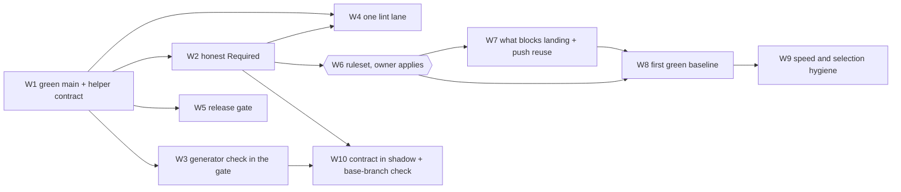
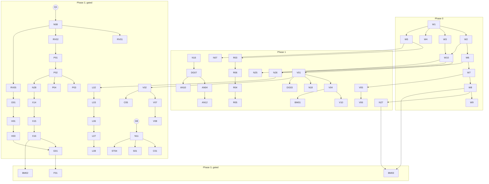

# Velnor delivery plan

| Field | Value |
|---|---|
| Status | Proposed. The owner confirms it before any issue is created (ruling R12) |
| Source of truth | [Rulings R1–R13](velnor-gen-rebase/rulings.md). Where this plan and a ruling disagree, the ruling wins |
| Built from | [Plan audit](velnor-gen-rebase/as-built/plan-audit.md) §6 (status of every item) and §8 (missing items N01–N24); [panel comparison](velnor-gen-rebase/comparison.md) §5 (merged phase 0) |
| Main read at | `6fa056da02` (2026-11-19 19:19 UTC), plus open PRs at that time |
| Owner questions | Q1–Q17 and the D ids that still stand are in [owner-questions.md](owner-questions.md) |

This plan delivers the [design](../../proposed/velnor-runner-architecture.md) on top of velnor-gen, which now writes every
generated workflow. It has four phases. Phase 0 makes the gate correct. Phase 1 adds trust and reuse inside velnor-gen
and velnor-ci, with no change to `docs/goals.md`. Phase 2 builds the runner, Velnor Native, the platform, storage and the
App, and waits for the owner. Phase 3 proves the speed claim and adds the full Actions protocol.

## 1. Summary

- **166 items, 1279 agent-hours of building, about 1448 with review.** Phase 0 is 10 items and 79 h. Phase 1 is
  38 items and 267 h. Phases 2 and 3 (93 + 25 items) are gated on owner answers.
- **Of the old plan's 174 items:** 8 are done on main, 10 are removed, 12 are folded into phase 0, and 144 survive
  with new file targets. 12 new N-items come from the audit and the rulings.
- **Main is red.** Almost every push since the cutover has failed. The latest cause is the pinned helper 0.1.96, released
  before the nextest preflight fix (#1768), so the Test step still fails with
  "`--no-fail-fast` cannot be used with `--no-run`" (run 44594918317). 0.1.97 is released (#1789) but not pinned.
- **Nothing reaches the ruleset until `Required` has been green on main with tests running** (R2). The critical path
  of phase 0 is W1 → W2 → W6 → W7 → W8 → W9, about 42 agent-hours plus owner time and measurement wall time.
- **No runner, platform or storage crate is in phase 0** (R7). The runner crates get correctness fixes only until Q1
  and Q9 are answered.
- **Targets stay budgets until W8 measures them** (R9). Goals are unchanged: PR verdict P50 90 s or less and P90 4 min
  or less; push-to-merge P50 3 min or less and P90 8 min or less.

## 2. How to read an item

- **IDs.** W1–W10 are phase 0. Old IDs (V01, R04, …) keep their number with a rewritten scope. N-IDs are new; N01–N24
  are the audit's numbers, N25–N28 come from the rulings. An ID is never reused.
- **Size.** Agent-hours of building, without review. Anything over 8 h is split into sub-issues at its first commit.
- **Seats.** Implementation uses the repository's executor labels only: Haiku 5.5 (`exec:haiku`), Sonnet 5.5
  (`exec:sonnet`), Opus 5.5 (`exec:opus`), with `effort:low`, `effort:medium` or `effort:high`. Fable 5.2 has no
  label and appears only as a reviewer, named in the issue text, on soundness and trust-boundary items. If the owner
  answers Q11 "labels only", those reviews fall back to Opus 5.5 high.
- **Review.** Following root issue #574: the reviewer uses the executor's seat or a cheaper one at low effort, except
  where a mistake would be silently wrong (the gate, selection, reuse, cache keys, credentials, releases). Those get
  Opus 5.5 high or Fable 5.2 xhigh.
- **Done when.** Every check reads the state of main or of GitHub, not the contents of a PR. When another session
  lands the work first, the checks pass and the issue closes with their output instead of being built again.
- **Gate.** A Q or D id from [owner-questions.md](owner-questions.md). The item waits for that answer, or runs on its
  recorded default where the sheet gives one.
- **Deletion.** Each item removes what it replaces in the same PR. Nothing deletes `images/runner`,
  `.velnor/runner.lock` or the official-runner wrapper.

## 3. Main at `6fa056da02`: the facts the items depend on

| Fact | Evidence |
|---|---|
| Generated workflows: `rust-ci.yml` (727 lines), `rust-cache-trim.yml`, `qualification.yml`, `release-rust-ci-tools.yml`, `tag-ruleset-drift.yml`. `ci.yml` (alint, cargo-deny, cargo-machete, jactionlint) is the last hand-written one | `.github/workflows/`; `.velnor/workflows.toml` |
| A PR runs `rust` (plan, fmt, clippy, tests, local-mode lane), then `policy`, then `Required`. A push to main adds docs, 18 alone-checks and cache saves | `.velnor/rust-ci.toml` (`docs` and `check_alone` = `post_merge`) |
| `pr_ci = "label"` with `ci:run` and `ci:auto`. A draft converted from ready cancels its run (#1769). An unrelated label or a non-base edit still produces a skipped `Required`, which counts as a pass; #1770 is open to fix it | `rust-ci.yml` lines 11–35, 636 |
| `.velnor/rust-ci.lock` pins helper 0.1.96. `tools-v0.1.97` exists (#1789) | `git ls-remote --tags origin tools-v0.1.97` |
| The tools release gate only checks that the tag is on the default branch | `release-rust-ci-tools.yml` job `gate`; #1608 is open and stale |
| `StepKind::GeneratorCheck` is rendered but never planned | `crates/velnor-model/src/steps.rs`, `crates/velnor-render/src/steps.rs` |
| `.velnor/config.toml` is read only by `velnor-ci plan --mode/--request`, which no workflow calls; its presence sets `engine_configured` in velnor-gen | `crates/velnor-ci/src/io/plan.rs`, `crates/velnor-gen/src/io/mod.rs` |
| Ruleset 24396608: `Required` with no `integration_id`, admin bypass (`RepositoryRole 5`), HEADGREEN, build 2, wait 5, timeout 90, plus deletion, non-fast-forward, linear history and pull-request rules. `allow_auto_merge` is false. Rust CI has never run on `merge_group` | `gh api repos/tailrocks/velnor-new/rulesets/24396608` |
| The push `rust` job takes 564 s: alone-checks 48%, lane guard 17%, docs 16% | Run 44584072510 (R8) |

## 4. Phase 0: correctness, W1–W10

The order is ruling R2's. W1 comes first. W2–W5 can run in parallel after it. W6 is applied by the owner once main
has been green with tests running for three pushes in a row. W7–W9 follow the queue, and W10 can start once W3 is in.

### W1. Green main, and a contract that keeps it green

| | |
|---|---|
| Goal | Main is green with tests running. velnor-gen refuses to render a helper command or flag that the pinned helper cannot parse, so a regeneration the pin cannot run fails before it merges |
| Landed | #1768 (preflight argv, clippy), #1754 (alint caps, deny manifests), #1764, #1771 and #1780 (tag-ruleset drift and its golden), #1777 (batched inputs commands gated on 0.1.97), #1789 (tools 0.1.97 released) |
| Remaining | (1) Pin 0.1.97 and regenerate: 0.1.96 predates #1768, so Test still fails on every push. (2) Replace the hand-written version floors (`DocsHelperTooOld`, `TestLaneHelperTooOld` and nine more in `crates/velnor-gen/src/helper_gate.rs`; `BATCHED_HELPER` in `crates/velnor-rust/src/base_cache.rs`) with the pinned helper's command schema: `velnor-ci` prints its clap schema, `pin-helper` stores it with the lock, and `generate`/`check` reject any rendered argv the schema does not accept. (3) Fix whatever else #1555 still lists |
| Files | `crates/velnor-ci/src/cli.rs`, `crates/velnor-gen/src/{helper_gate.rs,io/pin.rs}`, `crates/velnor-rust/src/base_cache.rs`, `crates/velnor-render/src/helper_steps.rs`, `.velnor/rust-ci.lock`, `crates/velnor-gen/tests/it/`, regenerated `rust-ci.yml` |
| Done when | 1. The last three `push` runs of `rust-ci.yml` on main are `success`, each with the Test step executed (`tests_run` above 0 in the `Required` summary). 2. The newest of them saved a target cache (`gh cache list --ref refs/heads/main`). 3. `.velnor/rust-ci.lock` pins 0.1.97 or later. 4. A velnor-gen test renders against a schema missing one rendered flag and `generate` fails naming it; neither `helper_gate.rs` nor `base_cache.rs` keeps a per-command version floor. 5. #1555 is closed |
| Size | 8 h |
| Implement / review | Opus 5.5 high / Opus 5.5 high |
| Needs / gate | — / — |
| Links | #1555 (open). Absorbs N01 |

### W2. An honest `Required`

| | |
|---|---|
| Goal | Ruling R3, exactly: one label `velnor:verify`; a draft and an unlabelled ready PR run nothing; adding the label runs the latest commit; each push while labelled runs and cancels the previous run; removing the label cancels the run in flight. `Required` is never skipped on a pull-request event and is red ("CI not requested") on any commit without a verdict. A label carried by a draft arms the PR when it becomes ready. An unrelated label or a title edit keeps the commit's verdict |
| Landed | #1769 (`converted_to_draft` cancels requested CI), #1785 (`ci-run-label` waits for a green `Required`). #1770 (ignored events cannot publish a check named `Required`) is open: land it or absorb it here |
| Remaining | Rewrite `PrCi::Label` in place (no third mode): `unlabeled` trigger with cancel; drop `edited`; a `Required` job that always runs on PR events and fails without a verdict; delete `ci:run`, `ci:auto`, `ClearRunLabel` and the `ci-run-label` job; `[[lint]]` jobs follow the label. Update `generator/CONFIG.md` (`pr_ci`) and `docs/rust-ci.md`. Labels must be applied with an App or user token, since `GITHUB_TOKEN` label events start nothing |
| Files | `crates/velnor-model/src/{plan,steps,repo_config}.rs`, `crates/velnor-rust/src/{config_pr_ci,plan,plan_budget,required_job,lint_jobs}.rs`, `crates/velnor-render/src/{gate,events,draft_steps}.rs`, `crates/velnor-gen/tests/it/{pr_ci,pr_ci_labels,pr_ci_sim}.rs`, `generator/samples/pr-ci-label/`, `generator/CONFIG.md`, `docs/rust-ci.md` |
| Done when | 1. `gh label list` shows `velnor:verify` and neither `ci:run` nor `ci:auto`. 2. `rust-ci.yml` contains no `ci:run`, `ci:auto` or `ci-run-label`; `on.pull_request.types` includes `unlabeled` and not `edited`. 3. A golden test proves the `required` job cannot be skipped on a `pull_request` event; #1770 is merged or closed as absorbed. 4. velnor-lab, one run id per case: draft red; ready unlabelled red; label starts a full run on the head; a push while labelled cancels the previous run; unlabel cancels and the next head is red; an unrelated label keeps the verdict; a newer skipped run cannot hide an older red |
| Size | 10 h |
| Implement / review | Opus 5.5 high / Fable 5.2 xhigh, plus the lab proof |
| Needs / gate | W1 / Q2 (default: the flow above); Q6 (default: fork PRs keep today's fence) |
| Links | #1770 (open), #1551, #1652, #1370. Absorbs B06, B07, N02 |

### W3. Generator freshness in the gate

| | |
|---|---|
| Goal | `Required` fails when a generated file is stale or edited by hand, on every event, including PRs that touch no Rust. The engine leftovers go |
| Landed | #1757 deleted `run-authority`, `admit-preview`, `verify-runtime`, `verify-mac-proof`; #1772 deleted `install-gh`, `stage-bundle`; #1769 sealed `rust-cache-trim.yml` and treats undigested headers as forged |
| Remaining | Plan `StepKind::GeneratorCheck` for every managed workflow and add a gate need for it. Run it from the pinned release: `velnor-ci` already links velnor-gen (`=0.1.96` in `crates/velnor-ci/Cargo.toml`), so expose the check as a `velnor-ci` subcommand instead of shipping a second binary through `actions/setup-velnor`. Delete `.velnor/config.toml`, `plan --mode/--request`, `write-request`, `resolve-qualification`, `image-candidate` and `engine_configured`. #1778 hardened those four commands an hour earlier; no workflow calls them, so confirm with the session that owns them before deleting (R12) |
| Files | `crates/velnor-rust/src/plan.rs`, `crates/velnor-model/src/steps.rs`, `crates/velnor-render/src/helper_steps.rs`, `crates/velnor-ci/src/{cli.rs,plan_request.rs,plan_request/,write_request.rs,write_request/,resolve_qualification/,image_candidate/}`, `crates/velnor-ci/src/io/{plan.rs,plan_request.rs,write_request.rs,resolve_qualification.rs,image_candidate.rs}`, `crates/velnor-workflows/src/helper_call.rs`, `crates/velnor-gen/src/{drifts.rs,io/mod.rs,io/workflows.rs}`, `.velnor/config.toml` |
| Done when | 1. `rust-ci.yml` runs the generator check on pull requests, merge groups and pushes, and `Required` depends on it. 2. A golden or lab case: a hand edit to `rust-ci.yml` turns `Required` red. 3. `test ! -e .velnor/config.toml`. 4. `rg -l 'plan_request\|write_request\|resolve_qualification\|image_candidate' crates/velnor-ci/src` and `rg ENGINE_CONFIG crates/velnor-gen` print nothing |
| Size | 8 h |
| Implement / review | Sonnet 5.5 high / Opus 5.5 high |
| Needs / gate | W1 / — |
| Links | #1757, #1772, #1778. Absorbs DG08, N04, N14, RV03 (freshness part) |

### W4. One lint lane

| | |
|---|---|
| Goal | The four `ci.yml` jobs become `[[lint]]` entries in velnor-gen, `ci.yml` is deleted, and cargo-deny and cargo-machete run once instead of twice |
| Landed | #1754 removed the dead cargo-deny manifests; #1779 restored `ci.yml`'s `workflow_dispatch` inputs to match `docs/proposed/hosted-cache-qualification-contract.md` and `workflow-contract.md` |
| Remaining | `[[lint]]` for alint (with `scripts/alint-line-cap-probe.sh`), jactionlint (`.github/actions/velnor-verify-jactionlint`) and the sample lint. Drop the duplicate deny and machete in favour of `policy`. Update the two contract documents in the same PR, since they name `ci.yml` |
| Files | `.velnor/rust-ci.toml`, `crates/velnor-rust/src/{config_lint,lint_jobs,lint_tasks,lint_tools,lane,policy}.rs`, `.github/workflows/ci.yml`, the two contract documents |
| Done when | 1. `test ! -e .github/workflows/ci.yml`. 2. `Required`'s `needs` lists the lint jobs. 3. `cargo deny` and `cargo machete` each appear once in `rust-ci.yml`. 4. A planted 401-line Rust file turns `Required` red |
| Size | 6 h |
| Implement / review | Sonnet 5.5 high / Opus 5.5 high |
| Needs / gate | W1, W2 / — |
| Links | #1754, #1779. Absorbs N17, the `ci.yml` part of B06 |

### W5. Release gate on the exact green push run

| | |
|---|---|
| Goal | A tools release publishes only when the tagged commit's push run of `rust-ci.yml` passed `Required` (goals rule 13), checked by one helper command that fails closed |
| Landed | #1763 made the tools release a generated workflow; #1774 and #1787 taught `velnor-release` version groups. #1792 (open) lets `.velnor/release.toml` express this release; whether to move there is open in #1758 |
| Remaining | The gate job calls `velnor-ci release-gate` with the exact workflow, job and attempt instead of an ancestry check, and exits non-zero when `ready=false`. Put it in velnor-gen's release rendering so both the declared workflow and a future `release.toml` get it. Close #1608 as superseded |
| Files | `.velnor/workflows.toml`, `crates/velnor-ci/src/{gate.rs,gate/,cli_release.rs}`, `crates/velnor-render/src/release*.rs`, `crates/velnor-workflows/src/helper_call.rs`, `crates/velnor-gen/tests/it/release_workflow.rs`, regenerated `release-rust-ci-tools.yml` |
| Done when | 1. The tools release's gate job runs `velnor-ci release-gate`; no ancestry-only check remains. 2. A test: `release-gate` exits non-zero on `ready=false`. 3. Lab tag dry runs, one run id each: red push blocks; green push passes; skipped, wrong-workflow or older-attempt run blocks. 4. #1608 is closed |
| Size | 5 h |
| Implement / review | Sonnet 5.5 high / Opus 5.5 high |
| Needs / gate | W1 / — |
| Links | #1608 (open, superseded), #1792 (open), #1758. Absorbs R02, N06 |

### W6. Ruleset and settings (owner applies)

| | |
|---|---|
| Goal | `Required` is bound to GitHub Actions (integration 15368), the bypass list is empty, the queue uses ALLGREEN, auto-merge is allowed, and a generated drift check fails if any of it is undone |
| Precondition | W1 and W2 done: three consecutive green, test-running pushes and an honest `Required` |
| Owner action | One `PUT` on ruleset 24396608 that keeps `deletion`, `non_fast_forward`, `required_linear_history` and `pull_request`; `min_entries_to_merge_wait_minutes: 0` for clarity only (it costs nothing at group size 1, R11); `allow_auto_merge: true` |
| Agent part | velnor-gen renders the branch ruleset and its drift check the way it already does for tag rulesets |
| Files | `crates/velnor-gen/src/io/ruleset.rs`, `.velnor/workflows.toml` (drift job), `scripts/tag-ruleset-drift.mjs` |
| Done when | 1. The ruleset read-back shows `integration_id: 15368`, `bypass_actors: []`, `grouping_strategy: ALLGREEN` and the four other rules. 2. `gh api repos/tailrocks/velnor-new --jq .allow_auto_merge` is `true`. 3. Three PRs merged through `merge_group`, each with a green Rust CI merge-group run. 4. In the lab, the drift job is red when bypass is re-added |
| Size | 4 h plus owner time |
| Implement / review | Sonnet 5.5 high / Opus 5.5 medium |
| Needs / gate | W1, W2 / Q3, Q4 |
| Links | Absorbs B04, B05, N03, N23 (branch part) |

### W7. Decide what blocks landing, then let the push reuse the queue

| | |
|---|---|
| Goal | Docs and alone-checks run where Q13 says, and the push after a queue merge reuses the queue's result without dropping any deferred check (R5 rung 2) |
| Landed | #1764 (deferred steps are never reused from a queue run), #1785 (lookup counts a running queue run whose `Required` passed; needs helper 0.1.97), #1788 (lint steps join the merge-group skip) |
| Remaining | Apply Q13: under (a) or (c), move docs and alone-checks into the queue in parallel with tests; under (c), alone-checks only for crates that are released. Then turn on `skip_push_after_merge_group` and add a golden: no step is skipped on push unless it ran in the merge group |
| Files | `.velnor/rust-ci.toml`, `crates/velnor-rust/src/{docs_post_merge,merge_group_skip,config_ci,root_jobs}.rs`, `crates/velnor-ci/src/merge_group.rs` |
| Done when | 1. `.velnor/rust-ci.toml` sets `skip_push_after_merge_group = true` and the lock pins 0.1.97 or later. 2. The golden above exists and passes. 3. Over 20 queue merges, each push run either reuses with `skip_push=true` and still runs every check the queue did not, or runs them all. 4. A planted doc break is caught where Q13 says |
| Size | 6 h |
| Implement / review | Opus 5.5 medium / Opus 5.5 high |
| Needs / gate | W6 / Q13 (default: keep them after merge; the reuse waits) |
| Links | #1688, #1572, #1618 |

### W8. The first green baseline

| | |
|---|---|
| Goal | Measured numbers replace every estimate: PR verdict, queue, push, and push-to-merge net of bypass |
| Remaining | At least three runs per class (labelled PR, merge group, push) on a green main. Commit `.velnor/rust-ci-timings.json` so `shape = auto` decides from data (Q7), and a `[budget]`. Include the PR delta layer's restore time, which has never been measured |
| Files | `crates/velnor-ci/src/{timings,budget,collect,metrics}.rs`, `.velnor/rust-ci.toml`, `.velnor/rust-ci-timings.json` |
| Done when | 1. `.velnor/rust-ci-timings.json` exists on main. 2. `.velnor/rust-ci.toml` has `[budget]` and `rust-ci.yml` renders the budget job from it. 3. An issue holds the raw run ids and P50/P90 per class |
| Size | 4 h plus wall time |
| Implement / review | Sonnet 5.5 medium / Opus 5.5 medium (benchmark checklist) |
| Needs / gate | W6, W7 / Q7 |
| Links | #1770 (fail-closed budget measurement), #1705. Absorbs B15, N09, N10, N19 |

### W9. Speed quick wins and selection hygiene

| | |
|---|---|
| Goal | Cut the measured waste without touching soundness (R8 levers 3–5) |
| Remaining | (a) Path rules in `.velnor/rust-ci.toml` `[[inputs]]` for `generator/samples/**`, `.github/workflows/**` and `local/**`, proved by replaying 400 commits (40% of commits now select everything). (b) The local-mode lane's Lint and Documentation run only when its package is selected. (c) The lane guard reads the Test step's listing instead of calling `nextest list` three times. (d) Remove the `velnor-ci-serial` group (`max-threads = 1`) after isolating the tests that change the environment. (e) If cheap, `policy` stops waiting for `rust` (#1618 left this open) |
| Files | `.velnor/rust-ci.toml`, `crates/velnor-rust/src/{root_jobs.rs,root_jobs/,lane.rs,classify.rs}`, `crates/velnor-ci/src/lane_guard.rs`, `.config/nextest.toml` |
| Done when | 1. A replay report: the share of commits selecting everything for an unknown path is under 5%. 2. `grep velnor-ci-serial .config/nextest.toml` prints nothing. 3. A PR that does not select `velnor-runner-host` skips the local-mode Lint and Documentation steps. 4. The lane guard makes no `nextest list` call of its own. 5. Wall time saved against W8's baseline is posted |
| Size | 10 h |
| Implement / review | Sonnet 5.5 high / Opus 5.5 high |
| Needs / gate | W8 / — |
| Links | #1618, #1745 (grouped inputs audit; must not conflict). Absorbs T03 |

### W10. The verification contract in shadow, and a base-branch check

| | |
|---|---|
| Goal | R1 and R4 "now": velnor-gen writes a sealed `.velnor/verify.lock` next to the workflow: one obligation per thing that must pass, with an id, a key recipe, a reuse class and when it is due. `velnor-ci plan` fills the input half of each key. Each obligation gets a disposition (`Execute`, `Reused(receipt)`, `Excluded(reason)`), and `velnor_rust::decide` reports them; no reuse is accepted yet. The gate compares the PR's contract with the base branch's and fails on any reduction the owner has not signed for that exact diff |
| Files | `crates/velnor-model/src/obligation.rs` (new), `crates/velnor-rust/src/{plan,required_job,verdict,verdict_plan,weaken}.rs`, `crates/velnor-render/src/header.rs`, `crates/velnor-ci/src/{plan.rs,required.rs,io/plan.rs,io/required.rs}`, `crates/velnor-gen/src/{lib,drifts}.rs`, `.velnor/verify.lock` |
| Done when | 1. `.velnor/verify.lock` is on main with a digest header and `velnor-gen check` covers it. 2. The `Required` summary lists every obligation with its disposition. 3. In the lab, a PR that drops a test or an obligation against its base is red without an owner signature. 4. A shadow report over 200 runs shows no two runs with equal keys and different outcomes. 5. The 500 000-byte workflow cap still holds with the contract wired in |
| Size | 18 h |
| Implement / review | Opus 5.5 high / Fable 5.2 xhigh |
| Needs / gate | W2, W3 / Q12 (default: yes) |
| Links | Absorbs G03, DG01, DG04, N24, RV03 (gate part) |

**Phase 0 total: 79 agent-hours of building, about 94 with review.**

## 5. Phase 1: trust and reuse on velnor-gen

Phase 1 needs no change to `docs/goals.md`. It climbs the reuse ladder of R5 one rung at a time (same commit, then
same tree, then per-obligation keys in phase 2), moves the release to "built once, promoted", and gives agents the same
plan locally. Reuse beyond the push-after-queue rung waits for Q8.

**V: verification records, reuse and audits**

| ID | Item and files | Done when (state on main) | h | Implement | Review | Needs | Gate |
|---|---|---|---|---|---|---|---|
| N25 | **Same-commit lookup (R5 rung 1).** A re-run or re-trigger of a head SHA that already has a green `Required` for the same workflow digest becomes a lookup. `crates/velnor-ci/src/{plan,merge_group}.rs`, `crates/velnor-rust/src/{select_event,verdict}.rs` | `gh run rerun` of a verified SHA ends green with no Test step run, and its summary names the source run | 4 | Sonnet high | Opus high | W2, W10 | — |
| V01 | **Verification records (R5).** Records are GitHub cache entries keyed by the verdict key: written only on trusted events (`crates/velnor-ci/src/mbx_store.rs` `trusted_event`), read by PRs. Types in `crates/velnor-model/src/{verdict,cache}.rs`; key text only from `crates/velnor-render/src/cache.rs`. `decide` accepts `Reused(receipt)` only on an exact key. No ledger service | `gh cache list` shows records from push runs and none written by a PR into main's scope; a test in `crates/velnor-rust` refuses a near-miss key | 12 | Opus high | Fable xhigh | W10, N16 | Q8 |
| V04 | **Same-tree reuse in the queue (R5 rung 3).** `ReusePoint::SameTree`: a group whose `HEAD^{tree}` and contract digest equal a verified tree reuses that verdict. Generalises `Step.skip_after_merge_group` (`crates/velnor-model/src/plan.rs`, `crates/velnor-rust/src/merge_group_skip.rs`). Shadow first | Shadow report over 50 groups with zero mismatches, then the key is on in `.velnor/rust-ci.toml`; BM01's cases stay red | 8 | Opus high | Fable xhigh | W7, W10, V01 | Q8 |
| DG02 | **Would-hit telemetry.** Count would-hit obligations per kind from W10's shadow keys in `velnor-ci report` and `ci-metrics.json`. No gate path reads it | Seven days of would-hit counts per obligation kind on main | 4 | Sonnet medium | Sonnet low | W10 | — |
| DG03 | **Test binaries as the reuse unit (R13).** A test run keyed by nextest archive digests, the runtime contract and the definition key | A data-file edit with unchanged binaries still runs; 3,000 clean shadow comparisons per kind before it gates | 12 | Opus high | Fable xhigh | V01, DG02, R06 | Q8, Q15 |
| N18 | **Select what is not yet proven (R13).** Selection becomes "obligations without a record for this key", so `fetch-depth: 2` (`PLAN_DEPTH` in `crates/velnor-rust/src/plan.rs`; `crates/velnor-ci/src/io/git.rs`) no longer turns multi-commit pushes and groups into "everything" | A two-commit push selects only packages without a record; the base-commit path is deleted | 12 | Opus high | Opus high | V01 | Q8 |
| V10 | **Speculative queue (R13).** The label run tests the PR on top of the current queue tip, so a matching group is a lookup. Shadow first | Tree-match rate over 50 merges posted; on only at 60% or more, else closed with the number | 8 | Opus high | Opus high | V04, W8 | Q8 |
| V05 | **Audit A1: reuse-free full run.** A scheduled full run of the whole contract on the tip (`full_run` key), plus an audit of first-parent commits that had no push run. Push `Required` stays (goals rule 13). Name per N16 | `full_run` set in `.velnor/rust-ci.toml`; seven green nights; a commit without a push run shows in the audit report | 6 | Sonnet high | Opus high | W7, N16 | — |
| V06 | **Audit A2: shifted clock.** Nightly run with the clock moved +8 and +30 days through T08's clock | A planted date bomb fails A2 | 4 | Sonnet medium | Sonnet low | V05, T08 | — |
| V09 | **Flake sampler.** 300 paired reruns of main's test binaries with `velnor-ci bench collect` | Flake rate with an interval posted on the issue | 3 | Haiku medium | Haiku low | W8 | — |
| V16 | **Flake scoring.** Per-test discordance from V09, A1 and reruns; an issue per flaky test; quarantine only with an equal blocking check; quarantine expires | A planted flake is scored and gets an issue; an expired quarantine blocks again | 6 | Sonnet high | Sonnet low | V09, V05 | — |
| V12 | **C5 classifier.** The planner marks test binaries that read the clock, randomness, network or event (`now_seconds` in `crates/velnor-ci/src/io/{mod,budget}.rs`); they get reuse class `never` | `.velnor/verify.lock` marks the clock-reading binaries `never` | 6 | Opus medium | Opus high | W10 | — |
| V14 | **No-`.git` census.** List obligations that need Git metadata (for example `crates/velnor-ci/tests/it/plan_diff.rs`, `plan_main.rs`) and key them by commit | Every obligation passes without `.git` or is keyed by commit in the contract | 4 | Sonnet medium | Sonnet low | W10 | — |
| V15 | **Fast red.** The `rust` job runs check, clippy and previously failing tests first; never writes success | Time to first red on 20 planted failures posted, lower than W8's baseline | 6 | Sonnet high | Sonnet low | W8 | — |

**L: trusted status and the App**

| ID | Item and files | Done when (state on main) | h | Implement | Review | Needs | Gate |
|---|---|---|---|---|---|---|---|
| N26 | **Trusted verifier (R4 next).** A `workflow_run` workflow that checks out nothing, runs the released `velnor-gen check` on the PR tree as data and writes a shadow status `Velnor / Verified` | The status is on every labelled head for seven days; a hand-edited `rust-ci.yml` gets a red status | 10 | Opus high | Fable xhigh | W10, W6 | Q12, D7 |
| L01 | **GitHub semantics lab.** velnor-lab cases for the label flow, the queue, statuses, skipped versus red checks and who applied a label | Run ids for every case on the issue; every pass condition holds | 8 | Sonnet high | Sonnet low | W2 | D7 |

**H: conformance harness and canaries**

| ID | Item and files | Done when (state on main) | h | Implement | Review | Needs | Gate |
|---|---|---|---|---|---|---|---|
| H09 | **Canary PRs.** Permanent PRs that must never merge (no label; red check; hand-edited workflow), probed every 10 minutes | A canary that turns mergeable opens an issue within 15 minutes | 4 | Sonnet medium | Sonnet low | W6 | — |

**DG: names, checks and telemetry**

| ID | Item and files | Done when (state on main) | h | Implement | Review | Needs | Gate |
|---|---|---|---|---|---|---|---|
| N16 | **Naming ADR.** Names for new crates, binaries and subcommands; settles `velnor-ci inputs audit` vs audit A1/A2, velnor-local's dispatch ledger vs records, `report` vs `trace`, `gate`/`release-gate` vs `check`/`verify`, `velnor-host`/`velnor-local` vs one `velnor` | The ADR is in `docs/`; later items use its names | 2 | Opus medium | Opus low | — | — |
| DG07 | **Checks by name.** `check -l` and `check <name>` from the base commit's contract; names are velnor-gen step names (`Format`, `Lint`, `Test`, `Check <crate> alone`) | An unknown name is refused; `check -l` equals the contract's obligation list | 8 | Sonnet high | Sonnet low | W10, N16 | — |
| DG11 | **Traces.** Extend `velnor-ci report` and `ci-metrics.json` with per-step spans exported over OTLP | Every step of a main run appears in the exported trace | 8 | Sonnet medium | Sonnet low | W8 | — |

**AN: agent-native local and remote work**

| ID | Item and files | Done when (state on main) | h | Implement | Review | Needs | Gate |
|---|---|---|---|---|---|---|---|
| AN10 | **Hooks call check names.** `hk.pkl` fmt, clippy and deny steps call DG07's names | `rg 'cargo (fmt|clippy|deny)' hk.pkl` prints nothing | 4 | Sonnet medium | Sonnet low | DG07 | — |
| AN04 | **Local `verify` (R13).** Runs the contract's obligations on the agent's tree with CI's plan; results are advice and can never satisfy `Required` | On a clean tree it runs the same obligation list as the label run; a test proves its output cannot reach the gate | 16 | Opus high | Opus high | DG07, V01 | — |
| AN12 | **Failure lookaside.** A failed record on an unchanged key comes back as advice with a `why-red` class and `--rerun-failed`; never a gate input | A repeat failure is answered from the record in under 50 ms | 8 | Sonnet high | Sonnet low | V01, AN04 | — |

**B: phase-0 follow-ups**

| ID | Item and files | Done when (state on main) | h | Implement | Review | Needs | Gate |
|---|---|---|---|---|---|---|---|
| N13 | **Advisory `Cache` job.** The `cache` job in `rust-ci.yml` is advisory yet fails runs; it reports without failing (goals rule 3) | A red cache check leaves the run's conclusion green while `Required` is green | 3 | Sonnet medium | Sonnet low | W1 | — |
| N21 | **Evidence hygiene.** Dated numbers and PR references leave `docs/proposed/`; dead links fixed (`rustfs-exp/results.md`, `manager/owner-decisions-late.md`, `milestones.md`) | A link check over `docs/proposed/` and `docs/research/velnor-runner-2026-11/` is clean | 3 | Haiku medium | Haiku low | — | Q10 |

**R: release**

| ID | Item and files | Done when (state on main) | h | Implement | Review | Needs | Gate |
|---|---|---|---|---|---|---|---|
| R03 | **Smoke the shipped bytes.** Download the published archives and run them on x86_64 and native arm64 (`ubuntu-24.04-arm`) | The generated release workflow smokes the downloaded asset digests on both architectures | 4 | Sonnet medium | Sonnet low | W5 | — |
| R06 | **Stamp after link.** Write `VELNOR_COMMIT` into a fixed ELF note after linking, so bytes built on main survive a squash | Patched bytes pass smoke and `gh attestation verify` | 8 | Opus high | Opus high | R03 | Q15 |
| R04 | **Build once, promote (R10).** The push run on main builds the release binaries; the tag promotes those bytes after `release-gate`; a signed manifest binds digests to the tagged commit | The tag run compiles 0 crates; published digests equal the push run's | 16 | Opus high | Opus high | W5, R06 | Q5, Q15 |
| R05 | **Release timing.** Measure tag-to-published and dispatch-to-published | Numbers on the issue | 3 | Haiku medium | Haiku low | R04 | — |
| N07 | **`runner-v` release.** Declare the release of the `runner-v` group (`release-plz.toml`, 8 crates) in `.velnor/workflows.toml`, gated by `release-gate` | A generated runner release workflow exists; a dry run publishes to a lab tag | 8 | Sonnet high | Opus high | W5 | Q17, Q9 |

**A: actions**

| ID | Item and files | Done when (state on main) | h | Implement | Review | Needs | Gate |
|---|---|---|---|---|---|---|---|
| A08 | **Last `github-script` uses.** The two in `qualification.yml` become `velnor-ci` commands declared in `.velnor/workflows.toml` | `grep -c github-script .github/workflows/*.yml` is 0 everywhere | 3 | Sonnet medium | Sonnet low | W3 | — |

**T: test floor**

| ID | Item and files | Done when (state on main) | h | Implement | Review | Needs | Gate |
|---|---|---|---|---|---|---|---|
| T02 | **Long tests.** Split tests over 60 s; `velnor-runner-host` `receipt_integrity` (924.8 s) first. A test change, not a runner feature (R7) | No test over 60 s outside a named list in `.config/nextest.toml` | 6 | Sonnet medium | Sonnet low | W8 | — |
| T07 | **Split `velnor-ci`.** velnor-gen is already split; split `crates/velnor-ci` (about 34k source lines) along module lines: gate, release, inputs and delta, collect | Same test ids; edit-to-test time on 30 replayed diffs falls | 12 | Sonnet high | Sonnet low | W8 | — |
| T08 | **Injectable clock.** `now_seconds()` and the realtime-reading tests go through one clock fixed per obligation; `CARGO_MANIFEST_DIR` climbs become declared fixtures | Same assertions; V12's `never` share falls | 8 | Sonnet high | Sonnet low | V12 | — |

**BM: benchmarks**

| ID | Item and files | Done when (state on main) | h | Implement | Review | Needs | Gate |
|---|---|---|---|---|---|---|---|
| N27 | **Generator-owned benchmark (R9).** A declared `rust-ci-bench` workflow replays the last N commits on the pinned helper and on a candidate with `velnor-ci bench collect/compare/budget`; a pin bump lands only if not slower | A pin-bump PR carries the bench result; a planted slowdown blocks it | 10 | Opus medium | Opus high | W8 | — |
| BM01 | **Planted failures (S1).** 100 failing edits on every fast path: push reuse, same tree, record keys, selection (older mtime, undeclared build-script input, sibling file, clock shift, seeded flake) | 100% red; reruns on every change to a fast path | 10 | Opus high | Opus high | W7, V04 | — |
| BM08 | **Floor inventory.** Wall and CPU per test binary on a scale-set worker | Longest binary and per-package floor posted | 4 | Sonnet medium | Sonnet low | W8 | — |
| BM14 | **GitHub's share.** 50 auto-merged PRs timed from green to enqueue, group and merge; a shadow train that lands nothing | Numbers for D18 posted | 6 | Sonnet medium | Sonnet low | W6 | — |

## 6. Phase 2: runner, Velnor Native, platform, storage and the App

Every item here is gated. The runner, executor, platform and storage items wait for Q1 (the `docs/goals.md` executor
amendment, item N08) and, for the runner crates, Q9. Velnor Native's first target is the dialect velnor-render emits
(N28, Q14), not the full Actions protocol. Cluster and storage items wait for D8 and N11, because the manifests live
outside this repository. `docs/goals.md` line 59 (GitHub's cache limits) needs its own change before C09 and ST03; the
owner sheet lists it as a later decision without a Q id. New crates go under `crates/velnor-*` in the one workspace,
named by N16; there is no separate Cargo root.

**G: goals, routing and job types**

| ID | Item and files | Done when (state on main) | h | Implement | Review | Needs | Gate |
|---|---|---|---|---|---|---|---|
| N08 | **Goals and spec amendment.** The text Q1 approves for `docs/goals.md` lines 11-12, 16 and 75 and `docs/proposed/macos-scaleset-runner.md` §3 and §8 | Merged with the owner's approval linked | 2 | Opus medium | Opus high | — | Q1 |
| N11 | **Where cluster manifests live.** ARC and cluster manifests sit outside the repo today; pick the home | The decision is recorded and the manifests are in it | 2 | Sonnet medium | Sonnet low | — | D8 |
| G01 | **Move job types, one obligation kind at a time,** to Native; each move deletes the old route | Each moved kind runs on Native with H07 sampling it | 6 | Haiku medium | Sonnet medium | X16, H03 | Q1, Q7 |
| G02 | **Executor routing in velnor-gen.** Per-job executor; runner overrides already exist (`test_groups.runner`, `crates_mirror.runner`, `[[workflow]] runner`); hosted release labels (`HOSTED_RUNNER`, `crates/velnor-render/src/release.rs`) stay unless Q5 says otherwise | A golden with mixed executors | 4 | Sonnet medium | Sonnet low | N16 | Q1, Q5 |
| G05 | **Config keys for executors and storage routes** through `crates/velnor-rust/src/config_keys.rs`, `generator/CONFIG.md` and `crates/velnor-gen/src/helper_gate.rs` | A golden per new key; a key read from the PR side has no effect until it lands | 4 | Sonnet medium | Sonnet low | G02 | Q1 |

**RV: reviews before reuse**

| ID | Item and files | Done when (state on main) | h | Implement | Review | Needs | Gate |
|---|---|---|---|---|---|---|---|
| RV01 | **Review `velnor-runner-host` for the Docker backend.** Docker client and spec audit, ownership proofs, daemon lock, journal v58 | Verdict table per part merged into the design | 6 | Opus high | Opus high | N08 | Q9 |
| RV02 | **One runtime trait.** Reconcile `docs/proposed/kubernetes-runtime.md` (keeps the journal) with the architecture (deletes it) | One merged proposal | 4 | Opus high | Opus high | N08 | Q9 |
| RV04 | **Review velnor-local.** `crates/velnor-local`, `local/{scenarios,conformance,docker}`; record a run of the `velnor-new` scenario as a conformance seed | Verdict table; the recorded run is in `local/scenarios` | 4 | Sonnet high | Sonnet low | N08 | Q1 |
| RV05 | **Review the official-runner wrapper.** `crates/velnor-runner-host/src/launch/`, `crates/velnor-resource-probe`, `images/runner` | Verdict per part: move, redesign or delete | 4 | Opus high | Opus high | N08 | Q9 |

**P: platform trait and backends**

| ID | Item and files | Done when (state on main) | h | Implement | Review | Needs | Gate |
|---|---|---|---|---|---|---|---|
| P01 | **Capability model** and the fallback table (reflink → copy, no private daemon → refuse the Docker class, no read audit → whole-tree keys) | Each fallback has a test that turns the capability off | 3 | Opus high | Opus high | RV02 | Q1 |
| P02 | **Platform trait** in a new `crates/velnor-*` crate (name per N16): warm pool, mounts, exec and logs, limits, cancel, teardown, recovery; a backend kit | The kit runs against a fake backend | 8 | Opus high | Opus high | RV01, RV02, P01 | Q1 |
| P03 | **Docker backend.** Move the existing bollard code out of `velnor-runner-host` behind P02 | The kit passes on Linux and macOS Docker | 10 | Sonnet high | Opus high | P02 | Q1, Q9 |
| P04 | **Kubernetes backend.** kube-rs, warm pods, node-store mounts, Pod-UID proofs, no token on job pods | The kit passes; warm pod to first step 1 s or less | 14 | Opus high | Opus high | P02, N11 | Q1, D8 |
| P05 | **Private Docker daemon per request** (`images/dind`), refused where neither backend qualifies | Nothing of one request is visible to the next, on both backends | 8 | Sonnet high | Opus high | P03, P04 | Q1 |
| P06 | **Per-backend conformance.** The corpus on each backend, reported per backend | Both backends in the daily report | 3 | Sonnet medium | Sonnet low | P03, P04, H03 | Q1 |
| P07 | **Local runs on the Docker backend.** velnor-local drives Velnor Native; `--runner pair` and `plain` go only after goals rule 11 changes | Local scenarios equal the reference | 10 | Sonnet high | Opus high | P06, RV04 | Q1 |
| P08 | **Namespace slots (lab).** Direct namespace and cgroup slots against warm pods, 200 cycles at 80% CPU | Adopted only if faster at P90 | 10 | Opus high | Opus high | P04 | Q1 |
| P09 | **Resident planner, pre-cloned sandboxes.** `velnor-ci plan` stays resident; sandboxes cloned from the sealed generation | Plan 0.5 s or less and sandbox ready 0.3 s or less at P50 | 6 | Sonnet high | Sonnet low | V01, C05 | Q1 |

**O: GitHub Official executor**

| ID | Item and files | Done when (state on main) | h | Implement | Review | Needs | Gate |
|---|---|---|---|---|---|---|---|
| O01 | **GitHub Official executor.** Extend the existing wrapper for acquired jobs on both backends; bump `.velnor/runner.lock` from 2.338.0 | A real job completes on each backend; lease faults never double-report | 11 | Opus high | Opus high | RV05, P02 | Q1 |
| O02 | **Reference role isolation.** Reference runs write no verdict, cache entry or release | A test proves it on both backends | 4 | Sonnet high | Opus high | O01 | Q1 |
| O03 | **Official obligation mode.** A synthetic job message from the released command | Its conformance cases pass; until then the planner refuses Official for obligations | 14 | Opus high | Opus high | O01, V02 | Q1 |
| O04 | **Paired speed per job type** on the same backend, store and generation | A per-type table of measured numbers | 4 | Sonnet medium | Sonnet low | O01, H03 | Q1 |

**X: Velnor Native executor**

| ID | Item and files | Done when (state on main) | h | Implement | Review | Needs | Gate |
|---|---|---|---|---|---|---|---|
| X01 | **Executor crates and port checker.** Crates under `crates/velnor-*` in the one workspace (no separate root); a function-hash provenance checker for ports | The checker fails on one changed token | 4 | Sonnet medium | Sonnet low | N08, N16 | Q1 |
| N20 | **One action set.** The native set is `ALLOWED_ACTIONS` in `crates/velnor-render/src/rules.rs` (16 pinned actions); the design's list is corrected to match | A test fails if the two lists differ | 2 | Sonnet medium | Sonnet low | — | Q14 |
| N28 | **Velnor Native runs the velnor-render dialect (R6).** velnor-gen emits an execution manifest; Native runs one-command `run:` steps, the fixed expression set and `Step.after` edges for concurrent steps (R13) | `rust-ci.yml`'s jobs give the same results under Native and Official on velnor-lab | 24 | Opus high | Opus high | X01, P02, N20 | Q1, Q14 |
| X14 | **Journal and faults.** Append-only job journal with fault points | A kill at every boundary never double-reports | 8 | Opus high | Opus high | N28 | Q1 |
| X15 | **Executor image and deploy.** Built on main, digest-pinned, attested | One real job green on the production label | 4 | Sonnet medium | Opus medium | N28, N11 | Q1, D8 |
| X16 | **velnor-dispatch.** Session client, scaling over the platform trait, placement before acquire | Start 2 s or less at P90; 0 lost jobs under faults | 14 | Opus high | Opus high | X15, P04 | Q1, Q9 |
| X17 | **Legacy-incident suite** on both backends | Each case fails on a planted reintroduction | 6 | Sonnet medium | Sonnet low | X16 | Q1 |

**A: actions**

| ID | Item and files | Done when (state on main) | h | Implement | Review | Needs | Gate |
|---|---|---|---|---|---|---|---|
| A01 | **checkout as a native step** with mirror alternates and C10's verification | Same tree and `.git` state as the action; 1 s or less warm | 8 | Sonnet high | Opus high | N28, C03, C10 | Q14 |
| A02 | **Artifacts v4 as a native step**, uploads visible to `gh run download` | Digests equal; read back through the API | 6 | Sonnet high | Sonnet low | N28 | Q14 |
| A03 | **Cache as a native step** over the cache index | Hit and miss equal to the action on 20 keys and every restore-key order | 8 | Sonnet high | Opus high | N28, ST03 | Q14 |
| A04 | **mise-action as a native step** over the read-only tool store | Same `PATH`, env and outputs | 4 | Sonnet medium | Sonnet low | N28, C01 | Q14 |
| A05 | **mr-boxington, alint and setup-velnor as native steps** | Same output as the actions | 6 | Sonnet medium | Sonnet low | N28, C01 | Q14 |
| A06 | **Attest.** Signing on Velnor; today verification denies self-hosted runners (`crates/velnor-render/src/release_attest.rs`) | `gh attestation verify` passes under the policy Q5 picks | 6 | Opus high | Opus high | N28 | Q5 |

**H: conformance harness and canaries**

| ID | Item and files | Done when (state on main) | h | Implement | Review | Needs | Gate |
|---|---|---|---|---|---|---|---|
| H01 | **Conformance lab.** Official in the reference role beside Native on both backends | Both sides serve a hello job | 4 | Sonnet medium | Sonnet low | O01, P03 | Q1 |
| H02 | **Transform and replay.** Paired jobs in one run; replay real commits | 10 paired replays | 8 | Sonnet high | Sonnet low | H01 | Q1 |
| H03 | **Comparator.** Replace `qualification.yml`'s `echo compare-lanes` with `velnor-ci qualification compare`; conclusions, steps, outputs, logs, artifact digests, cache effects | Identical pairs show 0 differences | 10 | Opus high | Opus high | H02 | Q1 |
| H04 | **Corpus v1.** Seeded from `qualification.yml`'s 64 hosted-versus-scale-set jobs, `local/conformance` and RV04's recorded run | Every case runs on both sides | 16 | Sonnet high | Opus medium | H02, RV04 | Q1 |
| H05 | **Mutants.** About 30 planted executor faults | 95% or more caught | 4 | Sonnet high | Sonnet low | H03 | Q1 |
| H06 | **Runner release watcher.** Hourly release poll and protocol diff (`.velnor/runner.lock`) | A synthetic release triggers a run | 4 | Haiku medium | Haiku low | H03 | Q1 |
| H07 | **Drift sampler.** Shadow a sample of production runs per moved job type | A planted divergence opens an issue within 15 minutes | 5 | Sonnet high | Sonnet low | H03, O02 | Q1 |
| H08 | **Flake-aware pairing.** Rerun both sides before calling a difference | A planted flake is not a divergence | 3 | Sonnet medium | Sonnet low | H03 | Q1 |

**L: trusted status and the App**

| ID | Item and files | Done when (state on main) | h | Implement | Review | Needs | Gate |
|---|---|---|---|---|---|---|---|
| L02 | **velnor-control (the App).** Webhooks, the armed state machine, status `Velnor / Verified`, detail check `Velnor / Details` | 50 lab pushes: status P50 2 s or less; drafts and unlabelled heads get no status | 12 | Opus high | Opus high | N26, L01 | D7, Q12 |
| L03 | **Fenced status writer.** Epoch lease, read-back reconciliation | A stale lease's write is refused | 8 | Opus high | Fable xhigh | L02 | D7 |
| L04 | **Reconciler** every 10 s from REST state | A killed webhook still verifies within 10 s | 4 | Sonnet high | Sonnet low | L02 | D7 |
| L05 | **Policy changes, revocation and emergency stop.** Planned freeze and drain; a revoked epoch ejects queued groups | Lab: a revoked epoch ejects a queued group | 6 | Opus high | Opus high | L03 | Q16 |
| L06 | **Shadow and parity** of the App against W10's contract | 300 heads and 100 groups with 0 unexplained lost obligations | 6 | Opus high | Opus high | L03, L04 | D7 |
| L07 | **Ruleset: require `Velnor / Verified`** beside `Required` (owner applies) | Ruleset read-back shows both contexts | 1 | Sonnet medium | Opus medium | L06 | Q12 |
| L08 | **Ruleset: drop the PR and queue Actions gates.** The push `Required` stays for `release-gate` | The release gate still passes on main; H09's canaries stay blocked | 2 | Sonnet high | Opus high | L07 | Q12 |

**V: verification records, reuse and audits**

| ID | Item and files | Done when (state on main) | h | Implement | Review | Needs | Gate |
|---|---|---|---|---|---|---|---|
| V02 | **Observation and signing.** The node agent records every executed binary's digest; receipts are signed | A forged report mints 0 receipts | 12 | Opus high | Opus high | P04, V01 | Q1, Q8 |
| V03 | **Witness scheduler.** A distinct node, attempt and order seed | Two witnesses on one node are refused | 8 | Opus high | Opus high | V02 | Q8 |
| V07 | **Read audit.** eBPF in the node agent on file-open and stat calls per sandbox | Shadow traces on every obligation; overhead measured | 18 | Opus high | Fable xhigh | V02 | Q1, Q8 |
| V08 | **Per-package keys (R5 rung 4).** Contracts per package closure, including `[[workspace_groups]]` (`crates/velnor-rust/src/groups.rs`), enforced by V07 | 3,000 clean comparisons per kind; the sibling-file canary is caught | 14 | Opus high | Fable xhigh | V07, V04 | Q8 |

**C: compile reuse, checkout and mirrors**

| ID | Item and files | Done when (state on main) | h | Implement | Review | Needs | Gate |
|---|---|---|---|---|---|---|---|
| C01 | **Tool store.** Extend `velnor-ci tools-local` (`crates/velnor-ci/src/tools_local.rs`) to a read-only node store by digest | Set-up 0.1 s or less; a write fails with `EROFS` | 4 | Sonnet high | Sonnet low | N11 | D8 |
| C02 | **Crates store per lockfile** on the existing crates mirror (`[crates_mirror]`, `crates/velnor-ci/src/io/crates_mirror.rs`) | 0 downloads on a hit | 4 | Sonnet medium | Sonnet low | N11 | D8 |
| C03 | **Git mirror and bundle** per node, one writer per mirror | Fetch 0.5 s or less | 8 | Sonnet high | Opus medium | N11, ST01 | D8 |
| C04 | **XFS work volumes** with project quotas | Quota enforced | 6 | Sonnet medium | Sonnet low | N11 | D8 |
| C05 | **Verified generations** built on the PR delta layer (`crates/velnor-ci/src/io/delta*.rs`) and `inputs restore` | The canaries rebuild and fail as they must | 14 | Opus high | Fable xhigh | C04, P01, V02 | Q8 |
| C06 | **Reproducibility audit.** One commit cold on two nodes | Digests equal, or the unit is listed and stays cold | 4 | Sonnet medium | Sonnet low | C05 | — |
| C07 | **Compile-reuse shadow** against a cold second witness | 3,000 clean comparisons per package | 6 | Opus high | Opus high | C05, V03 | Q8 |
| C08 | **mbx head-to-head** against today's shared `mbx-store` node store | Measured; the loser is deleted | 8 | Sonnet high | Sonnet low | C05 | — |
| C09 | **Retire GitHub-cache families** (tools, sources, target and delta in `rust-ci.yml`; `rust-cache-trim.yml`) | 0 restores needed in 50 runs | 3 | Sonnet medium | Sonnet low | C05, ST03 | Q1 (goals line 59) |
| C10 | **Checkout verification.** Full staged-tree hash; sparse, submodule and symlink rules | Stale file, mode change, deletion and concurrent refresh all caught | 6 | Opus high | Opus high | C03 | — |
| C11 | **Upstream mirrors.** A registry mirror per site (crates mirror and tools-local exist) | 0 internet fetches on a hit | 6 | Sonnet medium | Sonnet low | N11, ST01 | D8 |
| C12 | **Twin generations.** Each landed tip built cold twice on two nodes | Witness-2 deltas equal witness 1's on 50 commits | 8 | Opus high | Opus high | C05, C06 | Q8 |
| C13 | **Narrowed step 3 (lab).** 300 diffs that add or remove a path, plus planted cases | Every planted case rebuilds; every digest equals cold | 10 | Opus high | Opus high | C05, C06 | Q8 |

**ST: storage**

| ID | Item and files | Done when (state on main) | h | Implement | Review | Needs | Gate |
|---|---|---|---|---|---|---|---|
| ST01 | **`velnor-storage`.** `BlobStore` with local and S3 backends | The kit passes on local, RustFS and MinIO | 10 | Sonnet high | Sonnet low | N08 | Q1 |
| ST02 | **Tiers and routes.** Every route `local` until ST06 passes | A degraded tier is slower, never wrong | 4 | Sonnet medium | Sonnet low | ST01 | Q1 |
| ST03 | **Cache index** with GitHub's lookup order and scope rules | Concurrent saves and PR-to-main isolation hold | 16 | Opus high | Opus high | ST01, V01 | Q1 (goals line 59) |
| ST04 | **RustFS per site.** Pinned version, one drive per worker | A shared or mis-sized layout is refused at startup | 8 | Sonnet high | Sonnet low | ST01, S03, N11 | D8 |
| ST05 | **Cache endpoint for Official.** | Conformance cache cases pass under Official | 10 | Opus high | Opus high | ST03, O01 | Q1 |
| ST06 | **RustFS cluster test** on the real workers: node loss, replication, fsync cost, snapshot transfer | Each part reports a measured result; a failed part keeps its route `local` | 10 | Opus high | Opus high | ST04 | D8 |
| ST07 | **Site replication** with lag monitoring | A stalled backfill alarms and costs only misses | 4 | Sonnet medium | Sonnet low | ST06 | D8 |

**S: cluster**

| ID | Item and files | Done when (state on main) | h | Implement | Review | Needs | Gate |
|---|---|---|---|---|---|---|---|
| S01 | **Cluster policy.** Priority classes, a reserved merge path, PID limits | No OOM in a week | 8 | Sonnet high | Sonnet low | N11 | D8 |
| S02 | **Control plane.** Three k3s servers across failure domains | Server and site loss drills pass | 4 | Sonnet medium | Sonnet low | N11 | D8 |
| S03 | **FI volume rebuild,** one node at a time | Each node rejoins with both volumes; no job lost | 4 | Sonnet medium | Sonnet low | N11 | D8 |

**AN: agent-native local and remote work**

| ID | Item and files | Done when (state on main) | h | Implement | Review | Needs | Gate |
|---|---|---|---|---|---|---|---|
| AN01 | **Count-only `cargo` wrapper.** Takes the `mise.toml` wrapper slot only after C08 retires mbx | 50 ms or less added per call at P90 | 14 | Sonnet high | Sonnet low | C08, DG07 | — |
| AN02 | **Tree snapshots and wip refs** to the node mirror | A later commit of the same tree hits the same key | 10 | Opus high | Opus high | AN01, C03 | D8 |
| AN03 | **Remote counting lane** on warm nodes with a per-identity budget | Interactive wait P90 5 s or less at 80% load | 18 | Opus high | Opus high | AN02, V03, S01 | Q1, D8 |
| AN05 | **Trust tiers** T0–T3 on every record | No T0 or T1 result reaches a gate | 8 | Opus high | Opus high | AN04, V02 | Q8 |
| AN06 | **Routing by replay** of 200 recorded agent commands | A published routing table | 6 | Sonnet medium | Sonnet low | AN03 | — |
| AN07 | **Flake soak in verify** | A planted 10% flake is found in 80% of soaks | 6 | Sonnet medium | Sonnet low | AN04, V16 | — |
| AN08 | **Dev runs feed graduation** through shadow re-execution | One disagreement suspends the class | 6 | Sonnet medium | Sonnet low | AN03, V04 | Q8 |
| AN09 | **Per-test-case receipts (stretch)** | 3,000 clean, then 2% sampled | 30 | Opus high | Opus high | AN04, DG03 | Q8 |
| AN11 | **Ejection prediction (lab)** | Dropped if fewer than 2% of 100 groups eject on semantic conflicts | 8 | Sonnet medium | Sonnet low | L06 | — |
| AN13 | **Receipt-coverage parity** of `verify` against the label run | Exact parity on 100 labelled heads | 12 | Opus high | Opus high | AN04, L06 | — |
| AN14 | **Shared local generation** per Mac (APFS clones), speed only | 0.25 s per worktree; never evidence | 16 | Sonnet high | Sonnet low | AN01 | — |

**DG: names, checks and telemetry**

| ID | Item and files | Done when (state on main) | h | Implement | Review | Needs | Gate |
|---|---|---|---|---|---|---|---|
| DG05 | **Targets** (`local`, `k8s://de`, `docker://host`) with mTLS | The trust tier follows the signer, never the URL | 4 | Sonnet medium | Sonnet low | P02, V02 | Q1 |
| DG06 | **Node-local request socket** for cluster agent shells | The socket accepts no results | 6 | Sonnet high | Sonnet low | DG05 | Q1, D8 |
| DG09 | **Agent environments** (`env new/push`, per-environment target and ports) | Environments never mint; parallel agents do not collide | 16 | Sonnet high | Sonnet low | DG05, P07 | Q1 |
| DG10 | **Frozen resolution.** Network inputs only from committed locks through the mirrors | An unlocked input fails or is `never`, never a hit | 8 | Sonnet high | Sonnet low | C11 | D8 |

**R: release**

| ID | Item and files | Done when (state on main) | h | Implement | Review | Needs | Gate |
|---|---|---|---|---|---|---|---|
| R01 | **Release jobs on Velnor**, if Q5 allows dropping `--deny-self-hosted-runners` | Dry-run assets equal the hosted build | 6 | Opus high | Opus high | A06, G02 | Q5 |

## 7. Phase 3: proof and the full Actions protocol

The benchmark suite S1–S6 runs as arms only once two executors exist (R9). The full protocol (X02–X12) serves other
repositories and waits for Q14 and the evaluator choice D4. Each X item's scope is the old plan's, ported into
crates under `crates/velnor-*` named by N16; its acceptance is the H corpus.

**BM: benchmarks**

| ID | Item and files | Done when (state on main) | h | Implement | Review | Needs | Gate |
|---|---|---|---|---|---|---|---|
| BM02 | **Control race (S2).** Native against Official on the same workers, 30 interleaved pairs per job type at 15% and 80% CPU | Per-type deltas with intervals published | 10 | Opus high | Opus high | O01, X16 | Q1 |
| BM03 | **Head-to-head harness (S3).** Replay 300 heads at arrival times on every arm; the baseline is W8's | Two dry arms reproduce W8's numbers within their interval | 16 | Opus high | Opus high | W8, N27 | Q1 |
| BM04 | **Loaded replay (S4)** with a fresh trace | Verdict P90 1.5× quiet or less | 6 | Sonnet medium | Sonnet low | BM03 | — |
| BM05 | **Census (S5).** C5 and whole-tree shares on main and 300 heads | Shares published | 6 | Opus high | Opus high | V07, V12 | — |
| BM06 | **Warm compile (S6)** per package, 300 diffs | Slower witness P90 published; digests equal | 6 | Sonnet medium | Sonnet low | C05 | — |
| BM07 | **Strong conventional arm.** Official runner on persistent agents with a reflinked warm target and mirrors | Same expected test ids as the contract | 12 | Sonnet high | Sonnet low | BM03, C04 | — |
| BM09 | **Contract freeze and publication rule** | A planted tie is reported as a tie | 6 | Opus high | Opus high | BM03 | — |
| BM10 | **RBE arm (optional)** for the cold-build lane | Same outputs and test ids on the lane, or dropped with the figure | 16 | Opus high | Opus high | BM03 | D22 |
| BM11 | **Toolchain matrix** (linkers, debuginfo, incremental, dependency opt-level) | Zero false greens; edit-to-test per cell | 8 | Sonnet high | Sonnet low | C06 | — |
| BM12 | **Page-cache contention** with 1, 4 and 6 sandboxes | P90 slowdown 1.25× idle or less | 6 | Sonnet medium | Sonnet low | C05, ST04 | — |
| BM13 | **Per-execution overhead** of the read audit and tree hash | 3% of suite wall or less | 6 | Sonnet medium | Sonnet low | V07, C10 | — |
| BM15 | **Hardware floor** against one rented high-clock node | Ratio published | 4 | Sonnet medium | Sonnet low | BM03 | D20 |

**F: final deletion**

| ID | Item and files | Done when (state on main) | h | Implement | Review | Needs | Gate |
|---|---|---|---|---|---|---|---|
| F01 | **Final deletion.** ARC's velnor-new scale set and the runner code RV01 and RV05 rejected; the same change updates `release-plz.toml`'s `runner-v` group, the `local-mode` lane in `.velnor/rust-ci.toml` and the tag rulesets. Keeps `images/runner`, `.velnor/runner.lock` and GitHub Official | No production path through ARC; `rg` finds no dangling references | 8 | Sonnet high | Opus high | G01, P07, R01 | Q9, Q1 |

**X: Velnor Native executor**

| ID | Item and files | Done when (state on main) | h | Implement | Review | Needs | Gate |
|---|---|---|---|---|---|---|---|
| X02 | **Broker and JIT** | Conformance cases pass on both sides | 6 | Sonnet high | Sonnet low | X01 | Q14, D4 |
| X03 | **Acquire, renew, complete** | Conformance cases pass on both sides | 4 | Opus high | Opus high | X02 | Q14, D4 |
| X04 | **Results service** | Conformance cases pass on both sides | 6 | Sonnet high | Sonnet low | X02 | Q14, D4 |
| X05 | **Job model** | Conformance cases pass on both sides | 4 | Sonnet high | Sonnet low | X01 | Q14, D4 |
| X06a | **Expressions, ported as-is** | Conformance cases pass on both sides | 3 | Haiku medium | Haiku low | X01 | Q14, D4 |
| X06b | **Expressions, upstream parser** | Conformance cases pass on both sides | 28 | Opus high | Opus high | X06a | Q14, D4 |
| X07 | **Templates and contexts** | Conformance cases pass on both sides | 8 | Sonnet high | Sonnet low | X05, X06a | Q14, D4 |
| X08 | **Job state machine and steps** | Conformance cases pass on both sides | 16 | Opus high | Opus high | X07, P02 | Q14, D4 |
| X09 | **Workflow commands** | Conformance cases pass on both sides | 3 | Haiku medium | Haiku low | X01 | Q14, D4 |
| X10 | **Secret masker** | Conformance cases pass on both sides | 6 | Opus high | Opus high | X04 | Q14, D4 |
| X11 | **Post steps and cancel** | Conformance cases pass on both sides | 6 | Opus high | Opus high | X08 | Q14, D4 |
| X12 | **Composite actions and admission** | Conformance cases pass on both sides | 8 | Sonnet high | Sonnet low | X08 | Q14, D4 |

## 8. Dependency graph across phases

## 9. Totals

| Phase | Items | From the old plan | New | Build h | Review h | Total h |
|---|---|---|---|---|---|---|
| 0: correctness (W1–W10) | 10 | 12 absorbed | 10 (W1–W10) | 79 | 15 | 94 |
| 1: trust and reuse on velnor-gen | 38 | 30 | 8 | 267 | 36 | 303 |
| 2: runner, Native, platform, storage, App (gated) | 93 | 89 | 4 | 725 | 95 | 820 |
| 3: proof and the full protocol (gated) | 25 | 25 | 0 | 208 | 24 | 232 |
| **All** | **166** | | | **1279** | **170** | **1448** |

Review hours count 0.5 h for a low-effort review, 1 h for medium, 1.5 h for high and 2 h for Fable at xhigh.

**Items and hours per stream in phases 1–3** (phase 0's W1–W10 are in the first row above):

| Stream | Phase 1 items / h | Phase 2 items / h | Phase 3 items / h |
|---|---|---|---|
| V | 14 / 95 | 4 / 52 | — |
| L | 2 / 18 | 7 / 39 | — |
| H | 1 / 4 | 8 / 54 | — |
| DG | 3 / 18 | 4 / 34 | — |
| AN | 3 / 28 | 11 / 134 | — |
| B | 2 / 6 | — | — |
| R | 5 / 39 | 1 / 6 | — |
| A | 1 / 3 | 6 / 38 | — |
| T | 3 / 26 | — | — |
| BM | 4 / 30 | — | 12 / 102 |
| G | — | 5 / 18 | — |
| RV | — | 4 / 18 | — |
| P | — | 9 / 72 | — |
| O | — | 4 / 33 | — |
| X | — | 7 / 62 | 12 / 98 |
| C | — | 13 / 87 | — |
| ST | — | 7 / 62 | — |
| S | — | 3 / 16 | — |
| F | — | — | 1 / 8 |

**Implementation seats:**

| Seat (label) | Items implemented | Build h |
|---|---|---|
| Haiku 5.5 (`exec:haiku`) | 7 | 25 |
| Sonnet 5.5 (`exec:sonnet`) | 95 | 582 |
| Opus 5.5 (`exec:opus`) | 64 | 672 |

Fable 5.2 reviews 10 items, all review-only: W2, W10, C05, DG03, L03, N26, V01, V04, V07, V08.

## 10. Done, folded in and removed

**Done on main (listed once, not planned again):**

| ID | Item | Where it landed |
|---|---|---|
| B03 | Gate jobs off hosted runners | `053fefa6a3` (#1523): every Rust CI job runs on `ubuntu-26.04-scale-set` |
| B08 | Cancel stall | `053fefa6a3` (#1523): PR concurrency cancels older runs on the scale set |
| B10 | macOS paused | `8cffe375c4` (#1529), `533fc35623` (#1550), `fa7fbfc865` (#1757) |
| B11 | Narrow per-push workflows | `533fc35623` (#1550), `a2c66d24db` (#1554); `qualification.yml` is dispatch-only |
| B12 | No `-j2` caps | `57b65af0db` (#1747) removed the last engine tasks |
| A09 | Closed action set | `ALLOWED_ACTIONS` in `crates/velnor-render/src/rules.rs`, pinned in `pinned_actions.rs` (`57b65af0db`) |
| G04 | velnor-gen cutover | `053fefa6a3` (#1523), `57b65af0db` (#1747), `cbf55d5df6` (#1763, tools release generated) |
| T06 | One `tests/it` per package | `57b65af0db` (#1747); only `velnor-runner-host` keeps several binaries |

T07 is partly done: velnor-gen is split into `velnor-gen`, `-model`, `-rust`, `-render`, `-release` and `-workflows`;
splitting `velnor-ci` remains (phase 1).

**Folded into phase 0:**

| Old IDs | Now part of |
|---|---|
| B04, B05 | W6 |
| B06 | W2, W4 |
| B07 | W2 |
| B15 | W8 |
| RV03 | W3, W5, W10 |
| R02 | W5 |
| G03, DG01, DG04 | W10 |
| DG08 | W3 |
| T03 | W9 |

**Removed:**

| IDs | Why they leave the plan |
|---|---|
| B01 | Replaced by the owner decision sheet, `owner-questions.md` |
| B02, B14 | Engine releases; the engine was deleted (#1747) |
| B13 | Engine per-job profiles; velnor-gen has its own runner keys (G02) |
| X13 | No workflow uses background steps |
| T04, T05 | The fixture script and `non_inputs_differential.rs` were deleted with the engine |
| S04 | The image jobs it would measure were deleted (#1554) |
| A07 | No workflow in this repository uses the App-token action |
| V13 | Merged into V08: per-package keys are the default in one workspace |

## 11. Open PRs and issues this plan touches

| PR or issue | State | What happens |
|---|---|---|
| #1770 | Open PR | Land it, or absorb it into W2 |
| #1608 | Open PR, stale | Close as superseded by W5 |
| #1792 | Open PR | Independent; W5 puts the gate where the release ends up |
| #1297 | Open PR (Renovate) | Close and let Renovate recreate it (R12) |
| #1555 | Open issue | Closed by W1 |
| #1745 | Open issue | Independent of phase 0; W9 must not conflict with it |
| #1758 | Open issue | Owner decision on moving the tools release to `release.toml`; W5 works either way |
| #574 | Root issue | Parent of the phase epics; its executor and review rules apply |

Before any issue exists, the `velnor-roadmap` and `velnor-runners-fc` sessions are told what is coming, so they do not
open duplicates (R12).

## 12. Risks

| Risk | What stalls | Mitigation |
|---|---|---|
| Main moves faster than the plan: 36 commits landed in the 70 minutes after the panel's tip (`0eb2d76a5c..6fa056da02`) | Items are built twice | State-based "done when"; an executor runs the checks before it starts and closes an issue that already passes |
| A regeneration renders a command the pinned helper lacks (three red mains so far) | Everything | W1's schema contract; a pin bump lands only with N27's bench |
| Bypass merges continue while main is red | W6 can never start | Q3 option (b): freeze bypass to repair PRs now |
| An unlabelled PR shows one short red job per push until the App | Noise | Accepted in R3; N26 and L02 remove it later |
| A PR edits its own gate | False green once bypass is gone | W10's base-branch check now; N26, then the App |
| Reuse hides a failure | False green | Each rung ships in shadow first, BM01's planted failures stay red, Fable reviews the soundness items |
| Q1 is not answered | All of phase 2 | Phases 0 and 1 need no goals change and deliver the correctness and most of the speed |
| Agents collide on shared files (`.velnor/rust-ci.toml`, `rust-ci.yml`, `generator/CONFIG.md`, goldens) | Rework | One item at a time per file; regenerate after rebasing, never merge generated files by hand |

## 13. Operating rules

- One issue is one PR. The executor and reviewer follow `docs/roadmap.md` and root issue #574: branch
  `fast/<issue>-<name>`, label `in-progress`, the "done when" proofs in the PR description, squash merge only on a
  green required check, never `--admin`.
- Before building, the executor runs every "done when" check against `origin/main` and reads each linked PR. Boxes that
  already pass are ticked with their output; if all pass, the issue closes without a PR.
- A failed attempt retries once on the next stronger seat, then the issue gets `blocked` with the evidence.
- Owner steps (W6's ruleset, labels the agents cannot create, N08's goals text) become `[OWNER]` issues with the label
  `owner-action`.
- Dated measurements go in issues and PR descriptions; the evergreen design stays in `docs/` (Q10).
