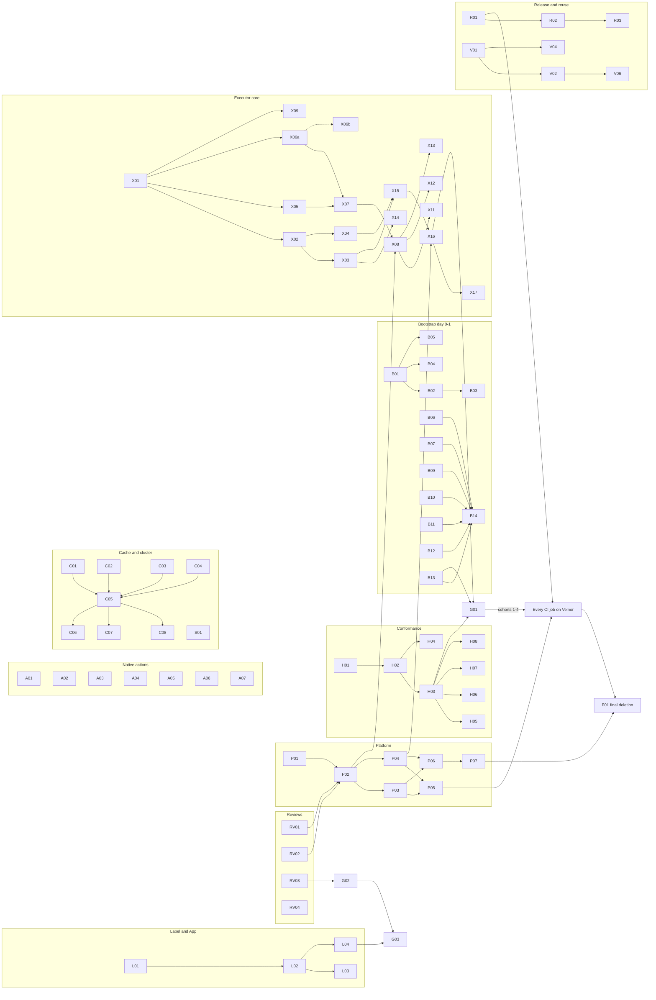

# Velnor delivery plan: the fastest step-by-step path

Status: plan, 2026-11-19. Destination: `docs/research/velnor-runner-2026-11/delivery-plan.md`. It feeds the
final design's phases. It follows owner decisions 1-12 (the Rust-only brief) and 13-18
(`manager/owner-decisions-late.md`):

- 13: one platform-agnostic core with Docker and Kubernetes backends;
- 14: legacy is ported only where it is good;
- 15: everything is sized by its real constraint;
- 16: migration is per job type;
- 17: every existing component is reviewed before reuse, velnor-new's own code included;
- 18: migrate and delete, with no fallbacks.

Code was re-read at velnor-new `d6be276a6c` and velnor-legacy `1b9fc038`. Labels: **[M]** measured
(evidence pack), **[E]** estimated (arithmetic shown), **[C]** read from code at the cited path.

## 1. Summary

- **Fleet assumed:** N = 12 builder agents, 4 reviewer agents and 1 orchestrator, running at once
  and around the clock. Only the owner's decisions are human. Section 7.6 explains why more than
  12 builders buys almost nothing.
- **Total work:** about 560 agent-hours of building plus about 100 of review, about 2.3 days of
  fleet time. Coding does not set the dates.
- **What sets the dates (decision 15):**
  - (a) velnor-new's own CI and merge queue, which every agent PR passes through;
  - (b) review gates and owner decisions, including engine releases;
  - (c) conformance evidence, counted in replayed job pairs and clean comparisons;
  - (d) free cluster capacity, GitHub API limits, and conflicts on shared files.
- **Reuse is decided per component after review (decisions 14, 17).** Where review passes,
  porting and refactoring legacy code costs about 190 agent-hours, against about 450 to write the
  executor and its actions fresh (section 2).
- **Day 0, phase-0 configuration.** This cuts an agent PR's push-to-merge from 85 min [M] to about
  34 min at P50, removes about 17 h of CI waiting from the critical path, and lifts the merge
  ceiling from ~1.3 to ≥ 15 merges per hour (section 3.4).
- **Backends.** The Docker backend gives the first conformance runs on day 1. The Kubernetes
  backend carries production from day 1.7.
- **Every velnor-new CI job on the Velnor executor, or retired:** day 5.5 at P50, day 8.5 at P90.
  Each move deletes the type's old route in the same change. Nothing moves back; a divergence is
  fixed forward (decisions 16, 18).
- **Final deletion milestone, day 7 at P50 (P90 day 10).** It deletes the ARC scale set, the
  official-runner image, velnor-runner-host's official-runner wrapper and their workflows.
- **Committed targets, day 10.5 (P90 day 13.5):** PR verdict P50 ≤ 90 s and P90 ≤ 4 min;
  push-to-merge P50 ≤ 3 min and P90 ≤ 8 min; ≤ 35 runner-min per merged PR; conformance 100% on
  both backends.
- **Stretch targets, measured by day 18:** verdict 30 s / 100 s; push-to-merge 100 s / 4 min;
  ≤ 15 runner-min per merged PR.

## 2. Reuse from velnor-legacy and velnor-new

Nothing is reused by default (decision 17). Each component below has a verdict:

- **port as-is:** sound design and code; moved with its tests;
- **port and refactor:** sound design, but the code is poorly structured (god files, Docker or
  official-runner coupling), so it is moved and reshaped;
- **redesign:** the design does not fit this architecture; it is written fresh, using the old
  code's tests and incidents as cases.

The verdicts below come from this plan's reading. Where a verdict depends on facts not yet
checked, a review item (RV01-RV04) must confirm it before any code moves. Line and test counts:
`wc` and a grep for `#[test]` in `refs/velnor-legacy/crates/velnor-runner/src`; "prod" means the
lines before the first test module.

**Why this is days, not weeks.** velnor-legacy's native lane already did most of what the executor
needs:

- JIT, broker, run-service acquire, renew and complete, and Results;
- expressions, the job model, script steps, commands, composites, post steps and cancel;
- native checkout, artifacts, attest, the App token and mise.

Legacy has 8,222 tests, and 8,172 pass on macOS [M §E.5]. It is "very old legacy" (decision 14):
`executor.rs` (37,028 lines) and `runner.rs` (36,759) are god files, and in September 2026, 60 of
its last 100 commits were fixes [M §E.6]. So the **structure** is redesigned, while the
**functions and tests** are ported. That is still much faster than writing fresh.

### 2.1 velnor-legacy

| Component | Legacy source (lines, tests) | Verdict, reason | Coverage | Strip | Adapt | Genuinely new | Agent-h port / fresh |
|---|---|---|---|---|---|---|---|
| Scale-set admin client and session | `scaleset/client.rs` 1,488 (13), `session.rs` 667 (8), `listener.rs` 857 (3) | Port and refactor: mirrors ARC's Go client faithfully; needs App auth | ~85% | — | App installation auth; ≤ 1% idle-CPU budget (#408) | Pre-acquired JIT pool | 6 / 20 |
| Scale-set lane: scaling, demand, workers | `scale.rs` 2,797, `demand.rs` 2,326, `lane.rs` 4,710, `worker/*` 4,813 | **Redesign:** built around official-runner containers plus dind (`worker/runner.rs` runs `run.sh --once`) | ~0% | Everything | — | Dispatcher placement through the platform trait | — / 16 |
| Broker, run service, Results | `protocol.rs` 18,419 (~10.2k prod, 154 tests): acquire 63 refs, renew 10, complete 12, steps update 8 [C] | Port and refactor: correct calls, but one 18k-line file | ~85% | 13 `_apis/distributedtask` paths, `pools/*/messages`; diff v2.337 → v2.338.x | Split into ≤ 400-line files; renew loop fresh (upstream null-deref) | String scan for banned endpoints | 14 / 74 |
| Job-message model | `job_message.rs` 6,799 (4.3k prod, 61) | Port and refactor: faithful shapes, one file | ~90% | — | Split | Executing `BackgroundStepControl` (legacy refuses it, `runner.rs:2654`) | 4 / 20 |
| Expression engine | `expression/` 3,565 (41) | **Port as-is** (branch A): a clean lexer, parser and evaluator, faithful to DTExpressions2 | 100% (A) | — | `hashFiles` native | Branch B, see 2.4 | 3 / 28 |
| Job orchestration: step loop, job state | `executor.rs` (16.7k prod, 356 tests), `runner.rs` (409 tests) | **Redesign:** god files mixing Docker, cache, telemetry and adapters. Rewrite the step loop after upstream `StepsRunner`; port the 765 tests as cases | ~30% (tests) | Docker job containers | — | New `velnor-exec` state machine | 16 / 30 |
| Templates, contexts, env | Functions in `executor.rs` | Port and refactor at function level | ~70% | Container env plumbing | Process env inside a sandbox | Byte-equal env corpus | 8 / 30 |
| Script steps, conditions, outcomes | `script_step.rs` 2,160 (30), `execution/step_conditions` 364, `step_outcome` 227 | Port and refactor | ~80% | `docker exec` | Run through the platform trait | — | 6 / 20 |
| Workflow and file commands | `workflow_command.rs` 1,521 (26), `command_files.rs` 481 (14) | Port as-is: small, well tested | ~95% | — | — | — | 3 / 14 |
| Post steps and cancel | `cancel.rs` 1,865 (19), `post_drain.rs` 346 | Port and refactor | ~80% | Docker kill paths | SIGINT, then SIGTERM after 7.5 s, then kill through the trait | — | 6 / 16 |
| Masking | Inside `workflow_command.rs` and `runner.rs` | **Redesign:** scattered, encodings incomplete | ~30% | — | — | One Aho-Corasick masker with all upstream encodings | 6 / 8 |
| Composites, admission, closed set | `action.rs` 6,978 (77), `admission.rs` 3,163 (42), `manifest.rs` 3,841 (57) | Port and refactor the metadata parsing; **redesign** admission (manifest schema v15 and 26 adapters → a closed set from velnor-gen's qualified SHAs) | ~60% | JavaScript runtimes (`executor.rs:654`), Docker actions, 20 unused adapters | — | Qualified-SHA admission | 8 / 24 |
| Background steps | none | — | 0% | — | — | Port `BackgroundStepCoordinator.cs` (394 lines); ci.yml has 105 `background: true` and 29 `wait-all` [C] | 8 / 8 |
| Crash safety | `fault_injection.rs` 914 (13) | Port and refactor | ~50% | — | Fault points in the new state machine | Kill-at-every-boundary suite | 4 / 8 |
| Docker and Firecracker backends | `docker/` 11,984, `docker_lease.rs` 21,607 (a socket proxy injecting labels; BuildKit hangs, #348), `container.rs` 5,425, Firecracker 1,339 | **Redesign:** the proxy design caused hangs; Firecracker is not needed now | ~5% | All | — | See 2.3 | — / 14 |
| checkout | `checkout.rs` 5,128 (61), `git_mirror.rs` 1,613 (18) | Port and refactor | ~80% | — | Mirror alternates; `fetch-depth: 0` | `sparse-checkout` (legacy refuses it) | 8 / 24 |
| Artifacts v4 (upload v7, download v8) | `executor.rs:10351-10760` plus `ArtifactService` | Port and refactor | ~70% | Same-host fallback | Per-run scope (#671); read back (#311) | v7/v8 inputs | 6 / 16 |
| Cache v2 | `gha_cache.rs` 17,140 is a **server** | **Redesign:** we need a client | ~30% (message types) | v1 | — | Twirp client and blob transfer | 8 / 12 |
| mise-action | `native_mise` (`executor.rs:5164`) | **Redesign:** it installs into a container; we mount a read-only store | ~20% | — | — | Store-backed `PATH` and env | 4 / 6 |
| mr-boxington-action, alint, setup-velnor | none | — | 0% | — | — | Thin native adapters | 6 / 6 |
| attest | `attestation.rs` 692 (sigstore-sign) plus `native_attest_build_provenance` | Port as-is (signing), refactor the adapter | ~80% | — | OIDC from the job | Generic `actions/attest` forms | 6 / 20 |
| create-github-app-token | `native_create_github_app_token` plus revoke | Port as-is | ~90% | — | — | — | 3 / 8 |
| Caches and trust stores | `mbx_store.rs` 1,870, `stable_workspace.rs` 4,443, `stale_trust_scope.rs` 6,284 | **Redesign:** host-persistent stores with GitHub-lane coupling | ~10% | All | — | Reflink snapshots and tool store | — |
| Harness inputs | `velnor-bench` 13,958 | **Redesign:** not differential | ~5% | — | — | Section 3, stream H | — |

### 2.2 velnor-new's own components (decision 17)

| Component | Source | Verdict, reason | Review item |
|---|---|---|---|
| `velnor-runner-github` (6,878 LOC of pure scale-set wire types, pinned to `actions/scaleset` e6daac70) | `crates/velnor-runner/crates/velnor-runner-github` | Port and refactor, pending review: no HTTP coupling, which is good; it carries official-runner lifecycle states | RV01 |
| `velnor-runner-core` (719 LOC: lifecycle, `CleanupProof`, `OwnedIds`) | `velnor-runner-core` | Port and refactor: the tri-state "unknown is never absent" rule is right; open defects #1143 (`covers` accepts a short id) and #1142 (`reserve` replaces a live slot) become tests | RV01 |
| velnor-host launch state machine, official-runner pair, JIT-to-`Runner.Listener` delivery, job-start hook | `velnor-runner-host/src/launch/*`, `local/*`, `velnor-resource-probe` job hook | **Redesign, then delete** (decision 18): it is the official-runner wrapper | — |
| velnor-host journal (Turso, ~35 schema modules) | `velnor-runner-host/src/journal*` | **Redesign:** schema bound to the official-runner lifecycle; `Journal::open` drives the 125-138 s test floor [M]; open defects #1303, #1206. Keep the discipline (persist intent, call, record), not the code | RV01 |
| velnor-host Docker client and spec audit (`docker_client` over a unix socket only; `docker_spec::audit_plan` forbids host mounts and the outer socket) | `velnor-runner-host/src/docker_*` | Port and refactor into the Docker backend, pending review: the audit rules are valuable; the call sites are spread over ~50 files (#1324 §1) | RV01 |
| Daemon lock, launchd service, keychain credential | `daemon_lock`, `plist`, `keychain` | Port and refactor for the Docker backend on macOS, pending review | RV01 |
| `Runtime` trait proposed in #1324 (`Observation{Present, AbsentProven, Unknown}`, Pod-UID proof mapping) | PR #1324, design only | Port and refactor into the platform trait: the observation model is right; `create_worker`, `deliver` and the JIT secret serve the official-runner pair and are dropped; warm pool, capabilities and exec plus log streaming are added | RV02 |
| `velnor-ci` (plan, gate, report, `inputs restore` mtime rule) | `ci-helper/` | Port and refactor: `gate.rs` must read the App check, not an Actions job (`gate.rs:15,127-159`) | RV03 |
| `velnor-gen` | `generator/` | Port and refactor: it is the generator of record, but it has one `runner` for all jobs (`velnor-rust/src/plan.rs:344`) and hosted runners hard-coded for release (`release.rs:157,172`, `release_binaries.rs:188,222`) | RV03 |
| Engine `velnor-actions` (orchestrator 186.8k, renderer 88.7k lines) and today's 39-job `ci.yml` | `crates/velnor-actions-*`, `.github/workflows` | **Redesign:** a 39-job, 3-runs-per-merge shape. Replaced by velnor-gen's one-job workflow (G03), which deletes velnor-new's engine-generated CI. Until G03, the engine gets only phase-0 config changes | — |
| `velnor-local` (runner.server stand-in, mitmproxy recorder, scenarios) | `local/` | Port and refactor the recorder and scenarios into the harness; **redesign** local runs onto the Docker backend (P07), deleting `--runner pair` and `plain` | RV04 |

**Totals for the executor and actions** (rows from the scale-set client through create-github-app-token):

- port: about 190 agent-hours, against about 450 to write fresh;
- the redesigned parts (orchestration, masking, admission, mise, cache client, Docker backend)
  are written fresh, but against more than 1,000 ported tests used as cases.

**Freeze the old runner now (decision 16, D13).** The ~35 open velnor-runner-host PRs
(#1249-#1359 [M §D.10]) improve code that the final milestone deletes. They are parked. That
frees review capacity and queue slots on day 0.

### 2.3 The platform trait and the two backends (decision 13)

**Trait `velnor-platform`.** The core (protocol, expressions, steps, actions, caches, ledger,
label flow) never names a backend. The trait covers:

- provisioning, with a warm pool;
- mounts for caches and work dirs, chosen by capability;
- process execution and log streaming;
- limits, cancellation and teardown;
- crash recovery and ownership proofs with tri-state observations;
- `capabilities()`: reflink, shared page cache, privileged dind, network policy, cgroup kill.

A missing capability selects a slower but correct path:

- copy instead of reflink;
- refusing Docker-class jobs instead of running them unsafely;
- killing the container instead of `cgroup.kill`.

| Backend | Runs | Comes first for | Base after review |
|---|---|---|---|
| **Docker** (P03) | Containers on one host: macOS Docker Desktop or any Linux Docker host | **First conformance runs (day 1)**: no RBAC, pod pool or cluster deploy needed; runs on any lab host or a developer Mac | velnor-host's Docker client and audit rules if RV01 passes; legacy `docker_lease` is not used |
| **Kubernetes** (P04) | Pods on the Hetzner k3s cluster, warm pods, node stores | **Production** (cohort 1 on day 1.7) | #1324's proof mapping (Pod UID, `preconditions.uid`) via RV02 |

Conformance runs per backend (P06). A job type moves in production when it passes on Kubernetes.
The Docker backend must pass the same corpus before local runs are advertised (P07).

### 2.4 The evaluator question (Q4): both branches

**What upstream actually runs.** Read in the official runner:
`Runner.Worker/ExecutionContext.cs:1551-1564`.

- By default, the runner builds `PipelineTemplateEvaluator` (DTExpressions2) under the comment
  `// Legacy`.
- Under `CompareWorkflowParser`, `PipelineTemplateEvaluatorWrapper` also runs the new evaluator but
  returns `_legacyEvaluator`'s result (`:115-199`, `:224-238`).

So legacy's transcription **is** upstream's "Legacy" evaluator, and it is also what production
jobs see today. Decision 3 bans it; decision 2 demands oracle-equal behaviour.

- **Branch A (critical path):** port `expression/` as-is (X06a, 3 h). It is oracle-equal by
  construction, and the corpus proves it.
- **Branch B (parallel):** port `Sdk/Expressions` plus `WorkflowParser` (X06b, about 28 h, a strong
  model), checked against the oracle in compare mode.
- **D4, by day 3.** The owner picks one. Under decision 18, only the chosen evaluator ships; the
  other is deleted, not kept as a fallback.
  - If A: B is deleted, and is redone when GitHub flips the wrapper.
  - If B: B must pass the full corpus before cohort 2, and A is deleted in that change.
  - B has been built in parallel since day 1, so the dates do not move.

### 2.5 Legacy defects that become regression tests (X17)

| Legacy incident [M §E.6] | Test |
|---|---|
| #389: slots "supervising" then silent, never registered; 9 daemons | Every warm JIT identity completes a broker poll within 30 s or is recycled; killing a session mid-registration re-registers and alerts |
| #329: job container dies; `exec` hangs on "container is not running" | Kill the sandbox mid-step on each backend: an infrastructure failure within 30 s, never a hang |
| #408: 600-700% idle CPU, JIT reconfig loops, broker 409s, poll 404s | 10-min idle soak at ≤ 1% CPU; injected 409/404/5xx get bounded backoff; single-instance lock |
| #670: a rerun poisons log ownership across attempts | Corpus "re-run failed jobs": attempt-2 ids, equal to the oracle |
| #671, #311, #672: artifact name collisions, lost uploads, lost logs of failed jobs | Concurrent same-name uploads; read-back after finalize; a planted failure's logs are visible |
| #275: an interrupted compile poisons the persistent mise store | The tool store is read-only; a write gets `EROFS` |
| #327 and velnor-new #1005, #1142: stuck or replaced slots across drain or cancel | Drain while queued, cancel mid-acquire: no stuck slot, no double report |

## 3. The dependency graph

### 3.1 Conventions

- **Size:** agent-hours of building, excluding review.
- **Classes:** strong (Opus 5.5, GPT-6.x high) for judgement; mid (Sonnet 5.5, GPT-6.x medium,
  Gemini Pro-class) for port, refactor and plumbing; cheap (Haiku 5.5, Gemini Flash-class, Muse)
  for mechanical work, config and case generation.
- **Deletes:** what the item removes in the same PR (decision 18). The rule: the item that moves
  or replaces the last user of something deletes it.
- **Location:** new code lives in a new Cargo root `executor/`.

### 3.2 Work items

**B: bootstrap (phase-0 configuration), day 0-1**

| ID | Title | Scope | Depends on | Agent-h | Class | Verification | Unlocks | Deletes |
|---|---|---|---|---|---|---|---|---|
| B01 | Owner decision pack | D1-D3, D6-D9, D13 with defaults, answered in one sitting | — | 1 | strong | Recorded in an issue | B02-B05, H01, C-items | — |
| B02 | Release velnor-actions 0.1.81 | Dispatch the release prepared in #1345; bump the lock | D1 | 1 | cheap | Asset sha256 equal to the lock | B03 | 0.1.80 lock entries |
| B03 | Gate jobs off hosted runners | Overrides for plan, alint, cargo-deny, cargo-machete, jactionlint, ledger-cli, required, required-gate; regenerate. At HEAD these 8 are still `ubuntu-26.04` [C `ci.yml:63-616`] | B02 | 1.5 | mid | 0 CI jobs on a hosted label in 50 runs; hosted queue on the critical path p90 ≤ 1 min | 5.8-57 min less per run [M T5] | Hosted placement of these 8 jobs |
| B04 | Merge procedure | Auto-merge at creation; no "0 behind main" or catch-up merges | D2 | 0.5 | cheap | ≥ 90% auto-merge; green to enqueue P50 ≤ 30 s | Queue (3.4) | The HANDOFF §4.6 rule and catch-up merges |
| B05 | Ruleset | Depth 2 → 4, timeout 90 → 30 min, min wait 0, bound to integration 15368 | D3 | 0.25 | owner | Read-back; merges per hour | Throughput | Unbound required checks |
| B06 | No `edited` | Remove from `pull_request` types | — | 2 | mid | A body edit creates 0 runs | 18.3% of PR runs [M] | `edited` and the "don't edit PR bodies" agent rule |
| B07 | Interim label flow | Triggers `labeled`, `unlabeled`, `synchronize`, `reopened`; Plan fails closed with "CI not requested" without the label | — | 4 | strong | Lab: unlabelled is red and cannot merge; label starts a run ≤ 5 s; removal cancels | 45% cancelled [M] | Fork twin `required-gate-fork` and fork fence (decision 8) |
| B08 | Cancel stall | `always()` gates on the cluster; measure | B03 | 2 | mid | Supersede first-job wait p90 ≤ 30 s (626 s [M]) | Pushes | — |
| B09 | Push run reduced | Plan plus a `Required` checking the exact-SHA merge group; otherwise a full run | — | 4 | strong | `release-gate` passes; ≤ 2 runner-min per push | −62 runner-min per merge [M] | Duplicate push-run obligations |
| B10 | macOS paused | Remove Darwin release legs, `macos-arm64` tools, mac-proof, homebrew macOS; Linux-only lock | — | 4 | mid | 0 `macos-*` jobs; Linux dry run | Releases ~104 → ~27 min [M Sol] | Darwin jobs, `.github/actions/generator-release-*-macos*` (4 composites), darwin lock entries, macOS release code paths in the renderer |
| B11 | Narrow per-push workflows | job-image-candidate on `images/**`, `main` and dispatch; source-qualification in the group or on dispatch | — | 2 | mid | 306 → ≤ 10 and 267 → ≤ groups per day [M T11] | Capacity | Per-push triggers |
| B12 | No `-j2` caps | Remove compiler and test budgets and `build.jobs=2` | — | 1 | cheap | maintenance-helpers 8.5 → ≤ 5 min; no OOM in 50 runs | Verdict | The caps |
| B13 | Per-job profiles | Overrides for crate and check jobs; `native` profile, label `velnor-native` | — | 3 | mid | Golden moves only the named job | G01 | — |
| B14 | Release 0.1.82 and regenerate | B06-B13 in one engine release | B06-B13, D9 | 1 | cheap | Freshness passes | Day-1 CI | — |
| B15 | Daily report | Push-to-merge, label-to-verdict, queue, merges per hour, runner-min (incl. cancelled), per-type durations, per-backend conformance; ETag reads | — | 6 | mid | Reproduces 85-min baseline | Milestones | — |

**RV: reviews before reuse (decision 17)**

| ID | Title | Scope | Depends on | Agent-h | Class | Verification | Unlocks | Deletes |
|---|---|---|---|---|---|---|---|---|
| RV01 | Review velnor-host for the Docker backend | Docker client and spec audit, ownership proofs, daemon lock, launchd and keychain, journal; verdict per part with reasons and defect links | — | 6 | strong | A verdict table merged into the design doc | P02, P03 | — |
| RV02 | Review the #1324 `Runtime` trait | Keep the observation model; drop pair-specific calls; specify warm pool, capabilities and exec | — | 3 | strong | Trait sketch approved | P02 | — |
| RV03 | Review velnor-ci and velnor-gen | `gate.rs`, the planner, the mtime rule, the runner model, hosted release labels | — | 4 | strong | A verdict table | G02, L04, R01 | — |
| RV04 | Review velnor-local | Recorder and scenarios for the harness; the local-run path | — | 3 | mid | A verdict table | H04, P07 | — |

**P: platform trait and backends**

| ID | Title | Scope | Depends on | Agent-h | Class | Verification | Unlocks | Deletes |
|---|---|---|---|---|---|---|---|---|
| P01 | Capability model | `capabilities()` and the fallback table (reflink → copy; no dind → refuse Docker class; no cgroup kill → container kill) | RV02 | 3 | strong | Each fallback has a test that turns the capability off | P02 | — |
| P02 | `velnor-platform` trait | Provision with a warm pool, mounts, exec and log stream, limits, cancel, teardown, recovery, tri-state ownership proofs | RV01, RV02, P01, X01 | 8 | strong | A conformance kit every backend must pass | P03, P04 | — |
| P03 | Docker backend | bollard, unix socket only; warm containers; spec audit; macOS and Linux | P02 | 12 | mid | Kit passes on Linux and macOS Docker; first lab jobs run | Day-1 conformance, P07 | — |
| P04 | Kubernetes backend | kube-rs; warm pod pool; node-store mounts; Pod-UID proofs with `preconditions.uid`; no token on job pods | P02, D8 | 14 | strong | Kit passes; pod-to-first-step ≤ 1 s with a warm pool | X16, production | — |
| P05 | Docker-class capability | Kubernetes: tainted nodes with a dind sidecar; Docker: host daemon socket proxy refused, dind container instead | P03, P04 | 6 | mid | 3 Docker test binaries pass on both | Cohort 3, images | — |
| P06 | Per-backend conformance | The harness runs the corpus on each backend; the report is split by backend | P03, P04, H03 | 3 | mid | Both backends shown daily | Gates | — |
| P07 | Local runs on the Docker backend | velnor-local drives the native executor through the Docker backend | P06, RV04 | 10 | mid | Local scenarios pass with oracle-equal results | F01 | velnor-local `--runner pair` and `plain`, the runner.server stand-in, official runner use in `local/` |

**X: executor core**

| ID | Title | Scope | Depends on | Agent-h | Class | Verification | Unlocks | Deletes |
|---|---|---|---|---|---|---|---|---|
| X01 | Root and port checker | `executor/` skeleton, line budget, a function-hash provenance checker | — | 4 | mid | Fails on one changed token | Ports | — |
| X02 | Broker and JIT | JIT config, RSA token, broker session, poll, ack (port and refactor) | X01 | 6 | mid | Lab transcripts replay; string scan clean | X03, X04 | — |
| X03 | Acquire, renew, complete | Fresh renew loop | X02 | 4 | strong | Faults until `lockedUntil` + 5 min; 404/409 on complete means done | X16 | — |
| X04 | Results | Steps update, logs, summaries, feed | X02 | 6 | mid | Seal-before-complete ordering | X16 | — |
| X05 | Job model | Port and refactor, plus background control | X01 | 4 | mid | 61 tests; 20 lab messages, 0 unknown fields | X07 | — |
| X06a | Expressions A | Port as-is | X01 | 3 | cheap | 41 tests; expression corpus 100% | X07 | Branch B if D4 = A |
| X06b | Expressions B | Port the new evaluator | X06a | 28 | strong | ≥ 50k fuzzed equal in compare mode | D4 | Branch A if D4 = B |
| X07 | Templates and contexts | Port and refactor | X05, X06a | 8 | mid | Env byte-equality | X08 | — |
| X08 | Job state machine and steps | **Redesign** the step loop after `StepsRunner`; port script steps and conditions | X07, P02 | 16 | strong | 765 legacy executor and runner tests as cases; status × needs corpus | X11-X13 | — |
| X09 | Commands | Port as-is | X01 | 3 | cheap | 40 tests; file-command corpus | X08 | — |
| X10 | Masker | Redesign | X04 | 6 | strong | One planted leak per encoding caught | Gates | — |
| X11 | Post steps and cancel | Port and refactor through the trait | X08 | 6 | strong | Order and timing equal to the oracle | Rust | — |
| X12 | Composites and admission | Port parsing; redesign admission | X08 | 8 | mid | 134 `declared-task-0` runs; unknown actions refused | Rust | — |
| X13 | Background steps | New port | X08 | 8 | strong | Group order, failure, cancel equal | Rust | — |
| X14 | Journal and faults | New append-only job journal; port the fault points | X03 | 8 | strong | Kill at every boundary: no double report | Cohort 1 | — |
| X15 | Executor image and deploy | Image built on `main`, digest-pinned and attested; deploy to `velnor-system` | X03, X04, D8 | 4 | mid | One real job green in production label | Moves | — |
| X16 | velnor-dispatch | Port the session client; redesign scaling over the trait; pre-acquired JIT; placement before acquire | X15, P04 | 12 | strong | Start ≤ 2 s P90; idle ≤ 1% CPU; 0 lost jobs under faults | Cohort 1 | — |
| X17 | Legacy-incident suite | Section 2.5, on both backends | X16, P03 | 6 | mid | All pass; each fails on a planted reintroduction | Cohort 1 | — |

**A: native actions**

| ID | Title | Scope | Depends on | Agent-h | Class | Verification | Unlocks | Deletes |
|---|---|---|---|---|---|---|---|---|
| A01 | checkout | Port and refactor; sparse checkout, `fetch-depth: 0`, mirror alternates | X08, C03 | 8 | mid | Equal tree and `.git` state; ≤ 1 s warm | Plan, Rust | — |
| A02 | Artifacts v4 | Port and refactor | X04 | 6 | mid | Digests equal; read-back | Verdict, Rust | — |
| A03 | Cache v2 client | Redesign | X04 | 8 | mid | Hit and miss equal on 20 keys | Plan, Rust | — |
| A04 | mise-action | Redesign over the store | C01 | 4 | mid | Same `PATH`, env and outputs | Gates | — |
| A05 | mr-boxington, alint, setup-velnor | New thin adapters | C01 | 6 | mid | Equal output | Lints, Rust | — |
| A06 | Attest | Port signing; refactor the adapter | X10 | 6 | strong | `gh attestation verify` passes | State seal, release | — |
| A07 | App token | Port as-is | X10 | 3 | mid | Works, masked, revoked | Release | — |
| A08 | Replace github-script | 3 uses → `velnor-ci` subcommands | — | 4 | mid | Equal results | Release | The 3 `actions/github-script` uses |
| A09 | Closed-set lint | Generators emit only qualified actions at qualified SHAs | — | 4 | mid | Unqualified SHA fails a golden | Drift guard | — |

**H: conformance harness**

| ID | Title | Scope | Depends on | Agent-h | Class | Verification | Unlocks | Deletes |
|---|---|---|---|---|---|---|---|---|
| H01 | Lab | velnor-lab with the **upstream** official runner (latest release) as the oracle, started by a lab-only launcher, beside Velnor on both backends | D6 | 4 | mid | Both sides serve a hello job | H02 | — |
| H02 | Transform and replay | Paired `<job>__oracle` and `<job>__velnor` jobs in one run; replay real commits | H01 | 8 | mid | 10 paired replays | Evidence | — |
| H03 | Comparator | Conclusions, steps, outputs, annotations, normalised logs, artifact digests, cache entries, env | H02 | 10 | strong | Identical pairs show 0 diffs | Gates | — |
| H04 | Corpus v1 | 300 cases, seeded from the 1,000+ ported tests and RV04's scenarios | H02 | 16 | cheap + strong | Every case runs on both sides | Gates | — |
| H05 | Mutants | 12 planted faults | H03 | 4 | mid | 12/12 caught | Trust in H03 | — |
| H06 | Release watcher | Hourly release poll, protocol diff, 63-day window, unknown-field alert | H03 | 4 | cheap | A synthetic release triggers a run | Drift | — |
| H07 | Drift sampler | Replay a sample of production runs per moved type; a divergence opens a P0 fix-forward issue | H03 | 5 | mid | A planted divergence opens an issue ≤ 15 min | Fix forward | — |
| H08 | Flake-aware pairing | Re-run both sides before calling a diff | H03 | 3 | mid | A planted flake is not called a divergence | Clean evidence | — |

**L: label flow and App check; G: workflows**

| ID | Title | Scope | Depends on | Agent-h | Class | Verification | Unlocks | Deletes |
|---|---|---|---|---|---|---|---|---|
| L01 | Lab proofs | Q1, Q3, Q8, Q9, Q14 settled with run ids | H01 | 4 | mid | Run ids recorded | L02 | — |
| L02 | Velnor App | Webhook ingress, label state machine, check `Velnor / Required` ("Not requested" while unlabelled) | L01, D7 | 12 | strong | 50 lab pushes: webhook P50 ≤ 2 s; unlabelled stays blocking | L04, V01 | — |
| L03 | Reconciler | 30-s reconcile and redelivery | L02 | 4 | mid | A killed webhook still gives a verdict ≤ 30 s | Robustness | — |
| L04 | Ruleset switch | `gate.rs` reads the App check; the owner switches the ruleset | L02, RV03, D7 | 8 | strong | Release gate on `main`; an Actions `Required` cannot satisfy the rule | Pending, not red | The interim fail-closed Plan step (B07), the Actions `Required verdict` and `Required` jobs, `gate.rs`'s Actions-job lookup |
| G01 | Cohort moves | One config PR per cohort, routing the jobs to `velnor-native` | B13, X16, H03 | 6 (6 × 1) | cheap | The cohort's jobs run on Velnor | Migration | The cohort's ARC (`local`) and B03 overrides; generated steps that only ARC needs (tool seed and prelude, restored-rust and manifest verification, tools cache restore and scrub, the state-snapshot restore and recover steps) as their last user moves |
| G02 | Routing in velnor-gen | Per-job-type runner map | RV03 | 4 | mid | Golden with mixed labels | G03 | Hosted labels hard-coded in `release.rs` and `release_binaries.rs` |
| G03 | velnor-gen cutover (#1290) | Rust part, one `Required` job, with parity | G02, L04 | 16 | strong | 100-run inventory parity | One job | Engine-generated `ci.yml` and the engine's velnor-new config sections (`.velnor/config.toml` stacks, checks, execution) |

**C: cache, T: test floor, S: cluster**

| ID | Title | Scope | Depends on | Agent-h | Class | Verification | Unlocks | Deletes |
|---|---|---|---|---|---|---|---|---|
| C01 | Tool store | Read-only node store keyed by the pins (Kubernetes); a read-only volume (Docker) | D8 | 6 | mid | Set-up ≤ 0.1 s; `EROFS` on write | A04, A05 | — |
| C02 | Crates store | Mirror plus a read-only registry per lockfile | D8 | 4 | mid | 0 downloads on a hit | Rust | — |
| C03 | Git mirror | Node and site mirror fetched on the webhook | D8 | 4 | mid | Fetch ≤ 0.5 s | A01 | — |
| C04 | XFS volumes | Work volumes with project quotas | D8 | 6 | mid | Quota enforced | C05 | ext4 emptyDir work dirs |
| C05 | Warm snapshots | `main` snapshot at `/w/velnor-new`, reflink (copy fallback), mtime rule, builder per site | C04, P01 | 12 | strong | Unchanged tree compiles 0 crates; an older-mtime edit is rebuilt | Verdict | — |
| C06 | Reproducibility audit | One commit cold on 2 nodes vs warm; test-binary digests | C05 | 4 | mid | Equal, or the crate is listed | Soundness | — |
| C07 | mbx-cache head-to-head | Kill rule | C05 | 6 | mid | Measured; kept or deleted | Cold nodes | mbx-cache if it loses |
| C08 | Retire GitHub-cache caching | — | C05, cohort 4 | 3 | mid | 0 restores needed | −19.7 runner-min per push | `state-seal.yml`, `cache-prune.yml`, the cache-family and seal code in the engine contract, `mbx cache import/export` steps |
| T01 | Journal template | Land #1333 and #1349 | — | 4 | mid | `Journal::open` ≤ 1 s | Runner-host tests | — |
| T02 | Loop splits | 40/12/10/6/4-case loops; prefix clones | — | 6 | mid | No test over 60 s outside a list | P90 | The serial loops |
| T03 | Parallel helper tests | ci-helper and archive-guard tests in parallel | — | 4 | mid | ci-helper ≤ 10 s | P90 | `test-threads = 1`, `threads-required` |
| T04 | Fixture and profile | Fold the 89-s fixture; four-way `opt-level` × assertions | — | 6 | mid | Numbers for D11 | Test CPU | The separate fixture build |
| S01 | Cluster policy | Priority classes (merge > PR > replay), reservations, PID limits, per-org quotas | D8 | 4 | mid | No OOM in a week; replay pre-empted first | Safe replay | — |

**R: release, V: verdict reuse, F: final deletion**

| ID | Title | Scope | Depends on | Agent-h | Class | Verification | Unlocks | Deletes |
|---|---|---|---|---|---|---|---|---|
| R01 | Release jobs on Velnor | Environments, OIDC, App token; 3 lab dry runs per workflow | A06, A07, G02 | 6 | strong | Dry-run assets equal; tag published | Cohort 4 | Hosted release placement |
| R02 | Build once, promote | Bytes from the merge group or `main`, promoted by digest; `VELNOR_COMMIT` per D12 | R01, V01 | 16 | strong | 0 crates compiled at tag; digests equal the receipt | Release minutes | Tag-time `cargo build` jobs and the per-push source-preview rebuild |
| R03 | Smoke shipped bytes | x86_64; aarch64 under qemu | R02 | 4 | mid | Smoke on the published digest | Confidence | `--version`-only checks |
| V01 | Exact-tree reuse | Rebase-only push instant; equal-tree merge group is a lookup | L02 | 8 | strong | A forged report mints 0 receipts | Push-to-merge | B09's push-run `Required` check (subsumed) |
| V02 | Per-root receipts | Shadow, then on after 3,000 clean comparisons | V01, C06 | 20 | strong | 0 disagreements in 3,000 (≈ 0.1% bound at 95%) | Committed | — |
| V03 | Flake sampler | 300 paired reruns | B15 | 3 | cheap | Rate with an interval | D10 | — |
| V04 | Queue-tip speculation | Shadow, then on; ALLGREEN | V01, D10 | 8 | strong | ≥ 70% match over 50 merges, else deleted | Group time | HEADGREEN setting |
| V05 | Cold audit | Every landed commit within 6 h | C05 | 6 | mid | A planted stale result is caught | Soundness | — |
| V06 | velnor verify (stretch) | Pre-push verify in the sealed sandbox, on either backend | V02 | 10 | strong | Verdict ≤ 10 s after a preflighted push | Stretch | — |
| F01 | Final deletion | After cohort 4 and P07 | cohort 4, P07 | 8 | mid | No official runner anywhere outside the lab oracle; `rg` finds no references | Done | ARC's tailrocks scale set (Helm release) and the `local`/`hosted` execution profiles; `images/runner`, `images/dind`, `images/resource-probe` and `.velnor/runner.lock` (the official-runner image); velnor-runner-host's official-runner wrapper (`launch/*`, `local/*` pair mode, job-start hook, `velnor-resource-probe`, `velnor-runner-qualification`, `velnor-runner-image-manifest` runner parts); `qualification.yml`; Turso journal; the rest of `crates/velnor-runner` once RV01's ported parts live in `executor/` |

84 items: about 560 agent-hours of building plus about 100 of review (~90 PRs × 0.7 h, plus 25
strong reviews × 1.5 h).

### 3.3 Owner decisions

| ID | Decision | Needed by | Default |
|---|---|---|---|
| D1 | Dispatch velnor-actions 0.1.81 (#1345) | h0 | — |
| D2 | No "0 behind main" or catch-up merges; auto-merge on | h0 | — |
| D3 | Ruleset depth 4, timeout 30, min wait 0, bound to 15368 | h2 | Depth 3 |
| D4 | Evaluator A or B (2.4); the other is deleted | day 3 | A |
| D6 | velnor-lab runs the upstream oracle and Velnor on cluster capacity | h6 | — |
| D7 | Velnor App (`checks: write`, a public webhook endpoint); the ruleset switch | day 2 | The interim red gate until then |
| D8 | Deploy identity for `velnor-system`; node changes (XFS, reservations, taints) | h6 | — |
| D9 | Pre-approve CI-only engine releases | day 0 | One approval each |
| D10 | Two or three pre-merge executions; HEADGREEN → ALLGREEN | day 7 | Two; ALLGREEN after V04 |
| D11 | Per-type cutover criteria in counts (section 5) | day 1 | — |
| D12 | Where release bytes are built; `VELNOR_COMMIT` | day 6 | Merge group |
| D13 | Park the ~35 open velnor-runner-host PRs; no new investment in the official-runner path | h0 | — |
| D14 | Whether the engine crates are deleted from velnor-new after G03 (other consumers?) | day 8 | Out of this plan |
| D15 | A bad Velnor release is recovered by deploying the previous immutable image digest (a deploy, not a code fallback); an executor-wide outage allows an admin merge of the fix with lab conformance evidence | day 1 | — |

### 3.4 What the phase-0 bootstrap buys the rest of the plan

An agent PR's cycle (two verdicts, one review-fix round):

| | Verdicts | Catch-up re-run | Green to enqueue | Merge group | Merge | Per PR, P50 |
|---|---|---|---|---|---|---|
| Today [M] | 2 × 26.7 | 0.47 × 26.7 = 12.5 | 7.5 | 19.9 | 0.75 | **94 min** (P90 > 5 h) |
| After day 0 [E] | 2 × 11 (fan-out 8.4-10.7 [M T5] plus gates without hosted queue) | 0 | 0.5 | 11 | 0.75 | **34 min** (P90 ≈ 60) |
| After day 2 [E] | 2 × 7 | 0 | 0.5 | 7 | 0.75 | 22 min |
| After day 4 [E] | 2 × 4 | 0 | 0.5 | 4 | 0.75 | 13 min |
| After day 8 [E] | 2 × 2 | 0 | 0.1 | 1 (lookup) | 0.75 | 6 min |

**Critical path.** About 14 dependent PRs.

- At today's rate: 14 × 94 min ≈ 22 h of CI waiting at P50 (over 70 h at P90).
- With phase 0 first: 2 PRs at the old rate, then 4 × 34 + 4 × 22 + 4 × 13 min ≈ 5 h.
- **Saved: about 17 h at P50 and about 60 h at P90.**

**Merge throughput.**

- Under the "0 behind" rule, merges are serial at one per 47 min (verdict plus group), about
  **1.3 per hour**. That is shared with the ~50 merges a day other velnor-new work lands [M: 159
  green groups over 11-16..18].
- B04 and B05 give depth 4 at ~11-min groups: about 22 per hour, less the 29% of groups disturbed
  at today's 8.1% false failure. That is **≥ 15 per hour**.
- D13 also removes ~35 runner-host PRs from the queue and the review load.

**Cluster capacity.** B06, B07, B09 and B11 roughly halve load [E: 285-347 → ≤ 170 runner-min per
merged PR]. The freed capacity pays for lab replay in days 1-4.

**Order rule.**

- Phase 0 lands with admin merges, as the owner's 2026-11-19 policy allows for a fix for the CI
  bottleneck itself, with the same bar: green at the head plus an approving review.
- Lab fix loops use branch builds and never touch velnor-new CI.
- Only production promotion (X15) needs `main`.

### 3.5 Streams graph

## 4. Parallel streams and the critical path

### 4.1 Streams (N = 12)

| Stream | Items | Agent-h | Peak agents | Main serialiser |
|---|---|---|---|---|
| Bootstrap and workflows | B*, G01-G03 | 58 | 2 | Engine release approvals (D1, D9); `.velnor/config.toml` and `ci.yml` are single-writer files |
| Reviews | RV01-RV04 | 16 | 2 (h0-h6) | Strong-model availability |
| Platform trait and backends | P01-P07 | 56 | 3 | RV01, RV02; D8 for Kubernetes |
| Protocol client | X02-X04, X16 | 28 | 2 | Shared wire types land first |
| Expression engine | X06a, X06b | 31 | 1 | D4 |
| Executor core | X01, X05, X07-X15, X17 | 85 | 3 | `executor/Cargo.lock`; one owner per crate |
| Native actions | A01-A09 | 49 | 2 | X08, C01 |
| Conformance harness | H01-H08 | 54 | 2 | D6; lab capacity |
| Label flow and App | L01-L04 | 28 | 1 | D7 |
| Cache and test floor | C01-C08, T01-T04 | 65 | 2 | D8; runner-host test files |
| Scheduler and cluster | S01 (Docker class is P05) | 4 | 1 | D8 |
| Release promotion | R01-R03 | 26 | 1 | D12; dry-run wall time |
| Verdict reuse and final deletion | V01-V06, F01 | 63 | 1-2 | Evidence counts |

Peak demand is about 20 agents on day 0-1. With 12, the orchestrator schedules the
critical-path items in 4.2 first and fills idle slots with X06b, V-items and G03.

### 4.2 The critical path in hours

| Step | Items | Wall | Cumulative |
|---|---|---|---|
| Reviews of velnor-host and #1324 (parallel with phase 0) | RV01, RV02 | 5 h | 5 h |
| Capability model and platform trait | P01, P02 (X01 to X05 run in parallel) | 6 h | 11 h |
| Docker backend; first lab jobs (the oracle and Velnor on Docker) | P03, H01-H03 | 7 h | **18 h: first conformance runs** |
| Kubernetes backend, dispatcher, deploy | P04, X16, X15 (needs D8 by h6) | 10 h (started at h11) | 28 h |
| Gate features: `needs` and `always()`, steps, checkout, mise, cache, artifacts | X07-X09, A01-A04, C01 (built since h6) | — | 28 h |
| Gate evidence on Kubernetes: 150 pairs per type; fixes | H04 subset, H05, P06 | 10 h | 38 h |
| Merge to `main`; move cohort 1 (deletes the gate routes) | G01 | 2 h | **40 h (day 1.7)** |
| Template evidence: background, composites, sparse checkout, mbx, crates; 300 pairs; two fix loops | X11-X13, A05, C02 | 26 h | 66 h |
| Move cohort 2 | G01 | 2 h | **68 h (day 2.8)** |
| Docker class and its evidence (3 types × 150) | P05 | 12 h | 80 h |
| Move cohort 3 | G01 | 2 h | **82 h (day 3.4)** |
| Release types: attest, App token, 3 dry runs each | A06, A07, R01 | 18 h | 100 h |
| Move cohort 4; retire state seal and prune | G01, C08 | 6 h | **106 h (day 4.4)** |
| velnor-local on the Docker backend; final deletion | P07, F01 | 14 h (P07 started at h60) | **~120 h (day 5) of work** |

The work alone takes 106 h. Owner-decision waits (two nights) and one large fix loop add about
26 h, so **every CI job is on Velnor at day 5.5 (P50)**. F01 lands about day 7. At P90 (two
more fix loops, a late D7 or D8): day 8.5 for the jobs and day 10 for F01.

- **Committed targets:** V02's 3,000 comparisons by replay (about 1.5 days) after C05 lands on day
  6.5, plus about 1.5 days of soak, give **day 10.5 (P90 day 13.5)**.
- **Stretch targets:** about a week more of evidence, so **day 16-18**.

The Kubernetes path (P04, X16) adds about 6 h to cohort 1 compared with the earlier ARC-launcher
idea. That idea was dropped because decisions 16 and 18 forbid investing in, or keeping,
today's system.

### 4.3 What serialises, and how this plan minimises it

| Serialiser | Size | Minimisation |
|---|---|---|
| (a) velnor-new CI and the merge queue | 94 min per PR today; ~1.3 merges per hour under the "0 behind" rule | Phase 0 first (3.4); ports land early as dark code; production moves are config-only; lab loops use branch builds |
| (b) Engine releases | ~104 min with macOS, ~27 without, plus approval | All day-0 engine changes in 0.1.82; D9 pre-approval; config-only moves afterwards |
| (b) Review capacity | ~90 PRs, ~100 review-hours, 4 reviewers ≈ 25 h | The two-commit port pattern: a checker report, then the refactor diff. The harness judges behaviour. Codex rounds capped at 2. D13 removes ~35 runner-host PRs |
| (b) Owner decisions | 15 decisions | One pack at h0 with defaults; later decisions at days 1, 2, 3, 6 and 7 |
| (c) Evidence | Gates 150 pairs per type; template 300; Docker types 150; receipts 3,000; flakes 300 pairs; speculation 50 merges | Replay historical commits in the lab; cluster capacity, not calendar time, sets the pace. Counts are higher than with a fallback because nothing moves back |
| (d) Cluster capacity | 480 threads shared; 92-95% CPU on 11-18 [M] | Phase 0 halves load; replay at the lowest priority (S01); first conformance on a Docker host outside the cluster |
| (d) GitHub API | The owner's token: 5,000 requests per hour across all agents; `gh run watch` polls every 3 s (~1,200 per hour per watcher) | One orchestrator watcher with ETags and webhooks; the harness uses an App token; content creation under 80 per minute |
| (d) Shared files | `.velnor/config.toml`, `ci.yml`, `executor/Cargo.lock`, the trait crate, runner-host tests | One workflow-lane agent; trait and types land first as contract PRs; one owner per crate; runner-host test PRs in sequence |

## 5. Per-job-type migration order

**Cutover criteria per type, in counts (D11).** There is no way back after a move, so the bar is
set before it:

1. Corpus cases for the type's features pass at 100% on the **Kubernetes** backend.
2. The 12 mutants are all caught.
3. N replayed real-commit pairs show 0 unexplained diffs (bound below 3/N at 95%).
4. Every step, made to fail, is red exactly as on the oracle. This is the deterministic
   zero-false-green check.
5. Start latency is no worse than ARC's at P90.

**The move PR deletes the old route.** After it, H07 samples production runs. A divergence becomes
a P0 fix-forward issue for a strong agent, with a 2-hour target. A bad release is recovered by
redeploying the previous image digest (D15).

| Order | Job type | Prerequisites | Conformance cases (pairs N) | Time saved when it moves | Deleted in the move |
|---|---|---|---|---|---|
| 1 | `Required` gate | X02-X08, X16, P04 | Status functions × `needs` results (16 cases); `if: always()` (150) | vs ARC: ~15 s per run on the critical path (on-demand pod 12 s [M]) | Its ARC override and hosted twin |
| 1 | `Required verdict` | + A02, X10 | Download 32 artifacts; a missing one fails; helper sha256 (150) | ~25 s of set-up [E: tools 10 + mise 2 + checkout 6 + action download 4.4 + set-up 4 s, M T9b] | Its override; the 0.1.78 helper download |
| 1 | Plan | + A01 (`fetch-depth: 0`), A03, A04 | Full checkout; cache hit and miss; outputs; upload (150) | ~40 s on the critical path (0.9 min → ~20 s) | Its override; Plan's tool-seed steps |
| 1 | Ledger CLI, the four lints, freshness | + A05, C01, C02 | Byte-equal output; a failure planted per lint (100 each) | ~2.5 runner-min per run, off the critical path | Their overrides; `velnor-tools-cache-restore` and `velnor-verify-jactionlint` composites |
| 2 | Rust crate template, 26 jobs without Docker | + X11-X13, sparse A01, C02 | Background group and `wait-all`; 134 composite calls; 34 uploads; cancel mid-group (300 across crates) | 30 s of set-up × 26 = 13 runner-min per run | Their overrides; `velnor-tool-seed`, `velnor-tools-prelude-u26`, `velnor-verify-restored-rust`, `velnor-verify-rust-manifest`, `u26`, `velnor-tools-cache-scrub` |
| 2 | `check-maintenance-helpers`, `check-generator-samples` | + bun and python in C01; B12 | nextest + bun + python output; planted failure (150) | Verdict max: 8.5 → ≤ 4 min [E] | Their overrides |
| 3 | `velnor-runner-host`, `(local-mode)`, `velnor-local` | + P05, T01, T02 | Docker-network test group; 3 Docker binaries (150 each) | Verdict P90: 10.1-10.4 → ≤ 6 min | Their overrides; ARC's dind sidecar use for velnor-new |
| — | Merge-group and push runs | Same types | `merge_group` and `push` contexts (30 each) | Move with their types | — |
| 4 | State seal | + A06, A03 save | Predicate; save only on the tip (30) | Off the hosted queue; then deleted by C08 | Hosted placement; later the whole workflow (C08) |
| 4 | Job image candidate, source qualification | + P05 | Image digest and verdict equal (30 each) | Hosted queue 5.9-9.1 min per run [M T11] | Hosted placement |
| 4 | release-rust-ci-tools, product-release (Linux) | + A06-A08, R01, B10 | 3 dry runs per workflow; asset digests and attestations equal | Release ~104 → ~27 min; ~1 min with R02 | Hosted labels in velnor-gen (G02) and the engine |
| 4 | qualification.yml, cache-prune, homebrew and mac-proof | — | — | Retired | Deleted (F01, C08, B10) |

**Why this order.**

- Cohort 1 is the critical-path gate chain with the least semantics and cheap evidence (jobs last
  seconds).
- Cohort 2 is one template covering 26 jobs.
- 2b and 3 set the verdict's maximum, so they get warm stores before they move.
- Release types come last: they run rarely, hold secrets, and need attest and the App token.

## 6. Milestones by day

Clocks follow B15: PR verdict is label (or labelled push) to green `Required`; push-to-merge is
final labelled push to merged. "Day N" means hours 24N to 24(N+1) from the start.

| Day | Milestone and deletions | PR verdict P50 / P90 | Push-to-merge P50 / P90 | Runner-min per merged PR | Conformance | Constraint that sets the date |
|---|---|---|---|---|---|---|
| Today | Baseline [M] | 26.7 / 92.3 min | 85 / 457 min | 285-347 (CI); ~460-515 (all work) | — | — |
| 0 | Phase 0 landed. **Deletes:** `edited`, fork twin, catch-up rule, `-j2` caps, Darwin release legs, per-push image and qualification triggers, duplicate push-run obligations | ≤ 12 / ≤ 20 min | ≤ 35 / ≤ 60 | ≤ 170 | Harness skeleton; RV verdicts in | (b) D1-D3, D9; engine release wall time |
| 0.75 | First conformance runs on the **Docker** backend | ≤ 11 / ≤ 18 | ≤ 30 / ≤ 55 | ≤ 160 | ≥ 80% of 300 cases; 12/12 mutants | Critical-path coding (RV → P02 → P03) |
| 1.7 | Cohort 1 on Velnor (**Kubernetes**). **Deletes:** gate routes and seed steps | ≤ 9 / ≤ 16 | ≤ 25 / ≤ 45 | ≤ 150 | 100% of gate cases, both backends | (d) D8 and the Kubernetes backend; (c) 150 pairs per type |
| 2.8 | Cohort 2. **Deletes:** 26 crate routes, 6 tool composites | ≤ 5 / ≤ 9 | ≤ 13 / ≤ 25 | ≤ 110 | 100% template; 300 pairs | (c) evidence and (d) replay capacity |
| 3.4 | Cohort 3; T01-T03 landed | ≤ 4 / ≤ 7 | ≤ 11 / ≤ 20 | ≤ 100 | 100% | (c); runner-host test files are single-writer |
| 5.5 (P50), 8.5 (P90) | **Every CI job on Velnor**; App check required. **Deletes:** the interim fail-closed step, the Actions `Required` jobs, hosted release labels, state seal and prune | ≤ 3.5 / ≤ 6 | ≤ 9 / ≤ 16 | ≤ 90 | 100%; release dry runs equal | (b) D7, D12; release dry-run wall time |
| 7 (P50), 10 (P90) | **Final deletion (F01).** **Deletes:** ARC scale set, official-runner image, velnor-runner-host's official-runner wrapper and its workflows, velnor-local's pair mode, the Turso journal, the remaining `crates/velnor-runner` | ≤ 2.5 / ≤ 5 | ≤ 6 / ≤ 12 | ≤ 60 | 100% on Docker and Kubernetes | P07 local runs; (b) review of a large deletion |
| 7 | Warm snapshots (C05), exact-tree reuse (V01) | ≤ 2 / ≤ 4 | ≤ 5 / ≤ 10 | ≤ 55 | 100% | (b) D8 node changes; (c) C06 |
| 10.5 (P50), 13.5 (P90) | **Committed:** receipts after 3,000 clean comparisons; flake rate from 300 pairs; speculation from 50 merges; G03 deletes the engine-generated CI | **≤ 90 s / ≤ 4 min** | **≤ 3 / ≤ 8 min** | **≤ 35** | 100% | (c) statistical evidence |
| 16-18 | **Stretch measured:** per-package keys, `velnor verify`, longest test ≤ 15 s, depth 8 with ALLGREEN | 30 s / 100 s | 100 s / 4 min | ≤ 15 | 100% | (c) package enrolment, 2% sampling after 3,000 clean; (b) D10 |

A milestone that misses its numbers does not start the next cohort until the miss is explained;
stretch work continues.

## 7. Agent operating model

### 7.1 Work items and PRs

- **Size.** 2-8 agent-hours, one PR, under 400 refactored lines. Ports carry the checker's report.
  Larger items (X06b, X08, P04, V02, G03, R02) split at the first commit.
- **Two-commit ports.** First the verbatim move into ≤ 400-line files, with the checker proving
  every function body equal to its source; a cheap model reviews the report. Then the refactor,
  reviewed by a mid or strong model.
- **Branches.** Independent PRs off `main` by default. Dark code merges early. Stacks only within
  one crate, at most two deep. No catch-up merges.
- **Deletion in the same PR (decision 18).** A PR that replaces something deletes it. A reviewer
  rejects a PR that leaves an old path, flag, alias or fallback behind.

### 7.2 Gates

- Every PR: green `Required` at the head, an approving review, all threads resolved.
- Executor, platform and action PRs also need:
  - the per-backend corpus rate does not drop;
  - the feature's new cases pass;
  - the mutants are still caught.
- The **conformance harness is the acceptance oracle** for behaviour; reviewers judge structure,
  safety and deletions.

### 7.3 Avoiding duplicate work

- Claims go in the roadmap project (`claimed:<agent>`) before any branch exists.
- One owner per crate and per shared file.
- After every merge, the orchestrator hands out the next critical-path item.
- An agent never starts a second branch for an item that already has one.

### 7.4 Strong models where judgement matters

| Class | Items | Share of hours |
|---|---|---|
| Strong | The reviews (RV01-RV03); the trait and capability model; the Kubernetes backend; the step-loop redesign; renew, cancel, background steps, masker, journal; dispatcher; comparator; gate, label and App; ledger; release; attest; branch B | ~38% |
| Mid | Port and refactor, Docker backend, native actions, harness plumbing, caches, test floor, deletions | ~48% |
| Cheap | Verbatim moves (with the checker), corpus generation, config moves, measurements | ~14% |

### 7.5 Around the clock

Agents run 24 hours a day. The owner answers in two windows a day. B01 asks everything due in the
first 48 h at once, with defaults, so no agent idles on a question.

### 7.6 Why N = 12

| N | Effect on the critical path |
|---|---|
| 6 | About +30% |
| 12 | As planned |
| 20 | No gain: evidence, review and the queue bind. Extra agents take stretch items (X06b, V02-V06, G03) |

## 8. Risks to speed

| Risk | What stalls | Detection | Mitigation |
|---|---|---|---|
| Owner decisions wait overnight (D1, D6-D8, D13) | Day 0-1 | B01 tracks due hours | One pack with defaults; D9 pre-approval; the Docker backend lets conformance start without D8 |
| A review verdict (RV01, RV02) says "redesign" for more than expected | P02, P03 | The RV tables | Redesign estimates are already in "fresh"; the trait is small. Worst case +8 h on the Docker backend, off the production path |
| No fallback after a move (decision 18) | A post-move divergence blocks that type's CI until fixed | H07 sampling; B15 per-type failure rate | Higher pre-move counts (150-300 pairs) and the deterministic false-green check; fix forward with a strong agent on a 2-h target; a bad release redeploys the previous digest (D15) |
| A broken executor blocks the PR that fixes it | Deadlock | Executor-wide failure alert | D15: admin merge of the fix with lab conformance evidence; the previous digest is redeployed first |
| Protocol drift from v2.337 (legacy) to v2.338.x (broker-session ownership, WebSocket probe [Sol]) | X02-X04 | H06 diff; unknown-field telemetry | Fix in the lab within hours; the 63-day window |
| Background-step semantics (new port) | Cohort 2 | Dedicated group cases | Strong model; port line by line from `BackgroundStepCoordinator.cs` |
| Docker and Kubernetes behave differently (exec, signals, mounts) | Per-backend conformance | P06 split report | Shared trait kit (P02); a capability fallback rather than special cases in the core |
| The comparator hides a difference | False confidence | 12 mutants | A comparator change that misses a mutant cannot merge |
| Flaky tests create divergence noise | Evidence counts slip | H08; B15 flake series | Count only reproducible diffs; flakes stay red |
| The cluster is saturated (92-95% [M]) | Replay | Per-class CPU in B15 | Phase 0 first; replay at the lowest priority and at night [M T8]; Docker-host replay outside the cluster |
| GitHub API limits exhausted | Agents and harness | `X-RateLimit-Remaining` | One watcher with ETags; App token for the harness |
| Agents collide on shared files | Re-work | Claims; conflict count | Single owner per crate and per config lane |
| D4 picks branch B late | Cohort 2 waits for B's evidence | B in parallel since day 1 | Only B's evidence gate remains, on replay |
| Depth 4 raises ejections at 8.1% false failure | Queue churn | Ejection rate in B15 | Depth 3 if ejections exceed 25%; T01-T03 cut flakes first |
| F01 (a large deletion) is hard to review | Final milestone | Deletion diff size | Split by area; `rg` proofs of no references; the cheap reviewer checks references, the strong reviewer checks what replaced each part |

## 9. First ten work items

| # | ID | Item |
|---|---|---|
| 1 | B01 | Owner decision pack (D1-D3, D6-D9, D13, D15) with defaults |
| 2 | B02 | Release velnor-actions 0.1.81 (#1345); bump the lock |
| 3 | B03 | Move the 8 hosted gate jobs to the cluster; regenerate |
| 4 | B04, B05 | Auto-merge, no catch-up merges; ruleset depth 4, timeout 30, bound to 15368 |
| 5 | B06-B13 | Engine 0.1.82 batch: no `edited`, interim label flow, cancel stall, push run reduced, macOS deleted, per-push triggers narrowed, `-j2` caps out, per-job profiles |
| 6 | RV01, RV02 | Review velnor-host and the #1324 `Runtime` trait; verdict per component |
| 7 | X01 | `executor/` root and the port-provenance checker |
| 8 | P01, P02 | Capability model and the `velnor-platform` trait |
| 9 | X02 | Broker and JIT client, ported from legacy with legacy paths stripped |
| 10 | H01, H02 | Lab with the upstream oracle; paired-job transform and replay driver |
